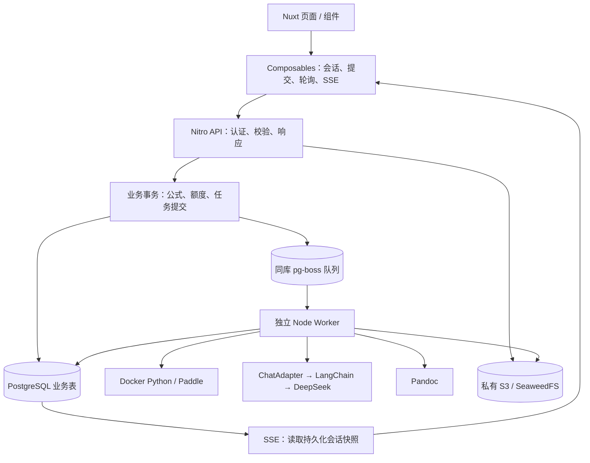
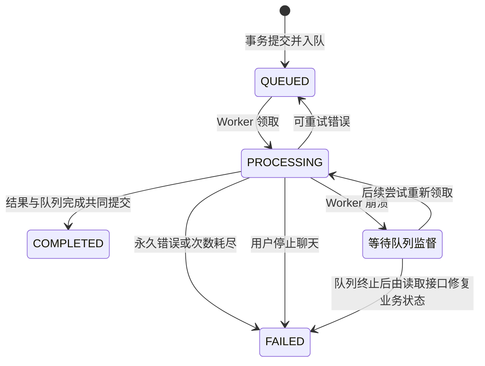

# Formula AI 架构审计报告

**审计日期：2026 年 10 月 22 日。审计方式：只读静态审查。**

本轮没有修改、删除或移动文件，没有运行数据库迁移、数据清理、业务 API、构建或数据库测试。报告直接呈现在这里，未写入项目。

**总体判断：项目已经存在明确的技术债务和未完成的前端改动，但没有发现必须整体重写的依据。** 数据归属、公式版本保护、事务入队、Worker 执行权校验、模型适配边界已有较好的基础。优先工作应是恢复可信的测试基线、补齐资源与异常恢复边界，再逐步整理前端。

本报告采用三种结论：

- **已确认**：可以从当前源码、配置或静态复演直接证明。
- **潜在风险**：存在触发条件，但本轮没有进行实际环境复现。
- **风格偏好**：不直接影响正确性，不作为强制重构事项。

未发现足以确认为 **P0** 的问题。这不等于完成了生产安全认证。

---

## A. 项目架构现状

### A1. 实际技术栈

根据 `package.json`、锁文件和源码确认：

| 领域 | 实际实现 |
|---|---|
| 全栈框架 | Nuxt **4.6.2**、Vue **3.5.44**、TypeScript **5.9.3** |
| 服务端 | Nitro / H3，文件式 API |
| 数据库 | PostgreSQL；Compose 配置为 **17-alpine** |
| ORM | Prisma **7.10.1**，使用 `@prisma/adapter-pg` |
| 认证 | Better Auth **1.7.12**，数据库会话与限流 |
| 任务队列 | **pg-boss 12.38.0**，队列表位于 PostgreSQL `pgboss` schema |
| Worker | 独立 Node.js 进程，消费识别、聊天、导出三个队列 |
| 大模型 | LangChain TS 的 `ChatDeepSeek`，通过自定义 `ChatAdapter` 隔离 |
| 识别模型 | 独立 Docker Python 服务，FastAPI + Paddle CPU 推理 |
| 文件存储 | S3 接口；本地 Compose 使用 SeaweedFS |
| 文档导出 | Worker 调用 Pandoc，生成包含可编辑公式的 DOCX |
| 测试 | Node 内置测试框架、tsx、真实数据库/API 集成测试、Python unittest |
| 格式化 | Prettier |

依据：[依赖与命令配置](<C:/Users/LXZ/Desktop/Formula AI/package.json:8>)、[Compose 配置](<C:/Users/LXZ/Desktop/Formula AI/compose.yaml:3>)。

**当前没有发现 Redis、BullMQ、tRPC、Pinia、Agent、Tools、RAG 或向量数据库的实际实现。** LangChain 在这里主要承担模型调用适配，并没有形成复杂 Agent 系统。

### A2. 目录与职责

| 目录 | 当前职责 | 评价 |
|---|---|---|
| `app/pages` | 路由页面、页面数据加载、部分业务编排 | 基本合理，部分提交流程和缓存规则散落 |
| `app/components` | 展示组件及带业务请求的账号组件 | 展示与业务组件并存，可以保留，但边界需要明确 |
| `app/composables` | 会话、列表分页、任务轮询、SSE、上传与聊天操作 | 已有合理复用；分页和缓存存在重复规则 |
| `app/plugins` | 游客数据持久化、当前标签页上传草稿 | SSR 边界处理较谨慎 |
| `server/api` | HTTP 参数、认证、调用业务函数、返回响应 | 多数路由较薄；SSE 和服务探测包含较多编排 |
| `server/database` | 查询、事务、额度、任务提交、聊天状态处理 | 名称与职责不完全一致，已经包含应用业务层 |
| `server/services` | 上传、资料更新、输入校验、模拟适配 | 与 `database` 中的业务函数形成两套组织方式 |
| `server/queue` | pg-boss 配置、事务入队、执行权校验 | 边界明确，值得保留 |
| `server/worker` | 任务执行、重试和结果提交 | 主流程清晰，终态处理需要收口 |
| `server/chat` | Prompt、模型配置、模型适配 | 隔离良好 |
| `server/recognition` | Python HTTP 协议与响应校验 | 隔离良好 |
| `shared` | 前后端 DTO、导航规则、游客类型、纯函数 | 未发现直接暴露 Prisma 或服务端密钥的共享依赖 |
| `services/recognition` | Python 模型服务、并发控制、前后处理 | 与 Nuxt 分离，适合当前需求 |

本轮检查了上述范围内 **200 个非生成 TS/Vue 文件，其中 61 个 Vue 文件**：

- 没有发现显式 `any` 类型节点。
- 发现 59 处类型断言；数量本身不构成质量结论。
- 对能够解析的显式本地运行时 import，未发现循环依赖。
- Vue SFC 解析与模板内存编译没有报错。

这些检查**不等同于完整 TypeScript 检查、生产构建或浏览器验收**，也不覆盖 Nuxt 自动导入和所有动态依赖。

### A3. 主要业务与数据流

关键事实：

1. 图片上传在 API 中完成校验、Sharp 解码和重新编码，然后保存私有对象。
2. 识别、聊天和导出通过任务提交接口入队，API 不直接等待模型完成。
3. **业务任务、额度扣减、pg-boss 入队使用同一数据库事务。**
4. Worker 完成任务时，业务结果与队列完成操作也共同提交。
5. SSE 从数据库读取 Worker 保存的快照，连接重建不会直接重新调用模型。

事务入队依据：[enqueue.ts](<C:/Users/LXZ/Desktop/Formula AI/server/queue/enqueue.ts:6>)、[任务提交](<C:/Users/LXZ/Desktop/Formula AI/server/database/task-submissions.ts:23>)。

### A4. AI 请求处理流程

当前流程是：

1. 创建绑定指定公式版本的会话，或者普通会话。
2. 提交问题，通过会话行锁限制同一会话同时只有一轮活跃任务。
3. 保存用户问题、扣减一次业务额度、创建队列任务。
4. Worker 读取历史消息和固定公式版本。
5. `ChatAdapter` 调用 LangChain / DeepSeek。
6. 生成片段约每 **250ms** 保存一次数据库。
7. SSE 约每 **750ms** 读取会话快照并发送变化。
8. 模型正常结束后，保存最终回答并完成队列任务。

相关实现：[会话提交事务](<C:/Users/LXZ/Desktop/Formula AI/server/database/conversations.ts:124>)、[聊天 Worker](<C:/Users/LXZ/Desktop/Formula AI/server/worker/chat.ts:17>)、[SSE 接口](<C:/Users/LXZ/Desktop/Formula AI/server/api/account/conversations/[id]/events.get.ts:20>)。

模型调用已有以下合理机制：

- LangChain 局限在适配器内。
- SDK 自动重试关闭，由队列统一重试。
- 有统一的 60 秒调用期限和 AbortSignal。
- 配置错误不会静默回退成模拟回答。
- 思考内容和原始供应商元数据不进入业务响应。
- 检查 `finishReason`，不把截断回答当成成功。

依据：[DeepSeek 适配器](<C:/Users/LXZ/Desktop/Formula AI/server/chat/deepseek-adapter.ts:7>)、[统一期限](<C:/Users/LXZ/Desktop/Formula AI/server/inference/deadline.ts:4>)。

### A5. Worker 生命周期与部署

启动入口是 `npm run worker`，执行独立的 `scripts/worker.ts`。

Compose 当前只定义：

- Python recognition
- SeaweedFS
- PostgreSQL

**Nuxt 和 Node Worker 尚未包含在 Compose 中。**

队列配置默认：

- 初次执行加两次重试，共最多三次。
- 指数退避。
- 任务过期 90 秒。
- 心跳周期配置 10 秒。
- 队列记录保留时间为七天。
- 每个 Worker 对每类队列按批量 1 消费。

依据：[Worker 启动](<C:/Users/LXZ/Desktop/Formula AI/scripts/worker.ts:6>)、[队列策略](<C:/Users/LXZ/Desktop/Formula AI/server/queue/client.ts:32>)、[消费注册](<C:/Users/LXZ/Desktop/Formula AI/server/worker/start.ts:11>)。

最后一条说明当前恢复设计的重要限制：**部分业务状态需要用户读取接口时才修复，尚未形成完全独立的后台收敛机制。**

---

## B. 技术债务清单

### B1. 已确认问题

“已确认”指代码机制或契约冲突已经明确；不表示本轮实际制造了故障。

| 优先级 | 问题 | 文件位置 | 证据 | 影响 | 建议 |
|---|---|---|---|---|---|
| **P1** | 测试直接复用开发数据库与公共任务队列 | [jobs.test.ts:33](<C:/Users/LXZ/Desktop/Formula AI/tests/jobs.test.ts:33>)、[jobs.test.ts:66](<C:/Users/LXZ/Desktop/Formula AI/tests/jobs.test.ts:66>) | 读取 `NUXT_DATABASE_URL`；按正式队列名领取任务，**领取后**才断言 owner 属于测试账号 | 与正在运行的 Worker 抢任务；也可能先领取非测试任务再断言失败 | 建立独立测试数据库、存储桶及测试 Worker；增加环境身份检查 |
| **P1** | 图片上传缺少累计容量、次数和并发资源限制 | [上传接口:25](<C:/Users/LXZ/Desktop/Formula AI/server/api/account/files/index.post.ts:25>)、[上传服务:46](<C:/Users/LXZ/Desktop/Formula AI/server/services/image-upload.ts:46>) | 单文件限制存在，但上传时不预留容量或检查累计额度；识别额度在之后提交任务时才扣减 | 登录用户可持续上传而不提交识别，消耗磁盘、Sharp 计算与内存 | 在上传服务入口增加原子容量预留和上传限制；单独限制图片处理并发 |
| **P2** | 旧集成测试与异步接口契约已经冲突 | [workspace.test.ts:276](<C:/Users/LXZ/Desktop/Formula AI/tests/workspace.test.ts:276>)、[识别接口:28](<C:/Users/LXZ/Desktop/Formula AI/server/api/account/recognitions.post.ts:28>) | 测试期待 `200` 和立即得到 `SavedRecognition`；接口实际返回 `202` 和任务状态 | 原有测试命令不能作为当前版本的可信回归依据 | 更新成“提交任务→消费→查询结果”，保留原有业务断言 |
| **P2** | 异常任务的业务状态收敛依赖读取接口 | [task-queries.ts:60](<C:/Users/LXZ/Desktop/Formula AI/server/database/task-queries.ts:60>)、[识别历史接口:11](<C:/Users/LXZ/Desktop/Formula AI/server/api/account/recognitions.get.ts:11>) | 详情 GET/SSE 调用 `reconcileTask`；历史列表不调用；Worker 启动没有业务状态扫描 | 崩溃后的列表可能持续显示处理中；活跃聊天约束的释放依赖后续访问 | 增加有界后台收敛；逐步将修复与查询分离 |
| **P2** | 聊天终态消息在三处重复构造 | [lifecycle.ts:55](<C:/Users/LXZ/Desktop/Formula AI/server/worker/lifecycle.ts:55>)、[chat-progress.ts:30](<C:/Users/LXZ/Desktop/Formula AI/server/database/chat-progress.ts:30>)、[task-queries.ts:94](<C:/Users/LXZ/Desktop/Formula AI/server/database/task-queries.ts:94>) | 失败、取消、崩溃修复分别生成失败回答和更新状态 | 修改终态语义需要同步三处；锁顺序和消息格式容易逐渐分叉 | 抽出一个事务内的终态写入函数，保留不同触发入口 |
| **P2** | 文件补偿覆盖异常捕获，没有覆盖进程退出 | [image-upload.ts:38](<C:/Users/LXZ/Desktop/Formula AI/server/services/image-upload.ts:38>)、[export.ts:33](<C:/Users/LXZ/Desktop/Formula AI/server/worker/export.ts:33>)、[profile.ts:20](<C:/Users/LXZ/Desktop/Formula AI/server/services/profile.ts:20>) | 上传遇到 `PENDING` 一直返回 409；补偿依赖 catch；头像先写对象再更新用户 | 崩溃可能留下长期 PENDING、无引用对象或无法继续使用的上传键 | 设计超时认领和对象核对流程，先建立清单与人工确认机制 |
| **P2** | 公式内容版本不能保护“仅修改标题”的并发冲突 | [formulas.ts:106](<C:/Users/LXZ/Desktop/Formula AI/server/database/formulas.ts:106>)、[formulas.ts:112](<C:/Users/LXZ/Desktop/Formula AI/server/database/formulas.ts:112>) | 并发检查只比较最新版本 ID；仅改标题不会产生新版本 | 他人改标题后，旧编辑窗口保存正文时可能把标题覆盖回旧值 | 区分内容版本与元数据修订；兼容增加 `expectedUpdatedAt` 等检查 |
| **P2** | AI 历史会保留失败轮次的孤立用户问题 | [worker/chat.ts:27](<C:/Users/LXZ/Desktop/Formula AI/server/worker/chat.ts:27>)、[prompt.ts:12](<C:/Users/LXZ/Desktop/Formula AI/server/chat/prompt.ts:12>) | 用户消息默认完成；失败回答为 FAILED，被历史查询排除；Prompt 只移除开头的助手消息 | 下一轮可能同时带入“上轮未完成的问题”和“本轮问题”，上下文含义不明确 | 按成功轮次组装历史，再单独加入本轮问题 |
| **P2** | 模型重试只保证业务不重复，不记录每次上游消耗 | [queue/client.ts:35](<C:/Users/LXZ/Desktop/Formula AI/server/queue/client.ts:35>)、[worker/chat.ts:22](<C:/Users/LXZ/Desktop/Formula AI/server/worker/chat.ts:22>) | 队列最多三次调用；每次重置片段；只保存最终一次模型信息，没有逐次调用记录 | 上游已生成后断线仍可能再次调用；内部只扣一次额度并不能证明供应商只计费一次 | 区分首字前与生成后的失败；记录 attempt、耗时及可获得的 usage |
| **P2** | SSE 每个连接反复读取并发送完整历史快照 | [events.get.ts:23](<C:/Users/LXZ/Desktop/Formula AI/server/api/account/conversations/[id]/events.get.ts:23>)、[conversations.ts:66](<C:/Users/LXZ/Desktop/Formula AI/server/database/conversations.ts:66>) | 750ms 循环；每轮检查会话并读取最多 100 条消息，变化时发送整个快照 | 数据库工作量和传输量随连接数、历史长度共同增长 | 首次快照保留，后续优先发送当前轮次进度和终态；暂时不必引入 Redis |
| **P2** | 资料存在自定义服务与 Better Auth 两个写入口 | [认证总入口:8](<C:/Users/LXZ/Desktop/Formula AI/server/api/auth/[...all].ts:8>)、[profile.ts:8](<C:/Users/LXZ/Desktop/Formula AI/server/services/profile.ts:8>)、[认证配置:72](<C:/Users/LXZ/Desktop/Formula AI/server/auth/config.ts:72>) | 自定义接口执行头像校验和清理；Better Auth 的默认 `/update-user` 也可更新 `image`，当前配置没有统一该字段策略 | 可绕过自定义头像生命周期，造成非法引用或遗留对象；未发现因此跨用户读取的证据 | 所有资料写入口采用一致字段策略；确认调用方后保留兼容或限制默认入口 |
| **P2** | 当前前端存在未落地的静态资源引用 | [首页:39](<C:/Users/LXZ/Desktop/Formula AI/app/pages/index.vue:39>)、[公式库:16](<C:/Users/LXZ/Desktop/Formula AI/app/pages/library.vue:16>)、[默认头像:19](<C:/Users/LXZ/Desktop/Formula AI/app/components/UserAvatar.vue:19>) | 引用了三个 `/images/*.webp`；当前 `public` 只有 favicon，没有这些文件 | 插画和默认头像无法正常显示，阻碍本轮页面验收 | 单独完成素材落地和资源检查，不扩大成全站重构 |
| **P2** | 客户端缓存失效规则散落并重复 | [login.vue:39](<C:/Users/LXZ/Desktop/Formula AI/app/pages/login.vue:39>)、[settings.vue:20](<C:/Users/LXZ/Desktop/Formula AI/app/pages/settings.vue:20>)、[公式详情:17](<C:/Users/LXZ/Desktop/Formula AI/app/pages/formulas/[id].vue:17>) | 多处手写缓存键前缀和名单；收藏又单独更新详情缓存及本地列表 | 新增页面后容易遗漏刷新规则，难以判断操作影响哪些视图 | 集中少量业务失效函数，如公式变更、身份切换；无需引入全局状态框架 |
| **P2** | 安全错误与内部诊断信息没有充分分离 | [workspace-operation.ts:17](<C:/Users/LXZ/Desktop/Formula AI/server/utils/workspace-operation.ts:17>)、[queue/client.ts:29](<C:/Users/LXZ/Desktop/Formula AI/server/queue/client.ts:29>)、[worker.ts:34](<C:/Users/LXZ/Desktop/Formula AI/scripts/worker.ts:34>) | 多处只记录错误名或固定字符串，不记录任务关联信息和安全错误分类 | 真实失败难以关联到任务、尝试次数、上游阶段 | 保持对外脱敏，内部记录结构化 taskId、attempt、错误分类和耗时 |
| **P2** | 缺少当前项目可执行的统一质量门禁 | [package.json:14](<C:/Users/LXZ/Desktop/Formula AI/package.json:14>) | 有分项命令，没有统一测试入口；当前目录没有 `.github/workflows`；没有项目内浏览器回归套件 | 容易只运行部分测试就宣布完成，旧测试和缺资源无法及时暴露 | 先建立隔离环境下的验证入口，再接 CI；不以引入工具数量为目标 |
| **P2** | 识别模型版本长度契约不一致 | [python-adapter.ts:71](<C:/Users/LXZ/Desktop/Formula AI/server/recognition/python-adapter.ts:71>)、[schema.prisma:244](<C:/Users/LXZ/Desktop/Formula AI/prisma/schema.prisma:244>) | 适配器允许模型版本长度 160，数据库字段为 100 | 101～160 字符的响应能过适配校验，最终写库失败并无效重试 | 统一协议上限，在适配层明确拒绝不可持久化结果 |
| **P3** | UUID 校验函数的类型收窄表达不完整 | [private-resources.ts:6](<C:/Users/LXZ/Desktop/Formula AI/server/database/private-resources.ts:6>) | 同时验证 owner 和 id，但类型谓词只声明 `ownerId is string` | 调用方重复 `as string`，增加阅读与维护负担；没有据此发现校验绕过 | 使用独立 `isUuid` 或返回已校验输入，保留运行时检查 |

### B2. 潜在风险与待实测事项

| 优先级 | 风险 | 证据与触发条件 | 判断 |
|---|---|---|---|
| **P2** | 反向代理部署后认证限流可能按代理 IP 聚合 | [认证入口:7](<C:/Users/LXZ/Desktop/Formula AI/server/api/auth/[...all].ts:7>) 使用实际连接 IP，忽略转发头；[认证配置:57](<C:/Users/LXZ/Desktop/Formula AI/server/auth/config.ts:57>) 登录限流为每分钟 8 次 | 当前防伪造思路合理；部署 Nginx 后需要可信代理策略，不能直接相信任意转发头 |
| **P2** | Python 推理超时后计算线程仍继续运行 | [Python 服务:67](<C:/Users/LXZ/Desktop/Formula AI/services/recognition/app/main.py:67>) 使用线程和互斥锁；Node 取消只中止 HTTP 等待 | 能防止第二路计算进入，但若底层推理卡死，缺少硬超时恢复措施 |
| **P2** | 本地部署配置尚未适配此前提到的 4GB 服务器 | [compose.yaml:27](<C:/Users/LXZ/Desktop/Formula AI/compose.yaml:27>) 识别容器上限为 6GB、4 CPU；Nuxt/Worker 尚无统一部署定义 | 6GB 是上限，不是实际占用；不能据此断言一定 OOM，但当前配置不能作为 4GB 容量保证 |
| **P3** | 对话列表排序与现有主要索引不完全匹配 | [conversation-queries.ts:41](<C:/Users/LXZ/Desktop/Formula AI/server/database/conversation-queries.ts:41>) 按 createdAt 排序；[schema.prisma:289](<C:/Users/LXZ/Desktop/Formula AI/prisma/schema.prisma:289>) 索引按 updatedAt | 小数据量可接受；应取得实际查询计划后决定是否补索引 |
| **P3** | 列表缩略图实际传输原始图片 | [AccountFormulaCard.vue](<C:/Users/LXZ/Desktop/Formula AI/app/components/AccountFormulaCard.vue>) 引用原图接口；[图片接口:19](<C:/Users/LXZ/Desktop/Formula AI/server/api/account/files/[id]/content.get.ts:19>) 完整读取对象到 Buffer | 图片较大、列表较长时会增加带宽与内存；需要实测后增加受控缩略图 |
| **P3** | 公式详情加载全部版本 | [formula-queries.ts:18](<C:/Users/LXZ/Desktop/Formula AI/server/database/formula-queries.ts:18>) 没有版本分页 | 当前可能完全够用，版本量增长后再处理 |

**纠正一个初步判断：** `reconcileTask` 的普通重试分支已经通过尝试计数限制回写；核对 pg-boss 领取时递增计数的实现后，不能把它直接认定为“必然覆盖新 Worker”的并发 Bug。本报告没有将该判断列为已确认缺陷。

### B3. 不应当当成问题的现有实现

以下建议保留：

- **Prisma 客户端复用**：Nuxt 使用进程级单例，避免热更新不断创建连接池。[database.ts:4](<C:/Users/LXZ/Desktop/Formula AI/server/utils/database.ts:4>)
- **连接池有上限**：业务池最大 5，队列 API/Worker 分别限制连接数；扩容时再统一预算。
- **ownerId 复合外键**：既有应用校验，也有数据库归属约束。
- **不可变公式版本与固定对话上下文**：数据库触发器提供最后防线。[完整性迁移:50](<C:/Users/LXZ/Desktop/Formula AI/prisma/migrations/202610200002_integrity/migration.sql:50>)
- **同一对话只允许一轮活跃任务**：会话行锁加数据库部分唯一索引。[任务迁移:120](<C:/Users/LXZ/Desktop/Formula AI/prisma/migrations/202610210003_jobs_chat_exports/migration.sql:120>)
- **执行权校验**：失效 Worker 的结果提交会回滚。[claim.ts:22](<C:/Users/LXZ/Desktop/Formula AI/server/queue/claim.ts:22>)
- **错误对外脱敏、私有 Runtime Config、图片重新编码和私有读取**。
- **原生 HTTP、SSE、pg-boss**：当前没有证据要求替换成 tRPC、Redis 或 BullMQ。
- **游客与账号各自的数据模型**：它们有不同的持久化和权限语义，不应为了减少文件数强行合并。

---

## C. 根本原因分析

### C1. 接口演进后，旧契约没有同步退出

最直接的证据是：

- 识别接口已采用 `202 + TaskState`。
- 旧测试仍使用 `200 + SavedRecognition`。
- `shared/types/workspace.ts` 仍保留旧的同步识别返回类型。

这说明异步化完成了主业务迁移，但**调用契约、测试和历史类型没有作为一个整体收敛**。应先修复契约维护流程，而不是继续增加另一套类型或包装函数。

### C2. 状态规则按触发入口增长，没有形成统一出口

聊天的失败、停止、崩溃修复分别位于：

- Worker 生命周期处理；
- 用户取消服务；
- 查询侧修复函数。

每个入口都补齐了当时的需求，但都重新构造状态与失败消息。现在维护者需要跨三个文件才能确认“终态究竟是什么”。

这里需要的是一个小而明确的事务内终态操作，**不需要引入完整状态机框架**。

### C3. 正常异常得到处理，进程级故障没有完全闭环

上传、导出、头像已有 catch 补偿，这不是毫无设计。但进程退出不会执行 catch：

- PENDING 记录可能遗留；
- 对象可能已写入而数据库尚未引用；
- 失败清理有时只输出一句警告。

因此缺口是**恢复与核对能力**，而不是再增加几层 try/catch。

### C4. 前端依赖“记住所有缓存键”维护一致性

登录、退出、公式保存、识别完成各自维护缓存键名单。新增首页、历史、会话选择器后，需要逐个想起哪些缓存需要刷新。

这是多轮局部修改容易形成的耦合：一次业务变化会影响多少页面，缺少明确、集中、可测试的规则。

### C5. “完成”的标准没有覆盖交付结果

当前 Vue 模板可以编译，但页面引用的图片不存在。旧测试也能长期保留与接口矛盾的断言。

这证明：

**语法通过、局部测试通过，与当前功能完整交付之间缺少验收闭环。**

最近的前端改造属于未完成工作，不能据此反推所有后端代码都需要重写；同样也不能把它标记为稳定交付。

### C6. 数据访问目录承担了应用服务职责

例如 `server/database/conversations.ts` 不仅查询数据库，还处理：

- 请求幂等；
- 会话并发规则；
- 额度预留；
- 队列提交。

这本身可以工作，但与 `server/services/profile.ts` 的组织方式不一致。未来容易把新业务随意放入两个目录之一。

应先约定职责，再在实际修改涉及这些文件时渐进整理，**没有必要单独开展一次大规模搬目录行动**。

---

## D. 渐进式重构路线图

以下均为建议，**尚未实施**。前一阶段验收后再进入下一阶段。

### 阶段 0：建立可信测试与交付基线

1. **目标**：保证后续测试不会干扰开发数据，明确当前接口契约。
2. **涉及文件**：`tests/jobs.test.ts`、`tests/workspace.test.ts`、其他数据库/API 测试、`package.json`、测试环境配置。
3. **修改建议**：独立测试数据库和存储桶；API 与测试 Worker 使用同一测试配置；修正旧同步断言；增加静态资源存在性检查。
4. **前置工作**：确认允许创建的测试环境及哪些历史接口仍需兼容。
5. **影响功能**：以测试流程为主，不改变线上接口和 Schema。
6. **风险**：低至中；主要风险是错误连接到非测试环境。
7. **验证**：环境保护拒绝开发/生产连接；在隔离环境中跑完整异步流程。
8. **验收标准**：测试不领取业务任务、不访问真实付费模型；现有有效业务断言全部迁移，不能靠删除失败断言过关。

### 阶段 1：限制资源消耗，补齐文件生命周期

1. **目标**：让图片上传和文件恢复有明确边界。
2. **涉及文件**：`image-upload.ts`、上传 API、`profile.ts`、`worker/export.ts`、相关测试。
3. **修改建议**：上传容量和次数预留、图片处理并发限制；定义过期 PENDING 的核对规则；统一头像写入策略。
4. **前置工作**：阶段 0；先确定容量、保留时间及重试语义。
5. **影响功能**：上传、上传重试、头像保存、导出文件恢复。
6. **风险**：中；不能误删正在写入或仍被引用的对象。
7. **验证**：模拟存储成功但数据库失败、进程中断、重复上传、并发限额；清理先提供预览清单。
8. **验收标准**：并发不能突破限额；过期记录有恢复路径；有效文件不被回收；原接口成功响应保持兼容。

如确需新增容量记账字段，先单独审查增量迁移；不要顺便重设计现有表。

### 阶段 2：统一任务终态与后台收敛

1. **目标**：使异常任务不依赖用户打开详情才恢复。
2. **涉及文件**：`worker/lifecycle.ts`、`database/chat-progress.ts`、`database/task-queries.ts`、Worker 启动和任务测试。
3. **修改建议**：共享终态事务函数；明确锁顺序；增加有界后台核对；初期保留查询侧修复兼容。
4. **前置工作**：阶段 0；写出当前各类状态转移表。
5. **影响功能**：失败重试、停止生成、崩溃恢复、历史状态展示。
6. **风险**：中至高，需要小批修改。
7. **验证**：旧 Worker 迟到写入、最后一次尝试崩溃、取消与完成并发、重复修复、队列记录失效。
8. **验收标准**：每轮最多一条终态回答；终态不回退；失效执行者不能写入；无人访问时也能在约定时间内收敛。

应保留现有事务入队和执行权校验，不同时替换队列。

### 阶段 3：整理 AI 轮次语义与流式读取

1. **目标**：让上下文、重试、费用与推送行为可解释。
2. **涉及文件**：`worker/chat.ts`、`chat/prompt.ts`、`inference/failure.ts`、SSE 接口和客户端事件处理。
3. **修改建议**：按成功轮次组装历史；明确生成中失败后的重试策略；增加安全的调用尝试记录；将完整快照推送逐步改为当前轮次进度。
4. **前置工作**：阶段 2 的终态规则稳定。
5. **影响功能**：连续追问、部分回答、断线恢复、自动重试。
6. **风险**：中；Prompt 行为和 SSE 契约都需兼容。
7. **验证**：失败后追问、停止后追问、首字前失败、生成后失败、重连不启动新模型、旧事件不覆盖新状态。
8. **验收标准**：上下文没有无意混入的失败问题；每次模型尝试可追踪；重连不重复扣业务额度；新旧客户端过渡可控。

建议先改上下文和尝试记录，再改 SSE，不把三件事一次合并。

### 阶段 4：收敛前端状态与三个主页面

1. **目标**：修复当前未完成改动，并明确页面与业务组件边界。
2. **涉及文件**：首页、公式库、我的、`AppBottomNav`、相关 Composables、缓存失效逻辑。
3. **修改建议**：补齐素材；集中业务缓存失效函数；明确游客/账号组件职责；按三个页面逐页整理。
4. **前置工作**：阶段 0；后端接口契约保持稳定。
5. **影响功能**：导航、收藏回显、列表返回、身份切换、首页最近记录。
6. **风险**：中，以视觉与状态回归为主。
7. **验证**：登录/退出切换、收藏后切页、筛选后返回、直接刷新、长列表滚动、小屏与安全区。
8. **验收标准**：三个页面有实际截图；导航滚动定位通过；没有缺失资源；游客与账号数据不混入；返回路径不循环。

当前导航代码已有 `position: fixed` 和 Teleport，但**本轮没有浏览器验收，不能据此宣布用户反馈已经解决**。

### 阶段 5：补齐部署与持续验证

1. **目标**：让本地可运行转化为可重复部署。
2. **涉及文件**：部署定义、Worker 启动、健康检查、验证脚本及后续 CI 配置。
3. **修改建议**：明确 Nuxt/Worker/Pandoc 的运行环境；区分存活检查与就绪检查；配置可信代理；建立 CI 门禁和资源验证。
4. **前置工作**：前述业务基线稳定，确定服务器和模型容量。
5. **影响功能**：部署启动、认证限流、Worker 停机恢复、导出工具可用性。
6. **风险**：中，需要部署环境验收。
7. **验证**：冷启动、Worker 重启、依赖不可用、反向代理登录、迁移副本演练及备份恢复。
8. **验收标准**：配置一致；依赖失败能被正确识别；CI 在隔离环境执行；4GB 环境有实际测量结果再决定是否承载模型。

---

## E. 推荐目标架构

### E1. 保持“单体全栈应用 + 独立 Worker + 独立 Python 模型”

当前规模适合保留这一部署与代码形态。没有证据支持现在拆微服务、替换队列或增加 Agent 系统。

| 层 | 推荐职责 | 依赖方向 |
|---|---|---|
| Nuxt 页面 | 路由参数、页面组合、展示状态 | 调用 Composables 和展示组件 |
| 业务组件 / Composables | 用户操作、请求、分页、轮询、SSE、业务缓存失效 | 调用 HTTP API 与 shared 契约 |
| Server API | 认证、来源检查、参数解析、状态码和响应映射 | 调用查询或业务服务 |
| 业务服务 | 幂等、额度、状态转移、事务编排 | 使用 Prisma、队列、存储接口 |
| 数据查询函数 | 明确的所属用户过滤、分页、投影、查询优化 | 使用 Prisma / 参数化 SQL |
| AI 适配层 | Prompt 转换、模型调用、错误归类、取消 | 使用 LangChain，不依赖页面或数据库 |
| Worker | 领取任务、执行耗时操作、提交结果、恢复 | 调用业务事务和 AI/识别/导出适配器 |
| Shared | DTO、纯校验、纯计算和导航规则 | 不依赖 Prisma、Nitro 或私密配置 |

**不要求建立通用 Repository。** 当前直接接收 `PrismaClient` 的函数已经具备测试和事务组合能力。为了套分层而包一层 CRUD，只会增加跳转成本。

### E2. 优先明确规则，而不是搬文件

建议约定：

- 纯查询留在 `server/database/*queries.ts`。
- “扣额度、创建任务、入队”等事务属于业务服务。
- Worker 执行逻辑不依赖 Nitro 自动导入。
- LangChain 不越过 `ChatAdapter` 边界。
- 终态写入复用同一个事务函数。
- 页面不自行维护一套新的任务状态规则。
- 缓存失效以“发生了什么业务变化”为入口。

现有文件在被实际修改时逐步调整位置，不一次性搬动所有模块。

### E3. 数据库与迁移建议

当前数据库基础值得保留：

- 资源归属复合外键；
- 请求幂等唯一键；
- 公式版本唯一序号；
- 不可变版本与固定上下文触发器；
- 活跃聊天部分唯一索引；
- 原子额度条件更新。

未发现明显的“循环里逐条查询数据库”的典型 N+1 实现。公式库的 LATERAL 最新版本查询也有明确用途，不能因为使用原始 SQL 就判定设计不好。

需要注意：部分保护只存在于 SQL Migration，Prisma Schema 无法完整表达。以后迁移审查必须同时核对两者。

**本轮没有连接数据库检查实际迁移历史、约束、索引或执行计划，因此不能确认现有数据库与源码完全一致。**

---

## F. 最终结论

### 1. 当前最严重的三个架构问题是什么？

按处理顺序：

1. **测试与开发环境不隔离。** 它使重构验证本身可能干扰业务，也削弱“测试通过”的可信度。
2. **文件资源消耗缺少累计约束。** 单文件大小限制无法防止持续上传耗尽存储和处理资源。
3. **任务与文件的异常恢复尚未闭环。** 当前依赖 catch 补偿和查询触发修复，恢复规则分散。

其中第三项为 P2，不应因为列入前三就夸大为已发生的数据丢失。

### 2. 哪些代码必须优先重构？

- 测试环境入口及 `tests/jobs.test.ts` 的队列使用方式。
- 旧同步识别测试与当前异步契约。
- `image-upload.ts` 的资源预留与恢复边界。
- 三处聊天终态处理。
- `prompt.ts` 对失败历史轮次的处理。

当前缺失图片属于需要单独完成的交付问题，修复范围很小，不应借此启动全站重写。

### 3. 哪些代码虽然不够优雅，但暂时不需要修改？

- `server/database` 中部分函数名字和所在目录。
- 游客与账号两套数据实现。
- 旧路由兼容映射。
- Prisma 与参数化 SQL 混用。
- 单 Worker 进程处理三类队列。
- 原生 SSE、pg-boss、自定义 `ChatAdapter`。
- `RecognitionStatus` 被聊天和导出复用的命名。
- 暂时全量加载公式版本。

这些事项需要边界和测试保护，但不值得现在付出大规模改动成本。

### 4. 哪些问题与 AI 辅助开发过程有关？

无法仅凭源码给每段代码判定作者，但结合本次迭代记录，可以明确看到：

- 接口异步化后，旧测试与旧返回类型未同步收敛。
- 多个入口分别补写失败处理，形成重复状态规则。
- 新页面逐步加入后，缓存失效名单不断扩展。
- 新组件和素材引用已经进入页面，但素材及调用整合尚未完成。
- 局部检查被过早表述为整体完成。

核心问题是**缺少变更边界与完整验收约束**，不是代码里用了某个特定框架。

### 5. 如果只有一周，优先处理什么？

建议限定为“恢复可维护基线”，不承诺一周清完全部债务：

| 时间 | 重点 |
|---|---|
| 第 1～2 天 | 隔离测试环境，修正失效契约，明确可执行的回归清单 |
| 第 3 天 | 完成缺失资源与三个主页面的最小稳定状态，暂停其他视觉扩展 |
| 第 4～5 天 | 上传资源限制、PENDING 恢复方案及聊天终态收口 |
| 第 6 天 | 修复失败轮次上下文，验证取消、重试和崩溃恢复 |
| 第 7 天 | 完整回归、构建及交付记录；条件允许时接入 CI |

SSE 增量协议、目录调整、缩略图、索引优化和队列替换后置。

### 6. 如何防止后续 AI 再次制造技术债务？

建议建立以下具体约束：

- **一次只完成一个可验收阶段**，写清允许修改的模块。
- 修改接口时，同时列出调用方、共享类型、测试和兼容策略。
- 修改任务逻辑时，必须说明幂等、重试、取消、失效 Worker 和终态行为。
- 数据库测试必须先通过环境身份检查。
- 新依赖必须对应已确认问题；不因“以后可能需要”引入。
- 页面交付必须提供实际浏览器结果，包含导航、返回、滚动和身份切换。
- 完成报告区分“源码检查通过、类型检查通过、集成测试通过、浏览器验收通过”，不能相互替代。
- 未完成工作明确标记，禁止用“都完成了”覆盖剩余问题。

**建议保留现有架构主体，先批准阶段 0，建立可信基线后再开展局部重构。本轮审计到此，不进入代码修改。**