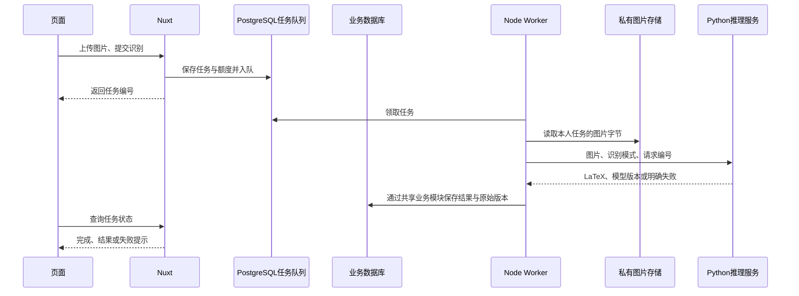

# Python 模型接入交接清单

日期：2026-10-21。本文保留第11天接入前的模型交接要求与接口约定。**当前已按Docker Python服务方案实施，代码与实际验收以 [第11天Docker模型接入开发说明与验收记录](第11天Docker模型接入开发说明与验收记录.md) 为准。** 模型更新时仍应确认匹配的版本、设备和样本。

后续检查：桌面 `model` 已提供 `PP-FormulaNet_plus-L` 的计算图、权重与含内置分词器的配置。已找到可加载并识别印刷公式的兼容运行方式，不要求先提供完整训练工程；实际手写样本和质量评测仍需补充。初始检查见 [Python模型检查与接入方案](Python模型检查与接入方案.md)。

## 先准备哪些东西

第一轮最小交付是：**能运行的推理代码、匹配的权重与配置、依赖版本、启动和调用方法、3～5张图片与预期 LaTeX，以及运行所需的设备说明**。如果已有服务，提供可访问地址、鉴权配置方式、一次成功和一次失败的请求响应示例即可开始适配。只有权重文件不足以接入，通常还需要网络结构、词表/分词器和预处理、解码逻辑。

| 交接项       | 需要说明的内容                                                                      | 由谁提供或确认                                               |
| ------------ | ----------------------------------------------------------------------------------- | ------------------------------------------------------------ |
| 推理代码     | 仓库或文件、版本号、入口函数/命令；一张图片如何得到 LaTeX                           | 模型开发者                                                   |
| 权重及配置   | 权重路径、对应配置、词表/分词器等实际必需文件；使用权限及下载方法                   | 模型开发者                                                   |
| 环境依赖     | Python 版本、锁定的 requirements/Conda 环境；如用 GPU，注明框架、CUDA、驱动兼容要求 | 模型开发者                                                   |
| 运行设备     | 支持 Windows/Linux、是否可用 CPU、最低内存/显存；单张耗时及安全并发数               | 模型开发者实测                                               |
| 支持范围     | 单条/整页、手写/印刷、中文、矩阵等；图片是否须裁剪；不支持的输入                    | 双方确认                                                     |
| 预处理与解码 | 缩放、灰度、二值化、归一化、裁剪及输出清洗的归属；不能漏掉训练时要求                | 模型开发者定义                                               |
| 服务或脚本   | 已有接口则提供地址与协议；只有脚本则先验证独立推理，再包装 HTTP 服务                | 本项目已实现Python服务包装和Node适配，朋友协助确认模型与样本 |
| 测试样本     | 先3～5张跑通，再整理30～50张有代表性图片，标注预期结果、支持范围和失败样本          | 用户与模型开发者                                             |
| 访问配置     | Worker 所在机器能否访问；私有网络地址、端口、服务凭据的配置位置                     | 双方确认                                                     |

无需把训练过程和全部训练数据搬进 Nuxt 项目；接入目标是稳定调用推理能力。若朋友只有本地脚本，先让脚本在其机器上完成一次“输入图片 → 输出 LaTeX”，再解决 HTTP 包装和网络访问。

## 接入后怎么工作



Worker 的结果保存直接使用共享数据库模块。Python 不需要用户数据库、对象存储密钥或 pg-boss 连接；浏览器也不直接调用 Python。权限、任务、额度、版本与私有文件仍由现有 Node 业务层负责。

现有边界：[RecognitionAdapter](../server/services/recognition-adapter.ts)、[识别 Worker](../server/worker/recognition.ts)、[统一结果类型](../shared/types/api.ts)。真实适配器实现相同接口，Python依赖安装在独立镜像内。配置和启动见 [Docker模型服务操作手册](Docker模型服务操作手册.md)。

## 建议的最小 HTTP 协议

优先通过私有 HTTP 服务传图片字节，避免共享本机文件路径、临时公开图片或重复授权对象存储。如果朋友已有稳定接口，可以适配其现有格式，无需为满足本示例改写模型。

| 项目     | 建议                                                                              |
| -------- | --------------------------------------------------------------------------------- |
| 识别入口 | `POST /recognize`                                                                 |
| 请求类型 | `multipart/form-data`，文件字段 `image`，普通字段 `mode`                          |
| 图片     | 实际 JPEG/PNG 文件；Node 已完整解码、校正 EXIF 方向并移除元数据                   |
| 模式     | `handwritten` 或 `printed`；如果模型只支持一种，应明确拒绝另一种                  |
| 追踪编号 | 请求头 `X-Request-Id`，由 Node 对同一识别任务稳定生成，便于关联重试与日志         |
| 服务鉴权 | 如采用 Bearer token，只放在 Worker 的私有配置，通过 HTTPS 或受控本机/容器网络传输 |
| 就绪检查 | `GET /ready`：模型加载完成可推理才返回200；加载中或不可用返回503                  |

成功示例是**建议格式**：

```json
{
  "requestId": "与请求对应的编号",
  "latex": "\\frac{-b \\pm \\sqrt{b^2-4ac}}{2a}",
  "modelVersion": "模型权重对应的实际版本"
}
```

要求返回纯 LaTeX，不包 Markdown 代码块或整篇 `\\documentclass` 文档；统一结果里 `isMock: false` 由 Node 真实适配器设置。业务接受1～5000字符，模型版本需稳定标识权重/配置。置信度可选，模型没有经过确认的可靠置信度时省略，不编造百分比。

如果选用 FastAPI 包装，文件与模式可以分别用 `File` / `UploadFile` 和 `Form` 接收，不能把同一次 multipart 请求的模式误写成 JSON Body。[FastAPI 文件与表单说明](https://fastapi.tiangolo.com/tutorial/request-forms-and-files/)

## 出错、超时和并发怎样约定

建议失败结构：

```json
{
  "requestId": "与请求对应的编号",
  "error": {
    "code": "UNSUPPORTED_INPUT",
    "message": "当前模型仅支持裁剪后的单条公式图片。"
  }
}
```

| 情况                                       | 建议 HTTP 状态  | Node 适配器的处理约定                                  |
| ------------------------------------------ | --------------- | ------------------------------------------------------ |
| 文件损坏、模式不支持、无可识别公式         | 400 / 415 / 422 | 明确失败，不重复推理同一无效输入                       |
| 服务凭据无效                               | 401 / 403       | 配置故障，停止此任务并提示服务不可用，不把凭据写入页面 |
| 模型未就绪、设备忙、临时过载               | 429 / 503       | 在任务总预算内有限重试，必要时遵循受限的 Retry-After   |
| 断连、推理服务暂时异常                     | 超时 / 5xx      | 有限重试；对用户返回整理后的失败信息                   |
| 响应缺少 LaTeX、空结果、版本缺失或超长内容 | 响应校验失败    | 不保存成成功结果，不静默退回模拟数据                   |

真实HTTP适配器已按上述永久/临时分类映射为共享的 `InferenceFailure`，Worker沿用统一生命周期处理。服务原始错误和凭据不会直接写入任务提示；重试次数仍由队列管理。

当前队列每次执行期限90秒、最多3次，包含首次与2次重试。Python 单次请求的超时、图片读取和保存耗时必须共同留在此预算内；测量实际推理耗时后再决定具体超时或调整队列期限，不能机械地把 HTTP 超时设为90秒。取消网络请求也不保证 GPU 推理立即停止，需要模型服务限制并发并说明取消行为。

模型通常在服务启动时加载一次，避免每张图片重新加载。FastAPI 的 lifespan 可以管理启动前加载与退出清理。[FastAPI 模型加载示例](https://fastapi.tiangolo.com/advanced/events/) 每增加一个进程可能复制一份模型到内存/显存，不能按 Web 服务惯例直接增加多个进程。

前端当前接收最大10MB、解码后最多2000万像素；这不代表模型支持全部尺寸。模型输入尺寸与缩放必须按训练要求在 Python 端完成，并与现有 Node 方向校正衔接。朋友应说明最长推理耗时、设备繁忙行为、冷启动时间和是否可并行；Node Worker 的识别并发需据此配置。

## 第11天如何判断真正接通

1. Python 在约定机器上独立启动，模型就绪后，直接调用接口能识别实际样本。
2. 从 Worker 所在环境可访问同一服务；容器里的 `127.0.0.1` 指向容器自身，需要按实际部署设置地址。
3. 在产品上传不同图片，后台确实调用 Python，返回各自的真实 LaTeX 与模型版本，并保存到账号。
4. 刷新不丢任务和版本；识别失败有明确提示，服务断开不会返回固定示例冒充成功。
5. 记录样本预期、实际输出、耗时及人工修订，保留失败样本；第12天继续做超时、预处理与真实模型回归。

## 可以直接发给朋友的交接文字

> 我们的 Nuxt 产品已经做好上传、私有存储、任务队列和公式版本。现在需要接入你的 Python 图片转 LaTeX 推理能力。请先提供能独立运行的推理代码、权重及必要配置/词表、Python与依赖版本、启动和调用命令、CPU/GPU及内存显存要求、支持的图片范围，以及3～5张测试图和预期 LaTeX。如果已有 HTTP 服务，请补充地址、鉴权配置方式和成功/失败响应示例；如果只有脚本，先确认单图推理可运行，再包装一个接收图片并返回 LaTeX 和模型版本的私有接口。我们会在 Node Worker 中完成适配，数据库、账号与队列不用你对接。
