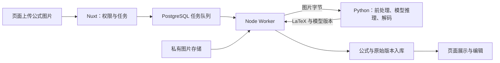

# Python模型检查与接入方案

检查日期：2026-10-21。检查目录：`C:\Users\LXZ\Desktop\model`。

本文保留接入前的文件检查、官方接口核对和方案比较。该轮只做静态检查，当时未运行模型或修改识别业务。用户随后已选择Docker方案，当前实施结果以 [第11天Docker模型接入开发说明与验收记录](第11天Docker模型接入开发说明与验收记录.md) 为准。

## 1. 检查结论

**建议采用“常驻 Python HTTP 服务 + 现有 Node Worker 适配器”。先验证这份本地导出包，再决定本机运行还是 Docker 部署；需要更快推理时，可以将同一服务迁移到 GPU 机器。**

配置标注的模型是 `PP-FormulaNet_plus-L`，属于 Paddle 公式图片识别模型，目标是输出 LaTeX。它与当前用于公式解释的 DeepSeek 分工不同：Python 负责图片转公式，LangChain TS 继续负责调用 DeepSeek 进行解释与对话。

官方导出教程列出的推理文件正是 `inference.json`、`inference.pdiparams`、`inference.yml`。因此，这份交付具有标准推理导出包的结构，可以优先尝试官方加载器，无须先搬入完整训练工程。文件结构一致仍不等于已经验证可运行。[PaddleOCR 公式识别模块及模型导出说明](https://www.paddleocr.ai/latest/version3.x/module_usage/formula_recognition.html)

### 实际发现的文件

| 文件                  |                            大小 | 用途与检查结果                                   |
| --------------------- | ------------------------------: | ------------------------------------------------ |
| `inference.json`      |     1,607,874 字节，约 1.53 MiB | 导出的计算图；头部标记为 PIR，包含循环与输出算子 |
| `inference.pdiparams` | 727,598,255 字节，约 693.89 MiB | 模型参数权重                                     |
| `inference.yml`       |     2,244,564 字节，约 2.14 MiB | 模型名称、输入处理、解码器和内置分词器配置       |

目录没有推理脚本、依赖清单、运行说明和测试图片。这里缺的是“已验证的运行环境与调用方法”，不能简单理解成“只有权重，缺全部模型定义”。

### 从配置中能确认的内容

- `Global.model_name` 为 `PP-FormulaNet_plus-L`。
- 输入处理包含 `UniMERNetImgDecode`、`UniMERNetTestTransform`、`LatexImageFormat`，配置的图像输入尺寸是 768×768。
- 配置包含 `max_seq_len: 2560`，后处理为 `UniMERNetDecode`。
- `PostProcess.character_dict` 内含 `fast_tokenizer_file` 和 `tokenizer_config_file`，不能仅凭没有独立词表文件就判断词表缺失。
- 计算图末端输出为整数序列，结合解码配置，应通过匹配的解码器得到 LaTeX，不能直接把底层输出当字符串。

官方 PaddleX 的对应实现会读取导出配置建立前处理，并把内置分词器用于解码；配置中保留的 `rec_char_dict_path` 不足以证明还必须复制训练仓库中的同名路径。[官方推理实现](https://raw.githubusercontent.com/PaddlePaddle/PaddleX/develop/paddlex/inference/models/formula_recognition/predictor.py)、[官方分词与解码实现](https://raw.githubusercontent.com/PaddlePaddle/PaddleX/develop/paddlex/inference/models/formula_recognition/processors.py)

### 还不能确认的内容

1. 朋友实际使用的 Python、PaddlePaddle、PaddleOCR/PaddleX 版本，以及是否修改过算子、前处理或解码。
2. 这份权重相对于官方模型做了哪些训练改动；名称本身不能证明训练来源或识别效果。
3. 本机或目标机器上能否成功加载，真实耗时、内存/显存、安全并发数是多少。
4. 对你们的手写、印刷、中文、矩阵、长公式和手机拍照样本的质量如何。

权重约 694 MiB 不代表只需同等大小的内存或显存。YAML 含 TensorRT 配置也不代表必须使用 GPU。当前没有确认本机 GPU、可用显存及可用的独立 Python 环境，不据此承诺速度。

这三份文件体现的是公式识别器，没有看到独立的整页版面检测模型。第一阶段适合以裁剪后的公式图片验证；若产品要自动处理整页试卷，还需单独评估检测、裁剪和多公式组织。

## 2. 四种接入方案

以下优缺点和优先级是结合本项目现状作出的工程判断。方案 A、B、C 共用 HTTP 接口，主要区别是运行位置与环境管理方式，后续可以互相迁移。

| 方案                             | 如何运行                                                                           | 优点                                                         | 代价与适用情况                                                               | 建议                                                 |
| -------------------------------- | ---------------------------------------------------------------------------------- | ------------------------------------------------------------ | ---------------------------------------------------------------------------- | ---------------------------------------------------- |
| A：本机常驻 Python HTTP 服务     | 独立 Python 虚拟环境，使用 PaddleOCR/PaddleX 加载本地文件，通过 FastAPI 等提供接口 | 调试直接；启动时加载一次；与 Nuxt 依赖分开；后续迁移方便     | 需处理本机依赖兼容性并单独启动服务；CPU 是否满足体验需实测                   | 优先用于本地打通，前提是依赖支持本机环境             |
| B：Docker 中的 Python HTTP 服务  | 在 Linux 容器固定依赖，模型目录只读挂载，供 Worker 调用                            | 环境便于复现；与现有数据库、存储的容器部署方式衔接；交付清楚 | 初次镜像构建、系统库和资源配置更费事；GPU 需要另外验证宿主机、驱动与容器支持 | 推荐作为后续稳定部署形态，也可在本机兼容性不佳时采用 |
| C：远程机器上的 Python HTTP 服务 | 在朋友机器或服务器常驻运行，Worker 调用约定接口                                    | 可复用朋友已跑通的环境或 GPU；本机无需安装模型依赖           | 依赖远端在线和网络；需约定地址、鉴权、传输和运行成本；图片会传到该机器       | 如果朋友已有可用 GPU 服务，这是很实际的选择          |
| D：Node 启动 Python 子进程       | Worker 使用明确参数启动推理脚本，读取标准化结果                                    | 单次技术验证直观；无需独立 HTTP 端口                         | 每次启动进程通常要重新加载权重；取消、日志、临时文件和异常处理耦合更强       | 适合独立验证或低频离线任务，不作为本项目长期首选     |

如果把 D 改成常驻子进程，可以减少重复加载，但又要维护消息分帧、进程重启、请求关联和取消协议。本项目已经有独立 Worker，用 HTTP 服务更容易明确跨语言边界。

### A：本机服务的落地思路

为识别服务建立独立虚拟环境，固定已验证的依赖版本。服务启动时显式加载桌面这份模型目录，先用 CPU 验证单图推理，再根据设备和样本耗时评估 GPU。

模型加载应明确指定 `model_name` 和本地 `model_dir`，设备也应明确配置，避免只填写官方模型名称而自动下载另一份权重。官方 `FormulaRecognition` 提供本地目录参数，对应包装器将其传给 PaddleX。[官方本地模型参数实现](https://raw.githubusercontent.com/PaddlePaddle/PaddleOCR/main/paddleocr/_models/base.py)

先采用单进程、单路推理，确认稳定后再测并发。Web 服务增加进程可能同时增加模型副本，不能直接按普通轻量接口的方式扩大进程数。

### B：Docker 服务的落地思路

将方案 A 的服务代码和已验证依赖放进镜像，模型作为只读数据挂载。镜像负责运行环境，模型版本独立管理，不在每次构建时重新下载或替换朋友的权重。

Docker 本身不解决模型与框架版本不匹配，也不自动带来 GPU 加速。GPU 容器部署要验证驱动、CUDA 与框架组合。首轮可先验证 CPU 容器，再决定是否做 GPU 镜像。

Worker 在宿主机运行时使用映射后的本机端口；如果后续 Worker 也进入容器，应使用实际容器网络服务名，不能沿用指向容器自身的 `127.0.0.1`。

### C：远程服务的落地思路

朋友在已经验证成功的机器上包装同一接口，提供服务地址和版本。我们只需要完成 Node HTTP 适配，不需要在本机复制整个训练环境。

建议先在受控网络内联调；跨机器访问时约定鉴权和 HTTPS 或等效的受控传输方式。Python 接收任务对应的图片字节，无须获得用户数据库、对象存储或 DeepSeek 的密钥。

### D：子进程的落地思路

推理脚本接收明确的图片路径或输入协议，标准输出只返回可解析结果，日志写到标准错误。Node 负责退出码、超时、临时文件清理和请求对应关系，使用参数数组调用进程，避免拼接 shell 命令。

由于本模型权重较大，需测量每次启动和加载的额外成本。若最终要持续提供在线识别，更推荐把已验证的推理逻辑放进常驻服务。

## 3. 在现有项目里如何接入

建议的数据流：

Python 只负责识别，不接管登录、数据库、额度、版本或任务队列。现有 DeepSeek/LangChain TS 对话链路保留，两种能力通过已保存的公式内容衔接。

### 现有代码与未来改动位置

以下是接入时的建议位置，尚未创建这些新增模块。

| 位置                                                        | 当前情况或建议职责                                                       |
| ----------------------------------------------------------- | ------------------------------------------------------------------------ |
| [识别适配器接口](../server/services/recognition-adapter.ts) | 已有图片字节、类型、模式和取消信号边界，目前只有模拟实现                 |
| [识别任务处理](../server/worker/recognition.ts)             | 已有图片读取、统一期限、结果入库和版本保存；接收真实适配器即可复用主流程 |
| [Worker 注册入口](../server/worker/start.ts)                | 目前识别未选择真实适配器；接入时需要创建并注入真实实现                   |
| 建议新增 `server/recognition/factory.ts`                    | 集中选择模拟或 Python 服务，启动时校验配置                               |
| 建议新增 `server/recognition/python-adapter.ts`             | HTTP 请求、取消信号、结果校验和错误映射                                  |
| 建议新增 `services/recognition/`                            | Python 服务、模型包装、依赖清单及运行说明；与 Nuxt 源码分开              |

**只填写已有的 `NUXT_RECOGNITION_SERVICE_URL` 和 `NUXT_RECOGNITION_API_KEY` 还不会接通模型**，因为真实 HTTP 适配器及其 Worker 注入尚未实现。后续需让独立 Worker 也能读取并使用这些配置。

### 接口与职责

建议延用 [Python模型接入交接清单](Python模型接入交接清单.md) 中的接口约定：

- `GET /ready`：模型成功加载、具备推理能力才就绪；启动失败应明确失败，不能改成另一份官方权重继续运行。
- `POST /recognize`：接收 multipart 图片和识别模式，返回请求编号、纯 LaTeX、稳定模型版本；真实适配器设置 `isMock: false`。
- 版本由模型发布标识和权重、配置的指纹关联，不能只写一个无法区分不同权重的固定模型名。
- 没有经过确认的置信度就省略，不能为了接口完整编造分数。

Node 已做图片格式、像素数、方向和元数据处理；Python 使用匹配导出配置的模型前处理和解码。不要在 Node 再实现一套缩放、归一化和词表逻辑，也不要简单拉伸图片来替代模型处理链。

当前 UI 有手写与印刷模式，但目录只有一套识别器。需要通过样本确认同一模型是否覆盖两类输入；不能据此虚构“两种独立模型”。

### 超时、失败与并发

- 现有推理期限默认60秒，队列单次执行期限90秒，最多3次尝试。先测真实耗时，再决定是否调整识别预算，并让图片读取、HTTP、结果保存共同落在执行期限内。
- 重试由任务队列统一控制，不在 Python HTTP 客户端再叠加多层自动重试。永久输入错误与临时服务错误需要分别映射。
- HTTP 请求取消不等于底层 Paddle 推理立即停止；服务需限制进行中的推理数量，避免超时重试继续堆积计算。
- 模型输出必须通过结果校验。业务当前接受1～5000字符，2560个模型 token 不等于最多2560个字符；超长内容应明确处理，不能静默截断后保存。
- Python 服务不可用、模型错误或结果为空时，应显示真实失败，不能静默回退成模拟结果。

## 4. 推荐推进顺序

1. 获取朋友使用的版本信息及3～5张带预期 LaTeX 的图片。如果朋友没有提供脚本，可以先用匹配的官方加载器验证这份导出包。
2. 显式加载这三个本地文件，独立完成一次真实图片到 LaTeX 的推理，记录依赖、冷启动、耗时和内存。
3. 使用方案 A 或 B 包装常驻 HTTP 服务；若朋友已有可调用环境，则直接采用 C。三者共用业务接口。
4. 实现 Node 真实适配器和配置选择，接入现有队列；验收真实上传、识别、保存、刷新和编辑链路。
5. 整理30～50张代表性样本，分别检查识别正确性、KaTeX 展示、长公式、失败提示和超时恢复，再确定部署设备与并发。

当前无需因为缺少训练工程就重新训练，也无需先转换成 ONNX。对于这份含循环解码和专用前后处理的导出包，转换兼容性必须单独验证；为了接入 TS 而优先转换，会增加与业务目标无关的工作。

## 5. 最值得让朋友补充的材料

| 材料                                                               | 为什么需要                                                    |
| ------------------------------------------------------------------ | ------------------------------------------------------------- |
| Python、PaddlePaddle、PaddleOCR/PaddleX 的实际版本，最好附依赖文件 | 缩小 PIR 加载及算子兼容问题的排查范围                         |
| 一条已成功的推理命令或脚本；若有自定义修改，提供对应代码           | 确认这三个文件的正确调用方式                                  |
| 3～5张图片、预期输出及一份实际输出                                 | 同时验证加载和识别质量，避免只测服务能启动                    |
| 训练/导出时使用的设备和单张推理记录                                | 帮助选择本机 CPU、Docker 或远程 GPU，后续仍以目标机器实测为准 |

以上材料用于降低试错成本，不代表必须先拿到完整训练数据和所有训练脚本才能开始验证。
