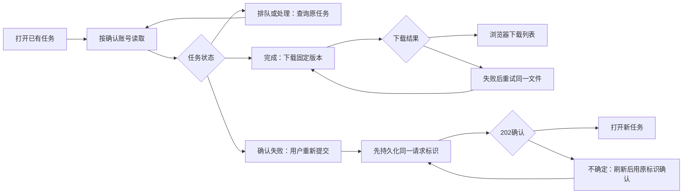

# R10 剩余页面与全站 UI 收尾

## 基线、范围与结论

分支 `refactor/r10-final-pages`，起点 R9 `8216077cd36cb85b1b7f547b2ba412e2ac1236a1`，已包含 R6.1 `2e484165b43e8766c5284f7705a38ee4912efc40`。开始时工作区干净。

本轮完成导出、帮助、反馈、关于四页和全局错误页的局部改造。此前13页保持业务和视觉设计。继续使用 R2 Token、R3 宽度模式和现有 AppModal。没有修改 Server、Worker、Schema、额度事务、认证方式、模型、SSE 协议或存储清理。

仓库未找到独立 R0 报告文件；本轮使用根目录《Formula重构.md》、R2—R9 验收文档及实际17页重新核查，没有假称读过不存在的文件。

全站逐页记录见 [R10全站页面验收矩阵](R10全站页面验收矩阵.md)。截图是实际 Chromium 浏览器截图，不是生成设计稿；账号业务界面使用3200隔离 HTTP 夹具。真实 API/DB/S3 验证单独列明，不把截图中的示例账号当成真实后端联调。

## 实际修改文件与原因

| 文件                                                         | 原因与职责                                                                                              |
| ------------------------------------------------------------ | ------------------------------------------------------------------------------------------------------- |
| `app/pages/exports/[id].vue`                                 | 只处理路由与确认身份；按账号+任务重新挂载业务组件，Session失败隐藏私有任务；选择reading宽度，保留旧地址 |
| `app/components/AccountExportTask.vue`（新增）               | 局部任务读取、轮询、下载、失败重新提交、恢复回执和反馈；离开/换账号后拒绝旧回调                         |
| `app/utils/export-state.ts`（新增）                          | 纯函数：任务身份/版本/尝试/终态检查、严格恢复回执解析、同源下载地址与文件名                             |
| `app/components/ExportResult.vue`                            | 展示已完成文件并发出下载意图；缩小纸页装饰，补充下载忙态，不隐藏业务请求                                |
| `app/pages/help.vue`                                         | reading阅读、FAQ 44px操作区，核对当前识别、快照式回答、100条历史及安全重试文案                          |
| `app/pages/feedback.vue`                                     | 明确仅整理复制；复制中、成功、失败、全选手动恢复、空白校验、迟到回调保护                                |
| `app/pages/about.vue`                                        | 品牌/标题/功能/边界信息分层；删除互相覆盖的h2规则；reading阅读                                          |
| `app/components/PageIntro.vue`                               | 增加显式可选inlineArtwork；仅帮助/反馈启用并排插图，避免320px标题与装饰重叠，默认样式不变               |
| `app/components/AppBrand.vue`                                | 不展示头像且未提供用户时，不再无谓读取Session；保留需要头像的调用方式                                   |
| `app/error.vue`                                              | 安全通用404/权限/503/其他错误文案；可信上一页、首页、显式重试；不渲染原异常                             |
| `app/plugins/account-boundary.ts`                            | 在既有私有状态清理时移除新增导出回执；不清除游客数据，不另建账号状态系统                                |
| `scripts/test-suite.ts`                                      | 将导出纯规则测试登记到原unit入口，没有移除旧套件                                                        |
| `tests/export-state.test.ts`（新增）                         | 快照、终态、合法自动重试、下载路径和损坏回执测试                                                        |
| `tests/jobs.test.ts`                                         | 新增刷新读取/重复下载不新增任务和额度；保留真实DOCX、版本、权限、幂等与执行权断言                       |
| `tests/profile-api.test.ts`                                  | 新增携带真实隔离账号cookie的公开页SSR隐私与私有页缓存头检查                                             |
| `tests/design-preview/final-pages-fixtures.ts`（新增）       | 显式cookie/run开启的有界HTTP替身；未知请求拒绝，不回退真实资源                                          |
| `tests/design-preview/session-middleware.ts`                 | 只在显式设计预览层注册R10夹具                                                                           |
| `tests/design-preview/app/pages/__r10-error.vue`（新增）     | 仅预览层的受控错误/恢复入口，正常构建没有此路由                                                         |
| `tests/design-preview/capture-final-before.js`（新增）       | 四页和404六种宽度的修改前真实截图                                                                       |
| `tests/design-preview/check-final-pages-browser.js`（新增）  | 六宽度、导出/下载/重放/失败、FAQ、剪贴板、错误恢复的浏览器断言                                          |
| `tests/design-preview/check-site-matrix-browser.js`（新增）  | 17页×4核心宽度；逐页390px刷新和浏览器后退、资源、底部与溢出                                             |
| `tests/design-preview/check-final-modals-browser.js`（新增） | 游客编辑/分类/版本/导出弹窗、焦点、ESC、背景锁定及可信返回                                              |
| `tests/design-preview/check-modal-focus.js`（新增）          | 实际账号编辑弹窗焦点现状复现，确认无需修改AppModal                                                      |
| 本文、实施计划、页面矩阵、浏览器验收JSON与截图               | 保留验收范围、证据、限制和下一阶段清单                                                                  |

## 导出状态、下载及恢复

原流程与当前流程均为：保存版本 → POST返回202 → 查询原任务 → QUEUED/PROCESSING → COMPLETED/FAILED。未修改HTTP契约。服务端仅在COMPLETED且文件READY时返回downloadUrl，因此删除了旧页面“非COMPLETED但有downloadUrl”的不可达分支。

- GET按账号和任务独立缓存；校验响应任务、所属公式、固定版本；低尝试响应不覆盖高尝试，已见终态不退回活动态。允许PROCESSING→QUEUED的合法自动重试，也允许同终态更新文件可用信息。没有声称获得服务端不存在的全局revision。
- 初始水合不清除额度缓存；仅实际状态变化或确认提交后使已有额度键失效，避免SSR/客户端不一致。其他全站缓存收敛仍属R11。
- 下载仅接受当前任务的精确同源私有URL。请求失败显示反馈；收到DOCX MIME且非空的Blob后交给浏览器下载，释放Object URL。界面只说“已请求浏览器下载”，不声称文件已写入磁盘。
- 此MIME检查不是DOCX结构验证。浏览器夹具只返回受控测试字节；真实隔离集成测试解压实际Word并核对数学XML及绑定旧版本，二者分开报告。
- 下载不生成新任务，不使用新额度；真实重复下载测试验证这一点。已完成但缺失可用文件时提示重新读取，不自动生成新任务。
- 已确认失败后重新提交仍绑定原versionId，并使用一次新额度。sessionStorage先保存账号/原任务/版本/请求标识，POST超时或响应丢失时保留；刷新后继续同一标识。重复点击有同步busy保护，无自动新增重试。
- 回执仅此标签页恢复，最多10条，字段严格校验；损坏/不可写时在POST之前阻止提交，明确“本次未发送新请求”。不要通过清除记录来盲目重建任务。关闭标签页后的跨会话恢复仍有局限，留给R11/R15评估，不引入新的服务端接口。
- 页面离开终止客户端请求，旧响应不得导航；这不等同取消已经提交的服务端任务。确认退出/换账号沿用既有边界清除私有缓存和导出回执。权限404合并“记录不存在或无权访问”，不泄露他人任务存在性。

## 公开页、SSR与错误边界

`AppBrand :avatar="false"`在关于页不再调用useAccountSession。首页、公式库、AI、个人中心已有提供用户的路径保留。

真实隔离账号携带cookie访问 `/about`、`/help`、`/feedback`：SSR HTML不含该账号ID、邮箱、昵称；仅包含账号边界插件注册的空 `"account-session":-1` 槽（Nuxt对undefined的编码）。空槽不能误判为私有Session数据。浏览器夹具同时核对关于页SSR+客户端的Session请求次数为0。

`server/middleware/private-cache.ts`没有修改：私有页面仍 `Cache-Control: private, no-store`、`Vary: Cookie`；公开三页没有新增共享缓存策略。没有测试真实CDN，因此不宣称生产缓存已全链路验收。

错误页不依赖Session，只展示固定安全描述；返回目标通过已有safeReturnPath白名单，排除当前路径，防止外部重定向和直接循环。404回首页、503显式重试、可信上一页均实测。受控错误原文含敏感哨兵，页面正文不展示。

边界：本轮只验证错误展示，不把“正文不显示原异常”扩大解释为所有服务端错误序列化绝无泄露。Nuxt开发错误覆盖层、显式服务端异常消息及生产日志策略应在R15/R17另行审查；本轮未改全局服务端错误处理。

## 弹窗与导航

实际13处AppModal调用点：AccountCategoryManager、AccountCategoryPicker、AccountExport、AccountFormulaEditor、AccountProfileEditor头像操作、AvatarCropper、DemoLibrary新分类、FormulaContextPicker、FormulaVersions、settings清理确认、result的编辑/分类/导出说明三处。FormulaVersions也被账号和游客共用。

收藏为直接切换，没有收藏确认弹窗；退出沿用现有操作，没有虚构第二次确认。未保存的公式、资料、聊天草稿沿用各自既有确认守卫。

| 类型                                | 实际验证                                                                                                |
| ----------------------------------- | ------------------------------------------------------------------------------------------------------- |
| 账号编辑/版本/分类/导出             | R6/R6.1浏览器回归：回填、非法输入、保存中关闭限制、失败保留、冲突、版本固定、分类失败重试、导出失败重放 |
| 公式库分类管理、游客新分类          | R5回归：新增、重命名、确认删除、归类、导航上方                                                          |
| 头像操作与裁剪、设置清理            | R9回归：裁剪失败/键盘缩放/保存失败、草稿、危险操作、本机与账号隔离                                      |
| AI公式选择                          | R8回归：分页选择、上下文、输入及生成状态                                                                |
| 游客编辑/分类/版本/导出说明         | R10补验320/390/430/1440：焦点进入、可见范围、内部滚动、ESC、触发按钮焦点恢复、背景滚动恢复              |
| 公共布局弹窗、Toast、输入与底部导航 | R3回归：层级、固定导航、安全区、长页面、返回与滚动                                                      |

原生dialog在最后一个控件按Tab时允许进入浏览器工具栏（document失焦），随后Tab回到弹窗，背景控件仍不可聚焦。这是保留浏览器操作的正常行为，不为测试强行添加另一套焦点循环。实际账号编辑关闭后的焦点已正确恢复，因此未修改AppModal实现。

## 手机与桌面截图

四页沿用浅紫/纸页/柔边框；帮助、反馈、关于、导出选择reading，900px以下仍兼容最大480px，桌面760px。没有修改全站默认宽度，工作区页保持R5/R8已有规则。

| 页面 | 手机前/后（390）                                                                            | 桌面前/后（1440）                                                                             |
| ---- | ------------------------------------------------------------------------------------------- | --------------------------------------------------------------------------------------------- |
| 导出 | [前](设计稿/R10全站收尾/修改前-导出-390.png) / [后](设计稿/R10全站收尾/修改后-导出-390.png) | [前](设计稿/R10全站收尾/修改前-导出-1440.png) / [后](设计稿/R10全站收尾/修改后-导出-1440.png) |
| 帮助 | [前](设计稿/R10全站收尾/修改前-帮助-390.png) / [后](设计稿/R10全站收尾/修改后-帮助-390.png) | [前](设计稿/R10全站收尾/修改前-帮助-1440.png) / [后](设计稿/R10全站收尾/修改后-帮助-1440.png) |
| 反馈 | [前](设计稿/R10全站收尾/修改前-反馈-390.png) / [后](设计稿/R10全站收尾/修改后-反馈-390.png) | [前](设计稿/R10全站收尾/修改前-反馈-1440.png) / [后](设计稿/R10全站收尾/修改后-反馈-1440.png) |
| 关于 | [前](设计稿/R10全站收尾/修改前-关于-390.png) / [后](设计稿/R10全站收尾/修改后-关于-390.png) | [前](设计稿/R10全站收尾/修改前-关于-1440.png) / [后](设计稿/R10全站收尾/修改后-关于-1440.png) |
| 404  | [前](设计稿/R10全站收尾/修改前-404-390.png) / [后](设计稿/R10全站收尾/修改后-404-390.png)   | [前](设计稿/R10全站收尾/修改前-404-1440.png) / [后](设计稿/R10全站收尾/修改后-404-1440.png)   |

同目录还包含320/430/768/1024、任务失败、反馈复制失败、503、游客弹窗、17页首屏和390px页面末尾。全页截图的固定导航显示在截图时的视口位置，判断底部是否遮挡使用另外保存的滚动到底部截图与几何断言。

## 测试与可重复命令

R1本轮新建清单 `tmp/r1-test/23d5bdad-5962-4528-b730-2d679383618b/environment.json`；随机专用库、pg-boss、S3实例，端口15432/18333，API3100。仅对新空临时数据库应用既有6份迁移；没有新增迁移，没有接触开发数据，没有启动公共队列消费者或真实模型。结束后停止本次API和测试容器；临时资源不可作为下一次清单复用。

| 实际命令                                | 最终结果                                                                 |
| --------------------------------------- | ------------------------------------------------------------------------ |
| `npm run typecheck`                     | 通过（Nuxt与服务端/测试检查）                                            |
| `npm run typecheck:design`              | 通过，含预览夹具与错误入口                                               |
| `npm run typecheck:tests`               | 通过                                                                     |
| `npm run check:assets`                  | 0缺失                                                                    |
| 修改文件 `prettier --check`             | 通过；未全仓格式化，15个历史格式问题未处理                               |
| `npm run test:unit`                     | 70通过，0失败/跳过；其中新增导出规则3项                                  |
| `npm run test:protocols`                | 20通过，受控本机HTTP/SSE                                                 |
| `npm run test:documents`                | 7通过，本机Pandoc/DOCX                                                   |
| 显式本轮清单 `npm run test:integration` | 106通过，0失败/跳过（较R9新增SSR、重复下载2项）                          |
| `npm run check:build`                   | 最终源码生产构建通过，随后完整客户端私有标记扫描1/1通过                  |
| R10剩余页、全站矩阵、补充弹窗浏览器     | 125项状态/布局，68个页面宽度组合，105项补充弹窗/导航；见验收JSON逐项结果 |
| R3—R9专项浏览器回归                     | 83 / 93 / 104 / 134 / 220 / 141 / 134项通过，共909项                     |

构建使用空dotenv、受控假私有标记与Mock，产物位于 `tmp/r1-test/build`，扫描要求源码指纹和全部客户端文件SHA匹配，没有缩小扫描范围。预览路由/夹具不进入正常生产构建。完整类型/生成/构建与集成、浏览器分阶段执行，避免HMR重启影响测试。

最终构建29.9秒，完整扫描146个客户端文件：JS49、CSS32、字体59、SVG4、JSON2。R9为147（JS50），变化来自构建分块数量，其他分类不变；扫描器和遍历范围没有修改。另行检查生产客户端不存在R10错误预览路由/夹具标记。

浏览器复现方式：先 `npm run preview:design`，再以独立playwright-cli会话按顺序运行新增三个 `check-*-browser.js` 文件。关闭同任务旧无头浏览器，串行执行。R3—R9回归将原脚本复制到tmp并仅替换shots目录，避免覆盖前轮截图。`test:ui`仍是unit别名，不把它称为浏览器测试。

过程中纠正的失败：首次SSR测试错误禁止了Nuxt空Session槽，修正为校验槽为空及无PII后完整重跑；导出初次额度失效导致水合不一致，已限定为真实状态变化并重验；浏览器夹具运行编号、旧场景请求归属及原生dialog工具栏焦点均按实际行为修正。最终复核曾遇旧无头浏览器资源不足，关闭本任务测试会话后串行重跑。失败尝试不计入最终通过数。

未执行：真实DeepSeek/Python模型、真实用户数据库、生产CDN、手机实体软键盘/Safari/屏幕阅读器、所有浏览器平台矩阵、压力/性能测试。没有将Mock通过扩展为这些保证。

## 尚未解决与后续归属

| 轮次    | 保留问题 / 建议                                                                                                     |
| ------- | ------------------------------------------------------------------------------------------------------------------- |
| R11     | 各业务局部缓存失效和分页规则继续收敛；导出回执仅标签页恢复、存储故障的人工确认体验；保留原生Nuxt，不因形式引入Pinia |
| R12a    | 累计上传容量、解码/处理并发约束。R7/R10界面完成不代表容量可靠性解决                                                 |
| R12b    | 遗留对象自动回收、补偿与存储生命周期；本轮没有扩大清理                                                              |
| R13a/b  | Worker异常恢复、终态收敛与补偿、任务长期排队治理；保留已有执行权与事务                                              |
| R14a    | 失败轮次进入Prompt、尝试记录、模型重试和计费语义                                                                    |
| R14b    | 快照式SSE成本、可靠revision/历史分页；目前只展示最近100消息                                                         |
| R15     | API/Service/Database职责；错误序列化/日志审计；若做跨标签页未知提交恢复，先评估最小服务端查询能力                   |
| R16     | 固化本轮浏览器矩阵与产物证据到CI，保留完整106项登记；15个历史格式问题另行处理                                       |
| R17     | 真实部署资源、连接数、私有缓存/CDN、真实设备键盘与性能验收；不以桌面Chromium代替手机实机                            |
| R18     | 自由裁剪、多公式识别等新增能力仍未实现，帮助文案没有假称支持                                                        |
| R19     | 结构化解释仍为后续产品需求，不改变本轮聊天与导出                                                                    |
| R20—R21 | 未在当前仓库找到足够明确的独立需求定义，不自行补全；真正反馈提交可作为R21候选，需要另行确定渠道/存储/权限           |

第一阶段现在具备统一视觉基础、17页可追溯记录和分离的浏览器/真实隔离业务证据；它不代表后端可靠性技术债已全部解决。新增导出回执和局部失效规则是有限范围实现，已把跨标签页恢复与统一缓存的剩余边界明确交给R11/R15，没有引入新框架。

## Git与回滚

本轮独立本地提交，提交号见当前会话交付。没有推送或配置远程。可通过 `git show --stat HEAD` / `git diff HEAD^ HEAD -- app tests scripts docs` 复核；工作区应干净。

需要撤销时，在审查后对本轮提交使用 `git revert <R10提交号>` 产生可审计的反向提交；不要reset/clean。需要独立查看原R9，可创建新分支指向上面的R9提交，避免覆盖当前工作。数据库无需回滚（未改Schema/迁移），隔离测试产生的临时数据不属于业务数据。

R10完成后停止，等待视觉与架构评审，不自动进入R11。
