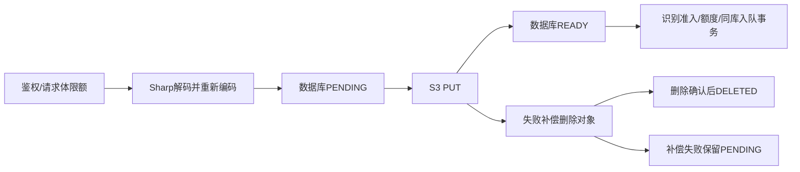

# R12 资源限制与生命周期：审计及待批准方案

状态：GitHub发布完成，R12只完成源码审计与方案。本文件不是实施完成或验收通过报告。尚未修改业务代码、Schema、迁移和事务，没有执行资源清理，也没有读取开发库/桶统计。

基线R11 `4b66ef8115c8eea87175cdac132fd985f30e88e2`；当前`refactor/r12-resource-lifecycle`包含该提交及发布准备文档提交。创建分支前工作区干净。读取《Formula重构.md》和R1/R7/R9/R10/R11说明后重新核对实际代码，未照搬旧报告。

## 1. 实际资源与引用

| 资源                           | 元数据 / 引用                                                                                | 创建入口与保护                                                                               |
| ------------------------------ | -------------------------------------------------------------------------------------------- | -------------------------------------------------------------------------------------------- |
| 规范化图片，非另存一份原始字节 | StoredFile(kind=IMAGE)，RecognitionTask.inputFileId→Formula.recognitionTaskId→FormulaVersion | `files/index.post`→`uploadPrivateImage`；owner+uploadKey唯一、SHA256、账号归属               |
| 已上传未识别图片               | 同一IMAGE记录，尚无RecognitionTask                                                           | 客户端有fileId/恢复凭据；不能刚上传就当孤立对象删除                                          |
| 头像                           | User.image直接保存头像对象key，没有StoredFile行                                              | `saveProfile`→`normalizeAvatar`；随机新key、User.updatedAt CAS；R9禁止默认Auth入口任意写头像 |
| DOCX                           | StoredFile(kind=DOCX)，ExportTask.fileId指向；ExportTask绑定不可变FormulaVersion             | `processExport`每次尝试独立对象key；完成事务包含completeClaim                                |
| 失败/中断对象                  | StoredFile PENDING/DELETED，或无元数据头像                                                   | 尽力补偿；无统一扫描、回收任务或持久清理审计                                                 |

真实FileStatus只有PENDING/READY/DELETED，FileKind只有IMAGE/DOCX。没有现成容量账本、上传预留、下载expiresAt或对象回收表。

## 2. 现有状态流与不确定窗口

头像：先PUT新key，再CAS更新User.image，失败尝试删新对象，成功才删旧头像。新头像PUT在事务补偿try之前，响应不确定或进程崩溃会留下无元数据对象。DOCX：转换→PENDING→PUT→READY/COMPLETED/completeClaim同事务；补偿失败可能留下PENDING。数据库和S3不共享原子事务。

## 3. 已有防护与缺口（当前代码证据）

| 证据                                                | 已有                                                                  | 缺口                                                                     |
| --------------------------------------------------- | --------------------------------------------------------------------- | ------------------------------------------------------------------------ |
| `server/utils/request-body.ts:readLimitedBody`      | 实际逐块计数，含无Content-Length；图片10MiB                           | 没有整段读取期限；无准入就开始积累Buffer                                 |
| `server/images/normalize-image.ts`                  | JPEG/PNG签名、完整解码、20M像素、单帧、移除元数据、输出仍≤10MiB       | 无跨请求/跨实例解码准入；像素上限不等于RSS内存上限                       |
| `server/images/avatar.ts`                           | Base64正文≤1.5M字符、解码≤1,000,000字节、512×512 WebP                 | 复用图片解码但无并发/累计计量；最终WebP未另行显式体积断言                |
| `server/services/image-upload.ts`                   | 请求键、内容一致性、PENDING→READY、补偿                               | 解码在PENDING创建前；无账号/全局累计容量、频率、上传槽位；中断无持久核对 |
| `server/database/task-submissions.ts`               | 幂等、任务+每日额度+pg-boss入队同事务                                 | 没有单账号/全局活动识别上限；每日额度不能代替积压/并发准入               |
| `server/worker/start.ts` / 已安装pg-boss manager.js | batchSize=1，localConcurrency默认1，即每个Worker进程每队列一个handler | 多进程会叠加；连接池max=4不是执行并发上限。没有全局队列长度上限          |
| `services/recognition/app/main.py`                  | 进程内推理Lock和请求体/图像限制                                       | 图片读取发生在取得推理锁之前；不是跨进程限制                             |
| `server/storage/object-store.ts`                    | 私有桶、HTTPS约束、PUT/GET/DELETE、连接与请求超时                     | 无LIST/HEAD；不能枚举或区分“缺失”和“无权限/不可用”                       |
| `server/worker/export.ts`                           | 每次写对象key唯一，过期执行权不能提交成品                             | 失败清理尽力执行；无长期核对，不得借机重写终态                           |
| `server/documents/formula-document.ts`              | Pandoc20秒、stdout≤5MiB、校验原生公式                                 | 重新打包后的最终DOCX需显式上限，不把stdout限额当最终值                   |
| `exports/[id]/download.get.ts`                      | 本人、COMPLETED、READY、私有响应                                      | 当前没有下载过期契约，不能擅自按30天删除合法文档                         |

`compose.yaml`的识别容器mem_limit=6g，高于此前提出的4GB服务器物理内存；不是可直接部署的承载保证。部署与实测归R17，本轮不给出虚构吞吐量。

## 4. 可能的孤立/异常路径

1. 图片PENDING后、PUT前崩溃：记录存在、对象可能不存在，不能当READY。
2. PUT已落盘但响应丢失，或READY更新失败：对象与记录结果不确定；补偿再失败会滞留。
3. 新头像已PUT、User更新前崩溃或PUT响应丢失：没有StoredFile可追踪。
4. 头像保存成功但旧对象删除失败：旧头像无当前引用，但仍占空间。
5. 导出PUT或completeClaim失败且补偿删除失败：尝试对象遗留；不能删除另一尝试的成品。
6. 账号/业务记录删除、外部写入或手工运维造成桶对象与数据库分离；静态审计不能断言当前实际数量。
7. 仅按年龄删除PENDING，会与仍在执行的旧写入或新引用竞争；仅在进程Map计数不能保护多实例。

## 5. 拟议默认限制（配置建议，不是既定产品需求）

| 范围                       | 建议初值 / 依据                                                                                            |
| -------------------------- | ---------------------------------------------------------------------------------------------------------- |
| 图片输入与规范化输出       | 保持10MiB、20M像素及JPEG/PNG，不放宽                                                                       |
| 头像                       | 保持现有输入限制，最终WebP显式≤1MiB                                                                        |
| 最终DOCX                   | 显式≤5MiB，与当前转换器量级一致                                                                            |
| 请求体完整读取             | 30秒，可配置；到期实际停止读取并释放准入，不用只reject但继续收集的Promise.race                             |
| 单账号/全局上传            | 1 / 2个，覆盖读取→解码→写入；以持久准入保护多实例，不用进程Map充数                                         |
| 账号新上传频率             | 10次/分钟，可配置；幂等重放不重新预留容量                                                                  |
| 账号累计/全局受管理容量    | 128MiB / 8GiB，包含待确认占用和预留；为40GB磁盘预留数据库、模型与系统空间，但它不是整个磁盘/S3的物理硬配额 |
| 账号/全局活动识别          | QUEUED+PROCESSING合计2 / 16；先读已接受请求再判断，拒绝不扣日额度、不创建任务                              |
| 未关联READY图片            | 至少24小时且没有恢复/写入操作、任务或公式引用才候选                                                        |
| 长期PENDING、失败尝试      | 1小时起标记需核对，不因过期就删除或盲目释放预留；确认可回收后仍有24小时宽限                                |
| 旧/孤立头像                | 当前正常替换顺序保留；失败补偿进入持久核对，批量回收至少7天宽限                                            |
| 已引用原图/版本/可下载DOCX | 保留，不新增静默TTL或改任务终态                                                                            |

API活动任务上限、队列积压与Worker实际执行是三件事。本轮增加API准入，不宣称将多Worker的执行统一为1；若要改变执行调度/任务执行权，需R13单独评审。现有每日额度事务不变。

## 6. 最小持久化与事务方案（需批准）

建议沿用StoredFile作为文件元数据来源，不另造一套文件系统：

1. FileKind增加AVATAR，FileStatus增加DELETING。头像新写入也先有元数据；历史头像只读核对后再按显式流程登记，迁移不能凭空假设S3内容。
2. 新增ResourceLease：操作id、owner、用途、请求键、可选fileId、预留字节、状态、时间和执行token。用于跨实例上传槽位、容量预留及频率；不是通用业务任务框架。过期而结果未知的记录进入核对，不能TTL一到就释放容量或当作CPU执行已停止。
3. 新增StorageCleanupAudit：对象指纹/可选fileId、模式、操作阶段、结果与时间，删除前持久记录；日志不输出对象内容、凭据或私有key/URL。只读扫描不写业务库。
4. 上传准入使用短事务中的固定顺序PostgreSQL advisory transaction locks：全局后账号；计入StoredFile占用+未转成文件的预留。并发检查与预留必须同事务，S3/解码不放长事务里。预留转换成实际文件占用也同事务，不能重复计量或提前释放。
5. 识别现有事务内增加同一准入锁、幂等再次读取与活动计数，然后沿用原任务/额度/入队。增加对输入文件的行锁，与清理的引用检查采用同一保护规则；防止查到READY后在另一事务删除。
6. 每次物理写入使用独立attempt key/token；迟到写入不能发布READY或删除新尝试对象。头像沿用CAS，导出保留completeClaim及既有任务终态，只衔接文件预留/写入保护。

这是核心事务和Schema的有限调整，需要先批准，尚未编写DDL或执行迁移。DDL拟为新增表/字段及枚举值，不删列、不删数据；先在R1全新隔离库验证。

兼容风险：扩展枚举后旧Prisma客户端不应假定能读取新值。API和Worker需协调升级，混合旧写入方期间不能开启清理。现有200/202成功DTO不变，错误可增加可选资源code，旧调用方仍可读message；前端仅白名单展示明确资源错误，不暴露未知503内部异常。

回滚：先停清理和新资源写入，再评估代码回退；不能在已有AVATAR/DELETING后直接删枚举或盲目运行旧客户端。优先前向修复或兼容回退；保留备份，不自动执行降级迁移。开发/生产本轮均不执行迁移或数据修复。

## 7. 清理机制与不变量

- 默认只读dry-run；缺失、确定孤立、疑似孤立、窗口内、无法判定分别分类。HEAD的403/超时不是404；任一关键资源身份或数据库不可用即停止删除。
- 只管理明确命名空间和已确认元数据。旧无登记对象默认疑似并保留，不以LIST没匹配到一次引用就直接删除。
- 删除前重新检查RecognitionTask、Formula关联链、ExportTask、User.image及活动资源操作；未知、正在处理、仍可下载一律保留。
- 短事务内锁定并标记DELETING、记审计后再做S3删除；所有新引用入口必须遵守同一行锁/状态约束。S3成功后再标DELETED和释放占用；失败保留可重试状态。多次执行幂等，不隐藏在GET或页面加载。
- 删除默认禁用，需显式apply和目标身份确认。本轮真实删除仅允许R1隔离环境对象，不能清理开发或生产桶。
- 固定版本、归属、请求幂等、日额度及队列事务不回退；容量拒绝不等于消耗业务额度；只有引用确定为空且操作已收敛才允许回收。

不能声称逻辑容量等于磁盘实际使用。旧头像、历史孤立对象需库存基线；无法确认的存量保留并报告，首次上线前需只读核对。租约失效不等于旧进程物理停止，其异常恢复边界仍需R13配合，不能伪称消除了网络分区下全部资源风险。

## 8. 预计文件与阶段验证

| 批次              | 预计涉及文件 / 验证                                                                                                                                                                                                        |
| ----------------- | -------------------------------------------------------------------------------------------------------------------------------------------------------------------------------------------------------------------------- |
| 1. 限制与准入     | schema、新增迁移（待批准）、新resource policy/lease模块、request-body、normalize-image/avatar、image-upload、task-submissions、nuxt.config/.env.example；独立DB客户端争夺边界、同key、不同key、读取超时、拒绝不扣额/不入队 |
| 2. 文件引用与核对 | object-store新增分页LIST/HEAD；profile、export的文件写入衔接；新resource inventory/cleanup与独立CLI，默认dry-run；桶缺失、403、缺对象、活引用、补偿失败与重试                                                              |
| 3. 安全回收       | 审计、DELETING、引用竞争；真实测试桶保留当前头像、历史原图、合法DOCX，删除确认孤立；重复apply、DB不可用停止、旧写入token失效                                                                                               |
| 4. 最小衔接       | workspace error公开code及前端白名单提示；不重新设计界面；类型、单元、相关隔离API/并发集成、生产构建与私有扫描                                                                                                              |

现有workspace/profile/jobs测试保留并扩充；头像仍需验证成功替换才处理旧对象，失败保留旧头像，补偿失败由核对接管。现有DOCX没有expiresAt，不凭空制造过期；验证合法下载不因年龄清理，显式过期产品策略另行确认。

目前只执行了Git发布与只读源码检查；R12测试、存量扫描、dry-run数量及删除测试均未执行，不能报告通过。审批后才进入实施，完成后停止于R12，不进入R13。
