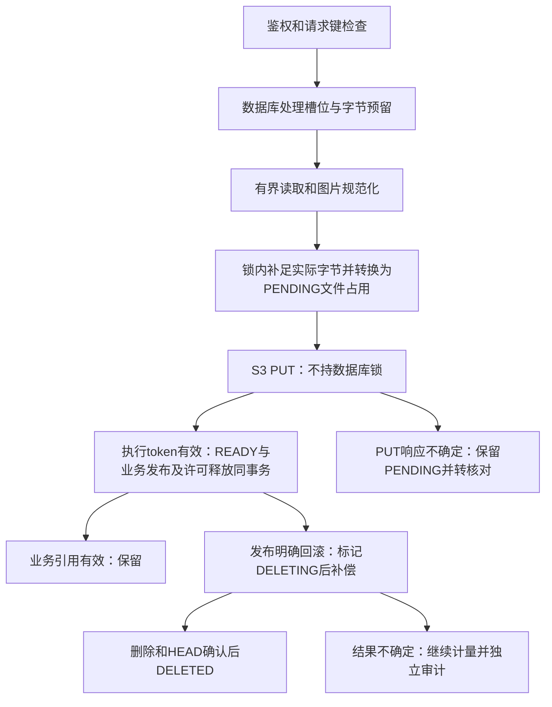

# R12 资源限制与生命周期验收说明

实施日期：2026-10-28。分支：`refactor/r12-resource-lifecycle`，保留 R11 `4b66ef8115c8eea87175cdac132fd985f30e88e2` 和发布准备/审计提交。R12 已获分阶段实施、Schema 和隔离迁移授权。本轮没有部署生产代码、迁移开发/生产数据库或清理真实用户对象；没有自动删除调度器。

## 1. 实际资源与状态

| 资源                     | 元数据和有效引用                                                             | 处理规则                                                                                          |
| ------------------------ | ---------------------------------------------------------------------------- | ------------------------------------------------------------------------------------------------- |
| 规范化图片               | StoredFile IMAGE；RecognitionTask.inputFileId，进一步关联历史公式/不可变版本 | 所有任务引用均保留，包括失败任务；无引用 READY 至少24小时才可成为候选                             |
| 新头像                   | StoredFile AVATAR；User.image                                                | 新文件 READY 与资料 CAS 更新同事务；成功替换/重置后才退役旧头像；失败保留正在用的头像             |
| 历史头像                 | 可能仅有 User.image                                                          | 不回填、不假设尺寸/体积；只读核对保留当前引用；正常替换时仅允许退役校验过的本人旧 key，且独立审计 |
| DOCX                     | StoredFile DOCX；ExportTask.fileId，任务绑定固定 FormulaVersion              | 合法下载引用永久保留；不新增下载 TTL；失败尝试沿用独立对象键                                      |
| 结果不确定的写入         | PENDING 文件 + ResourceLease REVIEW_REQUIRED                                 | 继续计量，不仅凭 TTL、一次 HEAD 缺失或用户重试释放                                                |
| 已确定结束写入的失败补偿 | DELETING 文件，可有 REVIEW_REQUIRED 许可                                     | 保留计量；宽限后显式重试删除、HEAD 确认、数据库落账后释放                                         |
| 无元数据的桶对象         | 只输出指纹                                                                   | 当前历史头像保留；其他一律疑似孤立、需核对，不自动删除                                            |

数据库与 S3 不组成共同事务。若事务实际提交成功、仅返回结果丢失，补偿会重新读取 READY/引用并保留成品。每次图片重试使用新的执行 token 对象键，旧补偿不能删除新尝试。

## 2. Schema 与迁移

- FileKind：在 IMAGE/DOCX 基础上增加 AVATAR。
- FileStatus：原来已经有 DELETED，只新增 DELETING。
- ResourcePurpose：IMAGE_UPLOAD / AVATAR_UPLOAD / DOCX_WRITE。
- ResourceLeaseStatus：ACTIVE / REVIEW_REQUIRED / RELEASED。

ResourceLease 字段：UUID id、ownerId、purpose、requestKey(varchar100)、唯一 executionToken(UUID)、status、reservedBytes(BigInt)、countsTowardRate、可空 fileId、expiresAt、finishedAt、createdAt、updatedAt。

约束/索引：

- `(ownerId,purpose,requestKey)` 在 ACTIVE/REVIEW_REQUIRED 上部分唯一，阻止同一有效请求重复预留。
- reservedBytes 非负；绑定文件时必须为0；RELEASED 时必须为0且 finishedAt 非空，非终态不得有 finishedAt。
- ownerId 外键延续账号清理的 Cascade；`(fileId,ownerId)` 复合外键对应 StoredFile 的相同账号，删除 NO ACTION、更新 RESTRICT。
- owner/purpose/createdAt、status/expiresAt、fileId 索引；StoredFile 新增 status/updatedAt 索引。
- AVATAR 的数据库 CHECK 要求 WebP、512×512、≤1MiB，且保留原上传身份 CHECK 所要求的成对 hash/key。头像使用内部 `avatar:<uuid>` 键，不占用图片客户端 UUID 命名空间。

StorageCleanupAudit 字段：UUID id、operationId、可空 fileId 快照、objectFingerprint(SHA256)、action、outcome、createdAt；索引 fileId/createdAt 和 operationId。没有文件/账号级联外键，删除原记录不会删除审计，不保存对象内容、原始私有地址或凭据。

迁移：

1. `20261028000000_resource_lifecycle`：事务内扩展枚举、新表、约束和索引。
2. `20261028000001_resource_file_guards`：独立事务增加复合归属外键和 AVATAR CHECK。与枚举扩展分开提交，避免同事务使用刚添加的 PostgreSQL 枚举值。

没有回填或删除历史数据，没有改旧 IMAGE/DOCX 约束、公式不可变版本和账号归属。迭代后重新创建全新 R1 空库，从零应用全部8份迁移成功；再次执行显示 No pending migrations。

## 3. 资源事务与并发

固定锁顺序为全局 advisory transaction lock →账号 advisory lock →必要的文件行锁/更新。所有资源准入、发布、补偿、头像引用变更、清理和识别新引用走相同顺序。全局锁仅覆盖短数据库事务，S3/Sharp/Pandoc 不在锁内。

容量 = 所有非 DELETED 文件 sizeBytes + 所有未 RELEASED 许可 reservedBytes。绑定 PENDING 和许可字节归零同事务完成，没有双计量。合法 Content-Length 可作为图片初始预留；无/无效声明按10MiB保守预留。规范化后超过预留的差额在同一资源锁内追加检查，不能超额 PUT。READY 请求重放先匹配原始内容/名称/类型，使用0字节预留，不因当前容量已满重复创建对象。

处理槽位、上传频率、持久容量、每日业务额度彼此独立。明确未绑定对象的验证/读取失败可以释放；绑定后必须发布成功或确认删除。过期许可撤销 token、转核对并记录审计，不自动释放字节或假定旧进程已物理停止。

仅对确定回滚的 Prisma P2034 冲突最多额外重试2次。没有给 S3/模型增加应用层自动重试；原 S3 SDK 的有限重试配置保留。

识别：先返回匹配的幂等请求，再在资源锁内复核并统计 QUEUED+PROCESSING。新任务、每日额度和 pg-boss 入队仍处于原同库事务。超限不建任务、不扣额度、不入队。没有更改队列领取或 Worker 执行权。

## 4. 配置与默认值

服务端通过 `FORMULA_RESOURCE_` 环境变量读取，所有 API/Worker 实例必须配置一致；非法或非正整数直接拒绝操作。`.env.example` 有中文说明，未改本机 `.env`。

| 后缀                                     | 默认值     | 单位/依据                                                 |
| ---------------------------------------- | ---------- | --------------------------------------------------------- |
| OWNER_BYTES                              | 134217728  | 128MiB，初版账号受管理逻辑容量                            |
| GLOBAL_BYTES                             | 8589934592 | 8GiB，初版全局受管理逻辑容量，不是磁盘保证                |
| OWNER_UPLOADS / GLOBAL_UPLOADS           | 1 / 2      | 正文读取、解码及写入处理槽位，跨实例数据库约束            |
| UPLOADS_PER_MINUTE                       | 10         | 每账号每分钟新上传/确认失败后的新尝试；成功重放不追加频率 |
| OWNER_RECOGNITIONS / GLOBAL_RECOGNITIONS | 2 / 16     | 等待+运行中的识别准入上限                                 |
| LEASE_SECONDS                            | 3600       | 到期转核对，不自动释放                                    |
| BODY_SECONDS                             | 30         | 总读取时间；超时实际销毁流                                |
| FILE_GRACE_SECONDS                       | 86400      | 已确认无引用普通文件的批量清理宽限                        |
| AVATAR_GRACE_SECONDS                     | 604800     | 批量旧/孤立头像7天宽限；正常替换顺序单独处理              |

安全硬上限：原图片 JPEG/PNG、输入及规范化输出≤10MiB、20,000,000像素、单帧；原头像输入≤1,000,000字节且 data URL≤1,500,000字符，新增最终 WebP≤1MiB；新增最终转换后的 DOCX≤5MiB。上述硬上限不随容量配置放大。

Worker 实际执行并发仍为 pg-boss 当前每进程每队列默认1。多个进程会叠加；准入16不代表模型可同时执行16个请求，也不保证4GB服务器可以承载模型。

## 5. 扫描、补偿与清理

`scanStorage` 检查当前桶文件、HEAD 大小/缺失、数据库引用、活动许可、宽限和无元数据对象；补充未绑定许可，报告文件/许可ID及对象指纹，不输出私有 key。403/网络故障不能当成404。分页无效或任一依赖不可用即停止，不对不完整结果继续清理。

`cleanupFile` 默认 dry-run。实际删除要求显式 apply 且已核验的 R1 测试桶；当前没有开放生产 apply 入口。删除前重新锁定、检查对象键和大小、检查所有任务/头像/导出引用及许可；候选先标记 DELETING 并记审计，再放锁删除。新的识别引用必须检查 READY，因此扫描与引用之间不能穿透删除标记。确认删除并 HEAD 缺失后才标 DELETED。删除结果或数据库落账不确定时保持计量，重复执行安全。

扫描时有效引用优先保留；未知对象只报告为疑似孤立。PENDING 和可能仍有旧执行者的 REVIEW_REQUIRED 不走自动清理。DELETING 表示已确定 PUT 结束后的删除意图，可以宽限后显式恢复。长期未知执行者的排空和自动恢复继续依赖 R13，不能凭一次 HEAD 或 TTL 宣称解决。

真实隔离 fixture 的 dry-run 样本在 `tmp/r12-dry-run.json`：包含有效引用、宽限、缺失、核对和疑似孤立等分类；测试清理完成后，CLI 对同一隔离桶再次 dry-run 为0对象、无删除。这里不是开发/生产库存报告。

## 6. API 和既有语义

- 图片成功仍返回原 UploadedImage；识别仍为202+TaskState；请求键和原业务参数不变。
- 新增可恢复429：STORAGE_CAPACITY、UPLOAD_BUSY、UPLOAD_RATE、RECOGNITION_BUSY，返回安全业务提示与 code；新增413提示复用原前端反馈组件。
- PUT结果未知由原先尽力补偿改为保守核对，同键返回409阻止盲目重传；已确认补偿删除后仍可同键重试并复用文件ID。
- 头像不要求旧客户端增加参数；当前相同头像 hash 成功重放不重复写对象，昵称 CAS 与 Better Auth 字段保护保留。现有 Profile API 没有完整请求幂等键，不能据此声称跨任意中间资料修改的重放具有一次且仅一次语义。
- 导出只调整文件预留/发布/补偿：READY、任务完成和 completeClaim 仍在同一事务。没有改固定版本、失败重试次数或每日额度的退款语义。已接收导出在 Worker 阶段遇到容量不足仍沿用现有失败机制，不额外扣额度，也没有新增自动退款。
- 没有修改队列生命周期、模型服务、Prompt、SSE、不可变版本或 R6.1 并发保护。

## 7. 测试与质量基线

最终 R1 运行编号：`23cd1800-662a-4812-949e-210472b0424f`。API3100、PostgreSQL15432、S3端口18333；模型强制 Mock。先校验容器、清单和 API 身份才连接。没有读取开发库/桶统计。

| 命令/检查                           | 结果及范围                                                                                                                                        |
| ----------------------------------- | ------------------------------------------------------------------------------------------------------------------------------------------------- |
| test:env:create / test:db:migrate   | 定稿8份迁移从零成功、重放无待执行项                                                                                                               |
| test:unit                           | 75/75，无跳过；包括读取超时真实终止流、分块超限、空内容和默认策略                                                                                 |
| test:resources                      | 20/20，真实隔离 PostgreSQL/S3；跨客户端容量/槽位/识别准入、复合归属、幂等、补偿、清理竞争、防误删、审计独立保留                                   |
| test:profile                        | 8/8，真实头像读取/替换/重置及默认Auth资料入口字段保护                                                                                             |
| test:workspace                      | 21/21，HTTP上传、校验、分块限额、任务提交、归属、R6.1并发和原图/版本保护                                                                          |
| test:jobs                           | 27/27，真实受控队列/Worker、失效执行者、DOCX下载、固定版本、额度与幂等；模型使用受控替身                                                          |
| 浏览器小范围回归                    | 390/1440px，8组HTTP Mock错误场景、13项断言；429/413/503/409提示、保留上传键、不提前提交任务、无横溢                                               |
| typecheck / check:assets            | 完整类型检查通过，0项静态资源缺失                                                                                                                 |
| 本轮文件Prettier / git diff --check | 通过；未批量修复历史格式问题                                                                                                                      |
| check:build                         | 生产构建及客户端私有配置扫描通过；当前源码指纹匹配，扫描全部147个客户端产物；凭据与日志在tmp/r1-test/client-build-receipt.json、tmp/r12-build.log |

故障层次必须区分：S3和数据库使用真实隔离实例；PUT/DELETE响应丢失、事务返回丢失、数据库不可用使用受控包装器注入；另有真实子进程在预留提交后/PUT后直接退出并跨进程核验持久状态。宽限测试调整的是 fixture 数据库时间，不是等待24小时或7天。浏览器错误场景仅Mock，不代替后端联调。

旧 Profile 单元测试的事务顺序场景已迁入真实资源集成测试，保留成功/冲突两分支的旧对象保护、新对象回滚、更新前后顺序断言。旧上传故障测试改为检查未知结果保持PENDING及禁止盲目重试；“确认补偿后同键重试”在新集成测试中继续验证，没有跳过或降低有效断言。

首次常规权限构建在Windows写入sharp依赖目录时出现EPERM，未记为通过；修正BigInt目标兼容提示后，以本机文件权限重试构建和扫描通过。未跳过扫描，也未使用旧产物凭据。

未执行：R3—R10全部截图与全站浏览器重跑、开发/生产库存扫描、真实用户文件清理、真实模型/付费接口、生产迁移/性能压测。没有用编译结果宣称全站UX重新验收。

## 8. 修改职责与文件

- `prisma/schema.prisma`、两份 R12 migration：许可、审计、枚举和数据库约束。
- `server/resources/policy.ts`：有界配置和业务错误；`leases.ts`：锁、计量、许可与准入；`files.ts`：文件发布/补偿及引用查询；`body.ts`：可测试的有界流读取；`cleanup.ts`：只读库存、过期核对、安全清理；`avatar-lifecycle.ts`：正常旧头像退役。
- `server/api/account/files/index.post.ts`、`server/api/account/profile.patch.ts`：读取前准入与释放；`server/utils/request-body.ts`：调用有界读取；`server/utils/workspace-operation.ts`：安全资源错误出口。
- `server/services/image-upload.ts`、`server/services/profile.ts`：沿用业务契约接入许可、幂等、头像CAS；`server/images/avatar.ts`：最终体积上限。
- `server/database/task-submissions.ts`：识别准入与重放优先；`server/worker/export.ts`：文件预留/发布接入，原 completeClaim 保留。
- `server/storage/object-store.ts`：真实 HEAD/LIST 能力与404区分；`app/utils/workspace-feedback.ts`：413提示，无视觉重构。
- `.env.example`、`package.json`、`tsconfig.database.json`、`scripts/test-suite.ts`、`tests/support/test-runtime.ts`：配置、受控命令和检查范围。
- `scripts/resource-audit.ts`、`scripts/test-migrate.ts`：强制R1身份后才运行的手动入口。
- `tests/resources.test.ts`、`tests/resource-policy.test.ts`、`tests/support/resource-crash-fixture.ts`、`tests/profile.test.ts`、`tests/workspace.test.ts`、`tests/design-preview/check-resource-browser.js`：资源验证与相关契约更新。
- 本文：设计、兼容、验证、局限和回滚说明。

## 9. 运维、回滚与后续

测试重现：先 `npm run test:env:create`，显式设置输出的 FORMULA_TEST_MANIFEST，再启动 `npm run test:server`。运行 test:resources/profile/workspace/jobs。`npm run resources:audit:test` 默认只读；`-- --file=<测试文件UUID>` 预演单个候选；实际删除必须显式加 `--apply`，入口只允许本次 R1 测试桶。`-- --reconcile` 只撤销到期许可token并标核对，不释放占用。禁止把这些命令改为根.env回退。

迁移失败：第一、第二份迁移分别有事务边界；第一份成功第二份失败时保留增量表/枚举，停止部署写入，检查迁移记录并修复后向前完成，不能强行标记成功或删除历史数据。没有自动执行 resolve、清库或删除枚举。迁移时应先备份目标库、停止写入与Worker并确认数据库身份；生产实施需另外审核。

代码可通过独立R12提交审查/回退，前置本机代码基线为 `a417f98945bf25fcfd795e2fe53156346441bf58`。已经承载新AVATAR/DELETING/许可数据的数据库不能直接配合旧Schema/旧生成客户端降级：先停写、排空与核对，保留扩展Schema及兼容客户端，再做兼容代码回滚或向前修复。不得自动删除新表/枚举或覆盖当前用户文件。开发/生产本轮未迁移，所以没有对应数据回滚操作。

GitHub仍采用独立过滤副本。原始本机历史保留本机证据，根仓库没有配置可误推的remote。发布必须完整过滤 `docs/设计稿/**`、`docs/验收证据/**`、`docs/R*验收记录.json`，核对所有保留Blob、历史秘密扫描及远端快进关系；不能将原始R12分支直接推到GitHub。最终过滤/远端核对结果在交付会话，不使用强推。

剩余边界：逻辑容量不含未知历史孤立对象或未登记旧头像，首次上线需只读库存；全局短锁与汇总查询适合当前规模，尚未性能压测；长期未知执行者会保守占用槽位，需要R13排空/恢复，不擅自TTL释放；长期审计/许可元数据留存策略待运维明确；账号删除目前延续既有级联，未来若开放账号删除产品流程，必须先做对象清单与排空，不能仅删除users行。R14继续处理聊天协议与Prompt，R17负责部署压力与容量。R12结束后不自动进入R13。
