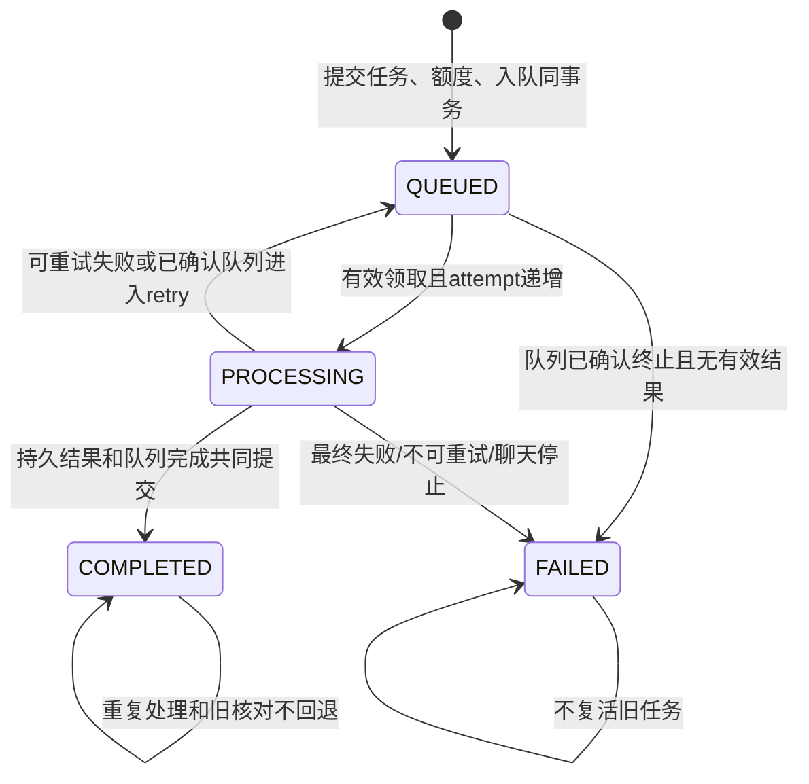

# R13 Worker任务终态与后台恢复验收说明

日期：2026-10-28。基线：R12 `77617168b20c46576fe7a63450a860d8582411bd`。分支：`refactor/r13-task-recovery`。开始时工作区干净，保留原提交历史。没有Schema/迁移、每日额度语义、模型适配器、Prompt、SSE协议或页面视觉变更；没有真实业务对象删除。

核对了《Formula重构.md》、R7/R8/R10/R12相关验收说明与实际Worker/队列源码。仓库仍没有独立命名的R0报告，不假称读过不存在的文件。

## 1. 原有规则与确认的问题

| 原实现                                             | 证据                                    | 本轮处理                                                    |
| -------------------------------------------------- | --------------------------------------- | ----------------------------------------------------------- |
| 成功结果和completeClaim同事务，按id+retryCount确认 | 三个Worker与queue/claim                 | 保留，并加强开始/提交时的有效性检查                         |
| 原失败更新已有PROCESSING/attemptCount条件          | R12 worker/lifecycle.recordFailure      | 保留；不能宣称原来所有迟到失败都会覆盖COMPLETED             |
| beginAttempt只检查业务行，没有先验证真实领取状态   | R12 worker/lifecycle.beginAttempt       | 先锁真实队列记录；无效、过期、不同尝试不能开始模型/转换工作 |
| 普通失败未touchClaim，队列fail依赖框架后续处理     | R12 worker/lifecycle.runTask            | 所有失败都核验执行权；可重试/最终失败与队列fail同事务提交   |
| beginAttempt允许同一attemptCount再次进入           | 原lte条件                               | 改为严格递增；相同领取重复调用不再次执行处理体              |
| GET/SSE核对在事务外findJobs，再修改业务            | R12 database/task-queries.reconcileTask | 锁内读取真实队列状态，与业务转换同事务；保留原导出入口兼容  |
| 失败回答在Worker、读取修复、停止生成中重复拼装     | lifecycle、task-queries、chat-progress  | 共用appendFailedAnswer，仍保留停止/重试的不同队列语义       |
| 仅用户访问时触发业务核对                           | scripts/worker无业务核对循环            | 启动先核对，随后独立周期扫描，与用户访问无关                |

静态审查定位了上述缺口；本轮53项真实隔离恢复测试验证修复后的边界，不把这些结论说成生产事故已经发生。

## 2. 实际状态图与业务差异

| 路径       | 识别                       | 聊天                                     | 导出                                |
| ---------- | -------------------------- | ---------------------------------------- | ----------------------------------- |
| 开始       | 清空失败字段、记录attempt  | 初始化本次片段及来源                     | 保留固定版本，申请R12文件许可       |
| 成功       | 创建公式与首版，不覆盖历史 | 一条COMPLETED回答和最终片段              | READY文件、任务fileId和完成共同提交 |
| 可重试失败 | QUEUED+errorCode           | QUEUED，片段到下一有效尝试才重置         | QUEUED，沿用本次文件补偿/核对规则   |
| 最终失败   | FAILED，无新公式           | FAILED，持久保存失败回答和可用片段       | FAILED，不制造可下载成品            |
| 用户停止   | 没有该操作                 | 继续使用FAILED；取消队列与失败回答同事务 | 没有该操作                          |

重要：队列completed表示“消费已确认”，不总代表业务成功。既有不可重试失败仍是业务FAILED、队列completed，避免队列继续重试。普通可重试失败对应retry；最后一次暂时失败对应failed。没有新增业务状态或修改每日额度退款规则。

## 3. 执行权、锁与事务

关键实现：`server/queue/record.ts:lockQueueRecord`、`queue/claim.ts:assertLiveClaim`、`worker/lifecycle.ts:beginAttempt/runTask`。

- 在固定pg-boss12.38.0/PostgreSQL适配点读取`pgboss.job`父表并FOR UPDATE，能锁住实际分区记录。
- 校验queue名、payload中的ownerId/taskId、active状态、retryCount和信号；以pgboss.job_now及其expire/heartbeat规则检查过期，不用客户端时间排列快照。
- pg-boss公开API及fromPrisma(tx)继续负责touch/complete/fail/cancel；没有直接改队列状态SQL或放宽fence。
- 锁顺序：聊天会话→队列记录→业务记录；识别队列→业务；导出保留R12资源锁/文件发布事务，在改任务前取得队列锁。S3和模型不在这些短事务中。
- beginAttempt只允许attemptCount严格增加，同一有效领取的重复调用不会再次开始处理。
- 完成保留原业务与队列共同提交。所有失败同样核验领取，失败业务更新与队列确认在同一事务中。框架外层再次fail因state/attempt围栏而不再生效。
- 聊天停止与完成争同一会话/队列锁，先提交者决定结果。对既有COMPLETED/FAILED重复停止直接返回，不再操作已完成队列。

部分适配器可能不及时服从取消信号；本轮保证其迟到结果不能写业务终态，不声称能撤销供应商已经发生的计算或计费。

## 4. 后台核对

`server/worker/recovery.ts:startTaskRecovery`在独立Worker启动时执行首轮核对，成功后才注册消费者。周期不重入；按id keyset保留游标、分批推进，前面的长任务不会一直挡住后面的异常任务。

| 实际队列事实                                           | 非终态业务的处理                                          |
| ------------------------------------------------------ | --------------------------------------------------------- |
| active（含刚到期但尚未监督）                           | 保留；到期由pg-boss监督决定retry/failed，不自行按年龄失败 |
| created/retry                                          | 合理的旧PROCESSING恢复QUEUED；尝试序号矛盾报告unresolved  |
| failed/cancelled，无完整结果                           | 原子FAILED；聊天只保存一条失败回答                        |
| completed，有同账号完整持久结果                        | 修复为COMPLETED，不创建新公式/消息/文件                   |
| completed，无完整结果                                  | FAILED并说明结果未确认，不重新调用模型                    |
| 业务已COMPLETED/FAILED                                 | 不变；旧恢复过程不覆盖终态                                |
| 队列缺失、身份不匹配、缺问题消息、有成品但队列确认矛盾 | unresolved保留，人工核对；不凭TTL推断、不删除成品         |

多个实例不需要新leader服务：在同一事务锁住队列记录并重读业务状态，第二个核对者观察终态后无操作。队列/数据库异常直接中止该轮，下一周期安全重试，不以不可用推断FAILED。日志仅输出数量或固定错误文案。

GET/SSE继续调用同一安全函数作为兼容回退，但不再是唯一入口；未声称GET已经完全无状态修复。没有新增模型任务、任务ID或额度操作。

启动/关闭使用停止信号和启动Promise屏障。退出先停止核对和等待当前短事务，再沿用pg-boss graceful stop，最后断开Prisma；启动期间收到停止不会继续注册消费者或留下周期定时器。

## 5. 配置、监督间隔与观测

`.env.example`增加：

| 配置                                     | 默认              |
| ---------------------------------------- | ----------------- |
| FORMULA_WORKER_RECOVERY_ENABLED          | true；可显式false |
| FORMULA_WORKER_RECOVERY_INTERVAL_SECONDS | 15秒              |
| FORMULA_WORKER_RECOVERY_BATCH_SIZE       | 每类每周期100项   |

周期与批次必须为1～3600的整数，非法配置在Worker连接前拒绝。测试启动器清除继承的FORMULA_WORKER配置。每周期结束后再等待下一个周期，不重叠执行。

实际库中superviseIntervalSeconds=5是唤醒间隔，内部monitorIntervalSeconds默认60秒，不是每5秒必然处理到期。本轮保留生产配置；后台周期还受队列监控准入、扫描规模和数据库可用性影响，不保证15秒内任何故障都能完成恢复。测试客户端单独使用1秒monitor间隔，旧崩溃测试改为先观察真实retry，再领取，没有修改生产重试或保留策略。

## 6. R12边界

任务恢复不更新ResourceLease，不删除StoredFile或S3对象，不释放容量，不根据任务FAILED判定旧写入已停止。导出成功仍在R12发布事务里共同完成，丢失提交响应后保留READY成品；失效尝试的补偿仅按R12规则处理本次对象。

真实隔离测试构造PENDING导出对象与ACTIVE许可后终止队列，核对将任务FAILED，但许可、PENDING元数据和实际S3对象均保留。

建议单独R12.1补丁：给已有reconcileExpiredLeases提供独立、可禁用的资源核对调度；默认仅撤销过期token/标核对，不自动释放或删除。上传未必已经有业务任务，不能把两种生命周期硬绑定；释放未知占用还需证明旧执行者已停止或确认写入结果。本轮未实施这个资源调度补丁。

## 7. 测试与复现证据

R1运行编号：`9bb39157-1c32-42e4-9ae5-ef3249a33965`。PostgreSQL15432、API3100、S3端口18333，清单/容器/API身份校验先于连接；未消费开发队列。只部署了既有8份迁移，没有新迁移。

| 检查                                              | 结果/范围                                                                              |
| ------------------------------------------------- | -------------------------------------------------------------------------------------- |
| test:recovery                                     | 53/53；真实隔离数据库、队列和对象存储                                                  |
| 定向真实boss.work回调                             | 3/3；同一Worker客户端完成事务确认，框架重复失败不额外重试/扣额                         |
| test:jobs                                         | 27/27；实际API、SSE、停止、Word下载、固定版本、旧Worker与额度幂等                      |
| test:resources                                    | 20/20；R12容量、租约、补偿、清理竞争与防误删                                           |
| test:workspace                                    | 21/21；上传识别、权限、历史版本及R6.1并发保护                                          |
| test:unit                                         | 79/79；含后台策略、禁用、启动失败、启动中停止                                          |
| test:protocols                                    | 20/20；LangChain和Python协议仅连接本机HTTP替身，含真实流读取超时/取消                  |
| 真实浏览器终态回归                                | 390/1440px，失败恢复及正常完成两种会话，17项断言通过；真实隔离API/数据库，模型为Mock   |
| typecheck / check:assets / 本轮文件格式与diff检查 | 类型通过；资源0缺失；格式按修改范围检查                                                |
| check:build / 客户端私有配置扫描                  | 生产构建和当前源码指纹校验通过，扫描全部147个客户端产物；tmp/r13-build.log记录实际执行 |

三类任务分别覆盖：完成及重复执行、已失效领取拒绝开始、旧失败晚到、三次超时/最终失败、领取前/后/开始后的真实进程退出、独立恢复进程无详情GET/SSE收敛、两个数据库/队列客户端竞争恢复、提交成功后响应丢失、领取真正过期、完整Worker消费与关闭、已存在结果的状态修复、队列缺失、同一有效领取重复调用、处理中到期、停止信号与结果交错、真实boss.work外层重复确认。

聊天额外覆盖6组停止/完成竞争、周期游标推进、关闭后不再恢复、两个后台循环同时运行、核对失败后重新可用。R12额外覆盖未知文件占用保留。

故障层次：进程退出是真实子进程exit；队列和数据库事务是真实；提交响应丢失/暂时服务失败/队列不可用使用受控包装器注入；模型适配器是Mock或本机替身，没有付费模型调用。停止信号采用AbortSignal及真实消费者graceful stop；未在Linux主机验证SIGTERM/SIGKILL和网络分区，不能把Windows本机结果外推为完整生产验收。

首轮3项崩溃时序测试受pg-boss监控间隔影响；修正测试实例间隔并观察真实队列状态后通过。旧jobs崩溃用例同样消除了与前一测试监督时间的耦合，保留原恢复断言。普通沙箱下本机协议连接受限，允许本机网络后20项通过，未更改模型适配器或降低断言。

没有重跑R3—R10整站截图/浏览器矩阵。生产UI和客户端协议未改；额外进行了390/1440px真实终态浏览器检查，但不将它宣称为全站视觉重新验收。没有开发/生产数据库破坏性测试、真实对象清理、真实模型或容量压测。

## 8. 修改文件与职责

| 文件                                                                                           | 修改原因                                                               |
| ---------------------------------------------------------------------------------------------- | ---------------------------------------------------------------------- |
| server/queue/record.ts（新）                                                                   | 固定版本的队列行锁、状态/期限与payload读取适配点                       |
| server/queue/claim.ts                                                                          | 开始/片段/完成/失败共同使用的有效执行权检查                            |
| server/database/task-lifecycle.ts（新）                                                        | 明确的共同查询、聊天会话锁、失败转换和失败回答                         |
| server/database/task-reconciliation.ts（新）                                                   | 原子队列事实核对、保守异常分类与已有结果恢复                           |
| server/database/task-queries.ts                                                                | 保留DTO读取与原reconcileTask导出，移除旧核对重复实现                   |
| server/database/chat-progress.ts                                                               | 复用失败回答，重复停止不操作已终态队列                                 |
| server/worker/lifecycle.ts                                                                     | 有效领取开始、严格attempt递增、失败事务共同确认                        |
| server/worker/recognition.ts                                                                   | 先锁领取并条件完成，再保存公式/确认队列                                |
| server/worker/chat.ts                                                                          | 初始化也核验领取，显式归属条件，保留原Prompt与完成事务                 |
| server/worker/export.ts                                                                        | R12发布回调中先核验领取，按当前尝试完成                                |
| server/worker/recovery.ts（新）                                                                | 启动+周期、公平批次、停止和异常重试                                    |
| scripts/worker.ts                                                                              | 接入后台核对及启动/关闭屏障                                            |
| .env.example                                                                                   | 三项服务端配置及真实监控间隔说明                                       |
| package.json、scripts/test-suite.ts                                                            | test:recovery命令及单元/集成登记，无新依赖                             |
| tests/support/test-runtime.ts                                                                  | 测试不继承生产Worker配置                                               |
| tests/support/queue-client.ts（新）                                                            | 两组测试共用明确的R1监督时序配置                                       |
| tests/jobs.test.ts                                                                             | 原崩溃断言保留，改为观察真实队列retry后重领                            |
| tests/task-recovery.test.ts（新）                                                              | 三类任务及多实例真实故障矩阵                                           |
| tests/task-recovery-policy.test.ts（新）                                                       | 纯配置和启动/停止安全边界                                              |
| tests/fixtures/r13-worker-process.ts（新）                                                     | 受控退出、独立后台恢复和完整消费者进程                                 |
| tests/fixtures/r13-browser-state.ts、tests/design-preview/check-task-recovery-browser.js（新） | 受控临时账号、后台终态准备和真实API浏览器检查；凭据仅写入忽略的本机tmp |
| docs/R13任务恢复实施计划.md、本文                                                              | 审查方案、状态、证据、限制与交付说明                                   |

没有引入通用任务框架、Redis、新数据库表或新的状态管理层。失败转换确实共用；成功产物、取消与R12补偿保持业务独立。

## 9. 风险、回滚与安全同步

- 本适配点依赖已锁定的pg-boss12.38.0及pgboss schema字段，升级必须回归队列行锁、期限和payload校验。
- 缺失队列或矛盾的持久结果默认保留并报告unresolved，不能保证任意人工破坏的数据都自动修好。
- 多实例核对保护的是持久业务状态。外部模型请求在进程崩溃后可能重发，无法承诺供应商恰好一次计费；每日业务额度未重复。上游重试/计费审计继续归R14。
- R14继续处理失败轮次Prompt、模型重试与SSE快照序号/成本，不在本轮混做。
- 生产批次/监督间隔、Linux信号和故障恢复时限需R17压测与部署验证；没有性能承载保证。

没有Schema迁移，代码回滚基线为R12 `77617168b20c46576fe7a63450a860d8582411bd`。停掉新Worker后可切回基线、重新构建；已经提交的正确终态/公式版本/文件不回写或删除。紧急时可配置FORMULA_WORKER_RECOVERY_ENABLED=false停用新增后台循环，但GET/SSE兼容核对仍保留；不要用开关绕过执行权保护。

Git保留本机原历史，根仓库不直接配置推送远端。提交后使用独立副本过滤docs/设计稿、docs/验收证据、docs/R*验收记录.json；核对保留Blob及完整历史秘密，再验证相对已发布main的快进关系。不强推，不把包含旧排除材料的原始分支直接上传。最终提交、Diff数量和过滤核对结果见交付会话。R13完成后停止，不自动进入R14。
