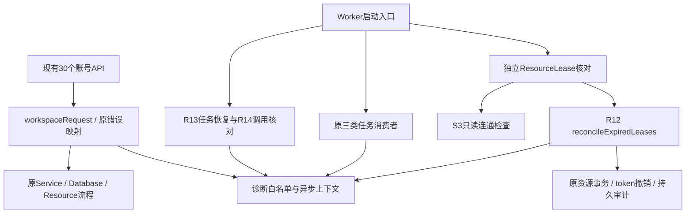

# R15 服务端职责、诊断与独立租约核对

日期：2026-10-28。基线：R14 `06b9b88a2a62b39997a9996cc3efa13a4a6b7c0e`。分支：`refactor/r15-server-reliability`，开始时工作区干净。没有修改Prisma Schema、增加迁移、变更API响应体、改UI或执行开发/生产数据清理。

## 1. 服务端职责审查

| 现状                     | 证据与结论                                                                                                                                                 |
| ------------------------ | ---------------------------------------------------------------------------------------------------------------------------------------------------------- |
| API主要是HTTP边界        | server/api/account已有requireAccountWriter、输入校验和workspaceOperation；保留业务体，只替换请求薄封装                                                     |
| Service编排有明确用途    | services/image-upload.ts组织准入、图片规范化和资源发布；profile.ts组织资料CAS与头像替换；没有理由重写成类                                                  |
| 数据库/队列跨层是必要的  | database/conversations.ts、task-submissions.ts调用queue/enqueue，以共用额度与pg-boss入队事务；拆出去会破坏原子性                                           |
| Worker和资源发布回调保留 | worker/export.ts通过资源发布回调在同事务内核验执行权、绑定文件并确认队列；不机械拆成几个独立Service调用                                                    |
| Adapter隔离合理          | chat/deepseek-adapter.ts不依赖Prisma；storage/object-store.ts隔离S3；诊断模块也不依赖模型、数据库或H3                                                      |
| Shared存在合理双协议     | shared/types/api.ts包含游客演示和适配器数据；tasks.ts是账号持久化任务/会话。小写游客状态和大写业务状态不能强行统一；R14 revision仍为字符串                 |
| 轻度HTTP耦合保留         | services/profile-input.ts等抛WorkspaceError(statusCode,message)，由workspace-operation统一映射。当前单体足够清楚；没有为形式另建DomainError/Repository体系 |
| 目录历史问题后置         | RecognitionAdapter位于services，Python实现位于recognition，实际依赖清楚且仍在使用，不为改名移动文件                                                        |

R12许可/文件、R13业务任务/队列、R14调用尝试/revision回答不同问题，不能合成一个状态来源。R15日志只表达观察，不作为资源计量、任务状态或费用的第二套真相。

## 2. 已确认问题与最小修复

| 优先级 | 问题与证据                                                                               | 处理                                                              |
| ------ | ---------------------------------------------------------------------------------------- | ----------------------------------------------------------------- |
| P2     | R12 reconcileExpiredLeases仅有scripts/resource-audit.ts手动入口，没有启动/周期/停止调度  | 独立lease-recovery控制器，复用原事务                              |
| P2     | workspace-operation、queue/client、worker/recovery、scripts/worker使用无法关联的通用日志 | 安全字段白名单、错误码分类、HTTP请求/业务标识关联                 |
| P2     | task恢复只有总数；调用审计和清理审计缺少安全日志关联                                     | 仅变化/未决时记录taskId、callId、leaseId、auditId等，不改状态规则 |
| P3保留 | 两种恢复计时、不同准入/发布参数、少量同形循环                                            | 语义、依赖和失败边界不同，不抽成万能管理器                        |

R15原型自审还发现连接池错误若继承创建连接时的异步上下文，可能误归属旧账号；已在提交前增加显式脱离上下文和单元测试。这不是声称R14已有账号数据泄漏。

## 3. 修改前后依赖

此前：HTTP通用错误包装、Worker/队列各自日志，租约核对只有手工调用。

现在：业务调用方向不变，新增一个只负责诊断的叶模块和独立资源定时控制器。



显式源码导入检查：121个文件，386条运行时导入、345条内部边，排除91条类型导入，未发现环。方法是TypeScript AST读取，不执行项目模块；外部包、生成代码和Nuxt自动导入不在该静态证明范围。脚本和报告保存在本机tmp/r15-import-audit.cjs/json，正式CI化可由R16决定。

## 4. 独立租约核对及安全规则

| 配置                                             | 默认值 | 范围/含义                                   |
| ------------------------------------------------ | ------ | ------------------------------------------- |
| FORMULA_RESOURCE_RECONCILIATION_ENABLED          | true   | true/false；仅控制新租约核对                |
| FORMULA_RESOURCE_RECONCILIATION_INTERVAL_SECONDS | 60     | 整数1..3600；上一轮结束后等待该间隔         |
| FORMULA_RESOURCE_RECONCILIATION_BATCH_SIZE       | 100    | 整数1..500；每轮上限，手动函数默认500仍保留 |

配置在创建Worker客户端前校验，错误不会被解释成无限制。禁用控制器不访问数据库或存储；整个Worker原本就需要对象存储，因此禁用此控制器不等于Worker不再依赖S3。

启动前完成一次核对，之后独立计时。先做只读存储连通检查，再按id顺序选到期ACTIVE租约。原resourceTransaction继续使用全局→账号锁；锁内以ACTIVE和到期条件CAS更新，换executionToken并写StorageCleanupAudit。两实例重复选择同一行也只有一次有效转换及审计。

**只转REVIEW_REQUIRED，reservedBytes、fileId、文件体积和上传槽位计量均不释放。** 不调用对象HEAD/GET/LIST/PUT/DELETE，不把Bucket连通等同于对象存在或写入停止。没有新增后台清理任务。

已标记行不再属于ACTIVE候选，健康批次能继续推进；停止信号在读取前和每条事务前检查，已经开始的事务完整结束。控制器stop取消后续计时并等待在途操作。scripts/worker.ts保留R13启动屏障，分别启动/停止两种控制器，之后才关闭队列和数据库。

启动依赖失败则不注册消费者；周期失败中止本轮，保留所有不确定状态，下一周期再试，不重叠、不无限快速重试。SDK自身既有网络超时/有限重试保持，因此正在进行的连通检查不会被stop瞬间中断；stop会等待其返回后停止，Linux关闭预算留给R17。

## 5. 诊断规则与可追踪边界

- HTTP新生成服务端UUID，返回X-Request-Id，忽略传入的不可信同名值；业务响应体和状态码保留。
- 请求、任务和后台批次使用独立AsyncLocalStorage入口；账号确认后记录UUID的摘要ownerRef，不输出原ownerId/邮箱/昵称。
- HTTP→异步Worker通过持久taskId关联，不伪造跨进程HTTP上下文。Worker记录jobId、attempt；ChatCallAttempt使用callId；资源使用leaseId/fileId，清理审计使用auditId/operationId。
- 成功GET/SSE/片段不逐次记录；下载完成和写入、错误边界记录。后台任务只对变化/未决项记录；空闲租约轮次不打印成功心跳。
- 复用连接的基础设施错误显式不继承旧请求，避免错误账号归属。
- 只输出枚举阶段、可信错误码、UUID及有界数字；不序列化Error、请求、Headers、Prompt、图片、对象key或私有地址。
- storage.audit的observed表示事务内观察，可能回滚；committed只用于事务返回后的边界。日志不是持久账本，提交结果不确定仍按R12—R14规则保留，不凭日志释放或退款。
- 未决任务使用TASK_RECONCILIATION_UNRESOLVED；未知模型结果使用CALL_OUTCOME_UNKNOWN，不凭此声称供应商失败或未计费。

Nuxt开发控制台会为JSON诊断payload加前缀，生产收集格式/解析在R17配置，不宣称所有开发输出已是纯JSONL。白名单需要随合法新错误码维护，未知码为UNCLASSIFIED；这是明确的维护成本，没有新增大型追踪设施。

真实R1日志已按相同taskId关联HTTP提交、Worker attempt和ChatCallAttempt，按leaseId/auditId关联租约与持久审计；证据在tmp/r15-diagnostic-evidence.json。示例在文末，来自受控fixture，不含用户内容。

## 6. 实际验证

专用R1运行编号：b9eaa4d8-7c48-45da-a843-6c0928220442。数据库、队列、API和S3均通过原有身份守卫；测试默认Mock，不继承根.env。只应用既有9项迁移，没有R15迁移。

| 检查                                | 结果与证据                                                                                                         |
| ----------------------------------- | ------------------------------------------------------------------------------------------------------------------ |
| test:unit                           | 93/93；新增诊断白名单/并发归属/脱离父上下文及调度配置/失败/停止测试；tmp/r15-unit-final.log                        |
| test:protocols                      | 21/21；本机HTTP替身，无付费调用；tmp/r15-protocols-final.log                                                       |
| test:lease-recovery                 | 9/9；真实PG/S3，含实际Worker入口；tmp/r15-leases2.log                                                              |
| test:integration                    | 203/203，已包含上述9项，不重复相加；因公共边界覆盖30个API，完整回归R6.1/R12/R13/R14；tmp/r15-integration-final.log |
| typecheck                           | Nuxt和测试/服务端TS通过；tmp/r15-types-final.log                                                                   |
| check:assets                        | 0项缺失；tmp/r15-assets.log                                                                                        |
| 修改文件Prettier / git diff --check | 通过，未批量格式化无关文件                                                                                         |
| check:build                         | 隔离生产构建及147个公开产物的私有标记扫描通过；tmp/r15-build-final.log                                             |
| 边界检查                            | prisma/app/shared均无Diff；无新依赖，无package-lock变动                                                            |

资源测试覆盖：到期发现、双实例/重复幂等、真实上传槽位仍受限、READY/未来有效许可不变、PENDING计量保留、S3响应不确定、数据库失败、旧执行者实际迟到PUT、独立进程重启继续剩余批次、真实HTTP请求头和任务调用关联。

故障层次明确：DB/S3使用真实隔离实例；数据库事务不可用通过受控包装器注入，未关闭真实数据库；S3先真实连通检查再注入不确定响应；后台对象操作用拒绝代理证明没有隐式删除/读取。独立子进程正常重启验证持久进度；实际Worker入口通过IPC注入内部SIGTERM事件验证关闭屏障，不冒充Linux OS信号测试。

测试阶段一次日志关联提取失败，原因是Nuxt dev前缀导致直接JSON.parse整行失败；修正本地证据解析后关联验证通过，没有修改业务代码或放宽业务断言。

## 7. 修改文件和原因

30个现有账号API只更换导入名及薄封装调用，**每文件2行替换**，业务体不动；具体名单附后。

| 文件                                      | 原因                                                           |
| ----------------------------------------- | -------------------------------------------------------------- |
| server/diagnostics/operations.ts（新）    | 类型化上下文、字段白名单、安全错误分类及可脱离上下文的输出     |
| server/utils/workspace-operation.ts       | 请求上下文和安全HTTP边界；保留原业务错误映射，避免重复错误日志 |
| server/utils/auth.ts                      | 身份确认后只向诊断上下文登记账号UUID，不改鉴权                 |
| server/resources/lease-recovery.ts（新）  | 独立、可禁用、可停止的安全周期核对                             |
| server/resources/cleanup.ts               | 原核对函数增加批次/顺序/停止点与诊断，不改计量/删除语义        |
| server/resources/leases.ts                | 预留事务返回后的leaseId关联                                    |
| server/resources/files.ts                 | 文件准备返回及持久审计观察关联，不改变原发布事务               |
| server/database/chat-calls.ts             | 仅在UNKNOWN转换提交后补调用标识诊断，原claim/队列条件不变      |
| server/worker/lifecycle.ts                | 三类任务共享诊断上下文，开始/返回/失败/失去执行权边界日志      |
| server/worker/chat.ts                     | 关联准备/完成的callId，不记录消息/Prompt/片段                  |
| server/worker/recovery.ts                 | 变化/未决项和失败阶段的安全诊断，任务恢复规则不变              |
| server/queue/client.ts                    | 连接故障使用安全码，脱离旧请求上下文                           |
| scripts/worker.ts                         | 独立控制器的启动/关闭屏障和配置说明                            |
| .env.example                              | 新控制器三项服务端配置，明确不释放/删除                        |
| package.json、scripts/test-suite.ts       | 注册test:lease-recovery和单元/集成组，无依赖变更               |
| tests/server-diagnostics.test.ts（新）    | 5项安全字段/异步归属/输出失败保护                              |
| tests/lease-recovery-policy.test.ts（新） | 4项配置、禁用、依赖失败、周期重试和停止保护                    |
| tests/lease-recovery.test.ts（新）        | 9项真实资源与请求诊断测试                                      |
| tests/fixtures/r15-lease-process.ts（新） | 独立受控租约核对进程，不消费队列                               |
| tests/fixtures/r15-worker-entry.ts（新）  | 真实Worker入口的内部信号注入与ready元数据                      |
| 本文、R15服务端审查与实施计划.md          | 审查、职责、安全不变量、测试限制和交付                         |

## 8. 未执行及剩余风险

- 未执行R3—R10整站截图/浏览器矩阵：本轮没有前端改动，真实HTTP和集成回归覆盖边界。
- 未执行开发/生产迁移、用户对象清理、真实付费模型、Linux OS信号/kill -9或生产网络故障。
- 未模拟所有Prisma迁移/网络故障组合，本轮没有新迁移；没有将包装器故障称为物理数据库断网。
- REVIEW_REQUIRED仍消耗容量和槽位，极端情况下可持续阻塞上传；必须由后续可信核对/人工运维处理，不可用TTL放开。
- 多实例会重复只读检查/候选扫描，依靠SQL条件转换保证幂等，不宣称集群恰好一次调度。
- 日志白名单与归属测试不能替代访问控制、正式日志脱敏审核或生产监控；日志仍需访问限制和保留期限。

## 9. R16准备

已登记可重现命令：test:unit、test:protocols、test:lease-recovery、test:integration、typecheck、check:assets、check:build。CI必须先创建R1资源，显式传入同一manifest，启动测试API后再运行集成；不能回退根.env。原有FORMULA_RESOURCE_配置清理已经覆盖新开关。

R16可将静态导入检查正式纳入版本管理、统一测试结果/日志归档、设置Worker子进程超时和失败证据保留。不要把本机tmp目录当作可从Git复现的CI脚本，也不要删除旧断言获得全绿。

## 10. R17遗留

正式JSON日志收集、Grafana/Prometheus/Loki、指标/告警/采样、账号摘要关联访问权限；日志与ResourceLease/ChatCallAttempt/清理审计长期留存；S3健康检查频率、全局资源锁和多实例批次压力；Node/S3关闭预算、Linux信号与时钟条件；长期未知对象/执行者的人工核对SOP。没有引入新技术框架，也不宣称零维护成本或零技术债。

## 11. Git、安全同步及回滚

实现与测试提交：`7f97ab52b2cae4f5f4c64d81b951554100987e37`，审查和验收文档另作提交。

保留原始本地历史；根仓库不配置可误推的remote。独立发布副本继续过滤设计稿、验收图片和R*验收记录JSON，检查保留Blob、凭据特征及相对远端main/过滤R14的快进关系。具体提交和过滤结果在交付会话，不强推原始历史。

回滚先停止新Worker并等待两个核对控制器/在途事务结束，再回退R15代码至R14基线或revert本轮提交。没有Schema回滚；已经转REVIEW_REQUIRED的合法记录继续保留，不恢复旧token、不自动释放或删除。R14仍能理解这些原有R12状态；保持所有写入者具备R14 revision能力，不能回到未支持revision的旧混合部署。

完成后停在R15，等待评审，不自动进入R16，不自动部署或推送。

## 12. API名单与诊断示例

```text
server/api/account/avatar.get.ts
server/api/account/categories/[id].delete.ts
server/api/account/categories/[id].patch.ts
server/api/account/categories/index.get.ts
server/api/account/categories/index.post.ts
server/api/account/chat-settings.get.ts
server/api/account/conversations/[id].get.ts
server/api/account/conversations/[id]/events.get.ts
server/api/account/conversations/[id]/messages.post.ts
server/api/account/conversations/[id]/turns/[turnId]/cancel.post.ts
server/api/account/conversations/index.get.ts
server/api/account/conversations/index.post.ts
server/api/account/exports/[id].get.ts
server/api/account/exports/[id]/download.get.ts
server/api/account/exports/index.post.ts
server/api/account/files/[id]/content.get.ts
server/api/account/files/index.post.ts
server/api/account/formulas/[id].get.ts
server/api/account/formulas/[id]/category.put.ts
server/api/account/formulas/[id]/favorite.put.ts
server/api/account/formulas/[id]/versions.post.ts
server/api/account/formulas/index.get.ts
server/api/account/library.get.ts
server/api/account/profile.patch.ts
server/api/account/recognitions.get.ts
server/api/account/recognitions.post.ts
server/api/account/service-status.get.ts
server/api/account/tasks/[id].get.ts
server/api/account/usage.get.ts
server/api/account/versions/[id].get.ts
```

以下为受控R1日志中的真实payload；开发输出的Nuxt前缀已去掉。HTTP和Worker通过taskId关联，Worker事件再关联callId；ownerRef不是原始账号ID。

```json
{"event":"http.operation","requestId":"beba205c-4cf4-44bb-b06b-309f59b79c60","taskId":"fb0f07fc-746f-4fdb-b41e-632329798625","resourceId":"fb0f07fc-746f-4fdb-b41e-632329798625","ownerRef":"c0e414b6a0a6f584","status":202,"durationMs":241,"stage":"request","operation":"chat","outcome":"returned"}
{"event":"worker.attempt","taskId":"fb0f07fc-746f-4fdb-b41e-632329798625","jobId":"0b4be417-dd00-4978-891e-4b06f366e285","ownerRef":"c0e414b6a0a6f584","attempt":1,"operation":"chat","outcome":"started"}
{"event":"chat.call","taskId":"fb0f07fc-746f-4fdb-b41e-632329798625","jobId":"0b4be417-dd00-4978-891e-4b06f366e285","callId":"30f74507-274c-4e51-a832-587bfaeef292","ownerRef":"c0e414b6a0a6f584","attempt":1,"stage":"prepared","operation":"chat","outcome":"committed"}
{"event":"storage.audit","leaseId":"89223665-a0d9-4c18-8d92-46a42b5190cd","auditId":"c5a166ba-d128-4e83-beac-c26b42e57227","operationId":"89223665-a0d9-4c18-8d92-46a42b5190cd","ownerRef":"c77026638ee0eaf0","stage":"audit","operation":"lease-recovery","outcome":"observed","auditAction":"LEASE_REVOKE","auditOutcome":"REVIEW_REQUIRED"}
```
