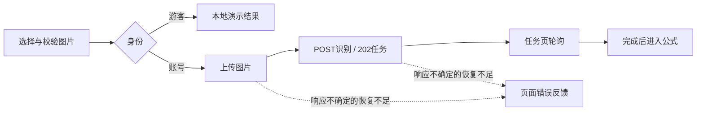
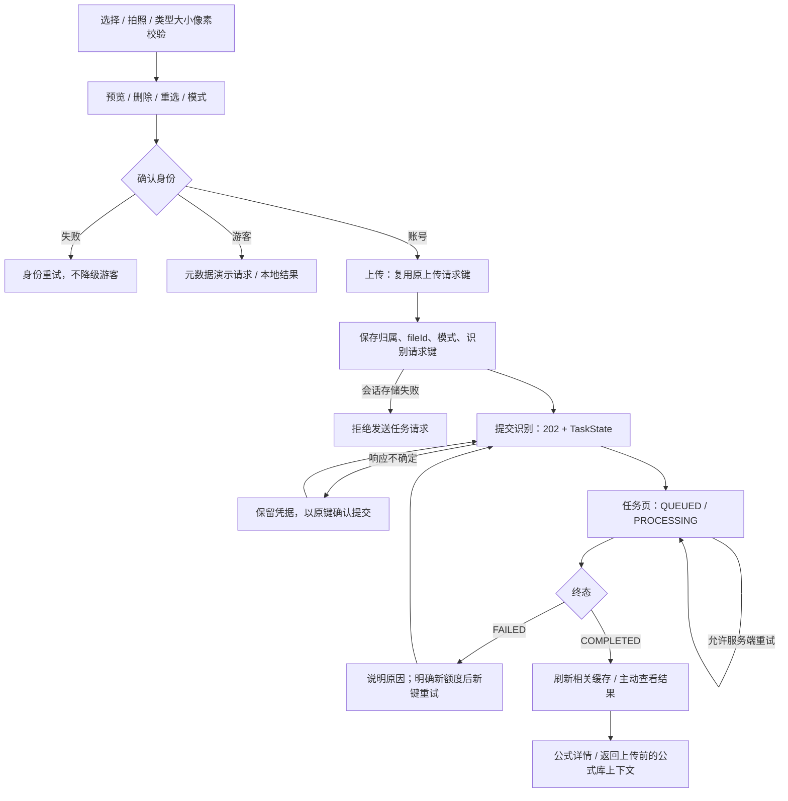

# R7 上传与公式识别重构及验收说明

日期：2026-10-27。基础提交：`2e484165b43e8766c5284f7705a38ee4912efc40`（R6.1）。分支：`refactor/r7-upload-recognition`。

R7 已完成实现及下述验证，停止等待评审，不进入 R8。未修改服务端业务、Schema、额度事务、Worker、模型服务或全站设计 Token。独立 R0 报告文件未找到；核对的是《Formula重构.md》、现存 R2—R6.1 文档及实际代码，不能把历史静态报告当成当前验证结果。

## 1. 业务流程和状态

原流程已经是异步识别，本轮没有将同步接口改成异步接口。

修改前：

修改后：

| 状态                      | 页面反馈及可执行操作                                               |
| ------------------------- | ------------------------------------------------------------------ |
| Session 待确认 / 失败     | 等待账号确认或重试身份；锁定正式提交，不伪装游客                   |
| 未选图 / 校验失败         | 选择、拍照；错误说明；不可提交                                     |
| 已选图                    | contain 预览、文件名大小、删除重选、手写/印刷模式                  |
| 上传中 / 提交中           | 两阶段文案，重复点击受限，离页取消前端等待                         |
| 提交未确认                | 锁定原图片和模式，使用原请求键确认；刷新后可恢复已知 fileId 的凭据 |
| QUEUED / PROCESSING       | 真实服务器状态和尝试次数，无虚构百分比或模型内部步骤               |
| FAILED                    | 本次没有公式结果；手动刷新；说明新任务会使用新额度                 |
| COMPLETED                 | 明确结果入口，不由后台完成事件强行导航                             |
| 网络错误 / 401、403 / 404 | 区分网络恢复、登录和不存在/不可访问；不暴露他人任务                |

上传和任务页继续保持原有“不展示底部导航”的页面配置；没有建立第二套导航。结果入口只调整这条完成路径的返回来源，并使用既有共享安全路径校验，不修改 R3 全局兼容规则。

## 2. 文件与职责

下表覆盖源码、测试与说明文件；另有截图目录 47 张 PNG。完整提交清单可通过 `git show --stat HEAD` 查看。

| 文件                                                                | 原因与职责                                                                                 |
| ------------------------------------------------------------------- | ------------------------------------------------------------------------------------------ |
| `app/pages/upload.vue`                                              | 页面组合、明确身份、上传/演示流程和局部响应布局，保留相机与全部原校验能力                  |
| `app/pages/recognitions/[id].vue`                                   | 身份/路由边界；按 owner + task 挂载，保留旧任务地址兼容                                    |
| `app/components/UploadImageCard.vue`                                | 纯预览及选择操作展示，无隐藏业务请求                                                       |
| `app/components/AccountRecognitionTask.vue`                         | 账号任务读取、快照接受、刷新/重试/结果入口与识别范围缓存协调                               |
| `app/components/RecognitionSteps.vue`                               | 对应真实任务阶段；失败不再显示为等待结果                                                   |
| `app/components/TaskProgress.vue`                                   | 可选紧凑展示，区分失败错误与重试说明；原导出默认展示保留                                   |
| `app/components/AccountUsage.vue`                                   | 可选账号作用域缓存，避免跨账号及过期额度反馈                                               |
| `app/composables/useAccountRecognition.ts`                          | 上传、提交、请求键、恢复凭据、身份/卸载失效与失败任务新键重试                              |
| `app/composables/useImageSelection.ts`                              | 文件校验、异步解码代次、删除及临时 Object URL 释放                                         |
| `app/plugins/upload-draft.ts`                                       | 内存 File/上传中间态与有界会话恢复凭据；确认身份后清理                                     |
| `app/pages/settings.vue`                                            | 仅将原退出时的上传草稿清理统一为 clearAccountState，覆盖新增恢复凭据，无视觉或登录流程改造 |
| `app/utils/recognition-state.ts`                                    | 可独立测试的凭据解析、任务快照规则、识别范围缓存失效和结果来源计算                         |
| `tests/recognition-state.test.ts`                                   | 7 项纯规则测试                                                                             |
| `scripts/test-suite.ts`                                             | 纳入上述单元测试                                                                           |
| `tests/jobs.test.ts`                                                | 新增真实隔离的旧请求重放/失败任务重试/额度断言，保留原业务断言                             |
| `tests/design-preview/recognition-fixtures.ts`                      | 明确 cookie 启用的受控内存 API，模拟身份、错误、丢失响应和状态顺序；未命中请求拒绝外连     |
| `tests/design-preview/session-middleware.ts`                        | 仅测试层注册 R7 受控 API                                                                   |
| `tests/design-preview/app/middleware/recognition-preview.global.ts` | 仅隔离预览层启用身份测试工具                                                               |
| `tests/design-preview/check-recognition-browser.js`                 | 真实浏览器交互、请求计数、乱序、资源释放、身份和六种视口断言                               |
| `tests/design-preview/create-recognition-images.mjs`                | 用已有 sharp 生成可复现的横图、长图及非法测试文件，不引入外部素材                          |
| `docs/R7上传识别实施计划.md`、本文                                  | 实施边界、状态、验收与未解决事项                                                           |
| `docs/设计稿/R7上传识别/`                                           | 47 张真实 Chromium 截图，包含修改前后和异常状态                                            |

## 3. 一致性、恢复和资源生命周期

- 同一次上传意图沿用上传键；拿到 fileId 后先持久化识别键，再发送任务 POST。未知响应、网络异常或取消不直接换键创建任务。HTTP 自动重试关闭。
- 已确认 FAILED 的“重新提交”是新任务，明确使用新额度；若这个新请求结果又不确定，则继续使用其原键确认，而不是再生成任务。
- 会话恢复仅保存 ownerId、fileId、mode、requestKey、可选 sourceTaskId；最大 20 条，验证格式和重复身份。File、Blob、Object URL、令牌、存储密钥不进入会话存储。存储拒绝写入时，在任务 POST 前阻断。
- File 与预览归内存草稿所有，可跨 SPA 跳转；临时解码 URL 在替换、删除、卸载时释放。最终预览由既有预览管理器替换/清理，游客结果后再次进入上传时清理。异步解码、上传和任务回调均受代次/身份/卸载保护。
- Session pending/error 不提前清空未知归属的恢复信息；确认退出或切换账号后过滤原账号凭据并释放私有草稿。设置页退出调用同一清理动作。
- 任务读取串行且受身份控制；拒绝不同资源、较低尝试次数，终态稳定；保留服务端合法 `PROCESSING → QUEUED` 重试，不能机械按状态排序。
- 仅集中识别相关失效规则：提交刷新历史、额度和概览；状态变化刷新历史；完成刷新公式库、首页最近公式和分类概览。首页展示语义仍是“最近公式”，不是新增实时任务模块。未改成全站缓存框架。

## 4. 视觉验收与截图

移动端先完成 320、390、430 单列布局；之后验收 768、1024、1440。采用已有 reading 容器，900px 起上传内容分预览与设置两区，全站默认宽度不变。纸页装饰在网格内约束，未使用全局 overflow hidden 掩盖溢出。操作目标至少 44px；长图 contain 显示，文件名可换行。

以下均是浏览器真实截图，业务数据来自明确的内存替身，不能代表真实 Python 推理或浏览器到真实数据库的端到端验收。

| 宽度 | 上传修改前 / 后                                                                         | 已选图修改前 / 后                                                                       |
| ---- | --------------------------------------------------------------------------------------- | --------------------------------------------------------------------------------------- |
| 320  | [前](设计稿/R7上传识别/上传修改前320.png) / [后](设计稿/R7上传识别/上传修改后320.png)   | [前](设计稿/R7上传识别/预览修改前320.png) / [后](设计稿/R7上传识别/预览修改后320.png)   |
| 390  | [前](设计稿/R7上传识别/上传修改前390.png) / [后](设计稿/R7上传识别/上传修改后390.png)   | [前](设计稿/R7上传识别/预览修改前390.png) / [后](设计稿/R7上传识别/预览修改后390.png)   |
| 430  | [前](设计稿/R7上传识别/上传修改前430.png) / [后](设计稿/R7上传识别/上传修改后430.png)   | [前](设计稿/R7上传识别/预览修改前430.png) / [后](设计稿/R7上传识别/预览修改后430.png)   |
| 768  | [前](设计稿/R7上传识别/上传修改前768.png) / [后](设计稿/R7上传识别/上传修改后768.png)   | [前](设计稿/R7上传识别/预览修改前768.png) / [后](设计稿/R7上传识别/预览修改后768.png)   |
| 1024 | [前](设计稿/R7上传识别/上传修改前1024.png) / [后](设计稿/R7上传识别/上传修改后1024.png) | [前](设计稿/R7上传识别/预览修改前1024.png) / [后](设计稿/R7上传识别/预览修改后1024.png) |
| 1440 | [前](设计稿/R7上传识别/上传修改前1440.png) / [后](设计稿/R7上传识别/上传修改后1440.png) | [前](设计稿/R7上传识别/预览修改前1440.png) / [后](设计稿/R7上传识别/预览修改后1440.png) |

任务页：[修改前](设计稿/R7上传识别/任务修改前390.png)、[排队](设计稿/R7上传识别/任务-account390.png)、[处理中](设计稿/R7上传识别/任务-processing390.png)、[完成](设计稿/R7上传识别/任务-completed390.png)、[失败](设计稿/R7上传识别/任务-failed390.png)、[网络错误](设计稿/R7上传识别/任务-network-task390.png)、[无权限](设计稿/R7上传识别/任务-forbidden390.png)、[不存在](设计稿/R7上传识别/任务-notfound390.png)。

流程截图：[上传中](设计稿/R7上传识别/上传中390.png)、[提交中](设计稿/R7上传识别/提交中390.png)、[未确认](设计稿/R7上传识别/提交未确认390.png)、[刷新恢复](设计稿/R7上传识别/恢复提交390.png)、[长图](设计稿/R7上传识别/长图320.png)、[游客](设计稿/R7上传识别/游客上传390.png)、[游客结果](设计稿/R7上传识别/游客结果390.png)、[桌面任务](设计稿/R7上传识别/任务处理1440.png)。

## 5. 实际验证

| 命令 / 验证                | 实际结果                                                                               |
| -------------------------- | -------------------------------------------------------------------------------------- |
| `npm run test:unit`        | 54/54，通过，0 跳过                                                                    |
| `npm run test:workspace`   | 隔离 API/DB：21/21                                                                     |
| `npm run test:db`          | 隔离数据库：13/13                                                                      |
| `npm run test:library`     | 隔离 API/DB：15/15                                                                     |
| `npm run test:jobs`        | 隔离 API/DB/pg-boss/受控 Worker：25/25；包含新增 R7 断言                               |
| `npm run typecheck`        | 最终源码通过                                                                           |
| `npm run typecheck:design` | 测试预览层通过                                                                         |
| `npm run check:assets`     | 0 缺失                                                                                 |
| `npm run check:build`      | 隔离生产构建完成，最终构建 43.0 秒；自动客户端私有配置扫描 1/1，通过，149 个客户端文件 |
| R7 Chromium 检查脚本       | 220 项通过，其中手机端 166 项；六宽度、真实 DOM 交互和受控 API                         |
| 原 R5 浏览器脚本           | 104 项通过，手机端 82 项                                                               |
| 原 R6 / R6.1 浏览器脚本    | 134 项通过，手机端 100 项                                                              |

真实隔离集成合计 74 项；浏览器采用内存 API，两种证据分别列出，没有将 Mock 冒充数据库联调。

R7 浏览器断言包括：非法类型/空文件/损坏文件/10MB/20M 像素；删除重选与解码取消；快速双击只产生一次上传和任务；上传响应丢失复用上传键；提交响应超时复用识别键；完整刷新后凭据恢复；会话存储禁止时零任务 POST；离页旧回调不导航；低尝试次数不覆盖现态；合法重新排队；失败重试凭据恢复；账号切换及退出；身份失败；额度不足及服务不可用；游客元数据识别；结果跳转和公式库原查询参数返回；暖缓存首页及识别历史更新。

集成环境使用 R1 守卫创建的新环境 `30cbb510-0d8c-4d77-bf1c-51ae5e756788`：API 3100、测试 PostgreSQL/pg-boss 15432、测试对象存储 18333，受控模型替身。仅在全新空测试实例应用既有迁移，不改 Schema、不清理开发数据。测试后通过守卫停止 API 及两个所属临时容器。旧 tmpfs 实例不能复用；复验应按 R1 文档重新创建、验证、启动专用环境，再运行上述集成命令。

视觉复验：`node tests/design-preview/create-recognition-images.mjs` 生成本机测试图片；`npm run preview:design` 启动空 dotenv、无真实模型凭证的 3200 预览；在 Playwright CLI 的 run-code 中执行 `tests/design-preview/check-recognition-browser.js`，将已有 page 交给 checkRecognition。脚本定义函数；在 CLI 中读取该文件并追加 `await checkRecognition(page)`，输出返回的检查结果。类型生成/构建与浏览器测试依次运行，避免预览重启重置内存替身。

本地证据日志在忽略目录 `tmp/r7-acceptance-browser.log`、`tmp/r7-jobs-final.log`、`tmp/r7-workspace.log`、`tmp/r7-db.log`、`tmp/r7-library.log`、`tmp/r7-quality-unit.log`、`tmp/r7-release-types.log`、`tmp/r7-quality-design.log`、`tmp/r7-release-build.log`、`tmp/r7-r5-regression.log`、`tmp/r7-r6-regression.log`。不提交运行日志和环境凭据。

过程中的失败均已区分：隔离 Nitro 构建不支持本次运行时相对 shared 导入，改由组件通过既有 `#shared/navigation` 引入，规则工具仅保留类型依赖；Windows 构建权限错误后用同一隔离命令重跑成功。新增积分测试移至末尾以保留原精确额度断言，没有放宽断言。浏览器在身份尚 pending 时的过早检查改为等待新身份确认，没有要求错误时清除未知归属凭据。最终完整浏览器检查和构建均在上述调整后重新完成。

## 6. 限制、未验证与后续轮次

1. **R12a 未完成**：累计上传容量、图像处理并发、长期 PENDING 文件和孤立上传回收。会话存储拒绝可发生在文件已上传后，虽阻断任务 POST，也不代表上传文件自动回收。
2. **R13a 未完成**：Worker 崩溃恢复、后台状态收敛、任务终态统一。本轮只处理前端接受规则。
3. **R11**：仅集中识别范围缓存失效，全站键与缓存策略仍需后续统一。
4. 全页刷新不会持久化 File。上传响应未知且尚无 fileId 时，刷新后无法从本地恢复原始文件及上传意图；须重新选择并核对记录。关闭标签页、清除/损坏会话存储后，恢复凭据可能丢失；当前无按请求键查询服务端结果的新接口，未擅自新增。
5. 没有服务端快照修订号时，无法分辨所有同尝试次数的任意后台乱序；本轮串行读取、代次隔离及终态/次数防护不能宣称彻底解决后台顺序问题。隐藏标签页轮询性能留 R17。
6. 未验证：真实 Python 模型质量、真实付费模型、真实相机硬件、iOS Safari/Android 真机与软键盘、Linux 部署、完整 WCAG 审计。没有执行浏览器连接真实隔离数据库的端到端测试；真实后端语义由上述隔离集成单独验证。
7. 没有新增依赖、全局状态框架或业务抽象层。新增会话恢复带来有界本地状态维护成本，已用解析、归属、存储失败和浏览器测试覆盖；不承诺“无任何技术债务”。

## 7. Git、回滚和 R8 建议

所有修改仅属于 R7 范围，独立提交于 `refactor/r7-upload-recognition`；最终 Commit Hash 见会话交付，或执行 `git log -1 --format=%H`。未推送远程。

回滚使用 `git revert <R7提交Hash>` 建立反向提交，经评审后执行；不使用 reset/clean，不覆盖原数据。回滚代码不会取消已经提交的服务端任务或删除上传文件，也不会修改数据库。会话恢复信息只在当前浏览器标签页，遇版本回退应先核对“最近识别”再清理。

R8 建议：先保留 SSE 解释正文的阅读密度，再梳理消息/轮次/连接归属与过期事件保护；区分断流、失败和可重试状态；复用 R2/R3 容器、焦点和安全区规范，分别验证键盘与固定输入区。不要以空大卡片代替实际解释内容，也不要把 R8 扩展到 Worker 状态机。本轮到此停止。
