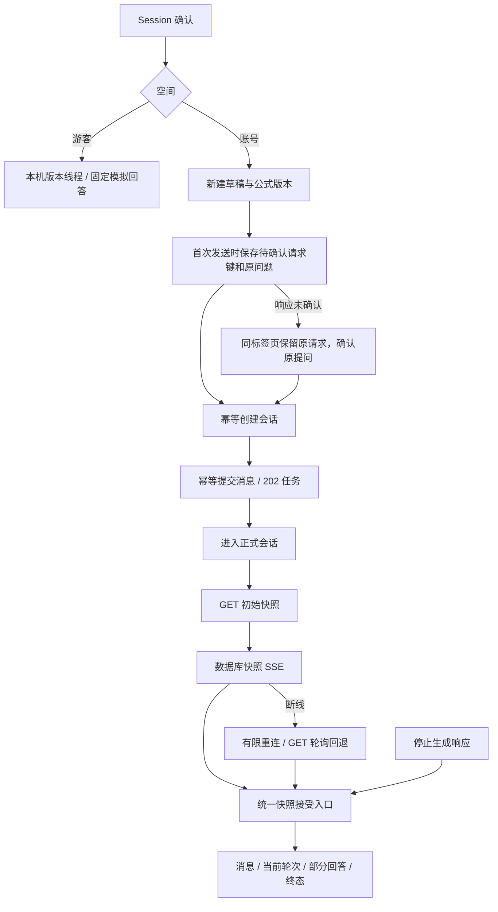

# R8 AI 聊天重构与验收说明

日期：2026-10-27。基线：R7 `7cb0896644d854df00659b0d9ac6abccdd45375f`。分支：`refactor/r8-ai-chat`。

本轮只处理 AI 页面、直接依赖及测试。未改服务端 SSE/HTTP 契约、Prisma、Prompt、LangChain、Worker、任务执行权、额度或模型计费规则；没有新增依赖和状态框架。完成后停止，不进入 R9。

独立命名的 R0 报告文件仍未找到。已核对《Formula重构.md》、R2—R7 与 R6.1 说明、当前页面及真实 API/数据库读写代码，没有照搬历史报告的结论。

## 1. 页面与产品规则

| 页面       | 职责和边界                                                                               |
| ---------- | ---------------------------------------------------------------------------------------- |
| `/ai`      | 页面确认身份、组合账号会话列表或本机演示入口；账号列表支持 URL 搜索、分页、空和错误状态  |
| `/ai/new`  | 页面处理身份和显式 demo 空间；账号草稿选择固定公式版本，实际首次发送才创建会话并提交首问 |
| `/ai/:id`  | 确认身份后按 owner + conversation 挂载正式聊天，路由参数变化不复用旧私有请求             |
| `DemoChat` | 本机普通线程或指定演示公式版本线程；只调用公开固定模拟回答接口，不创建账号会话           |

旧地址 alias 保留。正式聊天和新建页继续不展示底部导航；`/ai` 保留主导航。游客 `/ai` 不列出伪装成服务端记录的本机线程：入口明确说明本机线程独立，再次打开普通演示可继续已有本机记录，从演示公式进入可继续对应版本线程。没有游客记录自动合并。

实际没有会话删除/重命名 API，因此本轮没有补造删除或重命名功能。发送后的会话列表失效、重新进入和浏览器返回有相应验证。

## 2. 数据流与状态

| 状态                               | 用户反馈与恢复                                                           |
| ---------------------------------- | ------------------------------------------------------------------------ |
| 身份待确认、身份错误               | 显示等待或重新连接；隐藏私有内容，不自动降级演示                         |
| 列表加载、无记录、无搜索结果、失败 | 各自独立；失败可重试；加载更多失败保留已有列表                           |
| 草稿、创建中、首问提交中           | 输入和重复发送受到约束；进入新建页本身不调用创建接口                     |
| 提交结果未知                       | 原问题只读，明确“确认原提问”；使用原请求键，不自动另建会话或消息         |
| QUEUED / PROCESSING                | 排队与生成文案，展示已持久化片段；不承诺逐 Token 直传                    |
| COMPLETED                          | 展示持久化回答；恢复连接只查询，不重新生成                               |
| FAILED / 已停止                    | 沿用真实 FAILED 与原因，保留已生成的失败片段；重发新问题仍按现有额度规则 |
| SSE 断线                           | 1 秒、2 秒两次自动重连，之后轮询；提供手动重新连接入口                   |
| GET 失败 / 401、403、404           | 网络失败保留安全快照；权限或不存在清空私有内容并提示；手动重新读取       |
| 本机恢复存储不可用                 | 新请求在创建/发送之前拒绝；恢复存储后沿用原意图确认                      |
| 恢复信息损坏                       | 暂停发送，提示先核对账号会话和检查存储，不丢掉请求标识后盲目新建         |

## 3. GET、SSE、停止响应的同步规则

`chat-state.ts` 为正式聊天提供同一个接受函数，GET、SSE 和停止响应均经过它。依据全部来自现有协议，不使用本地到达时间或客户端时间戳推断版本：

1. 校验会话 ID、消息数组、递增位置、角色、状态、轮次和公式上下文。SSE 外部 JSON 不直接强转后写入。
2. 消息最大位置不能降低，已知消息的 ID、角色、内容和状态不能被冲突快照覆盖；服务端已有消息位置约束继续保留。
3. 同轮次拒绝较低尝试次数；同次生成片段只接受前缀增长；新尝试可重置片段。
4. 终态不被同轮旧活跃状态重新激活；迟到的旧停止响应不替换已完成状态或新轮次。
5. 保留服务端合法 `PROCESSING → QUEUED` 重试，不能简单为状态数字排序。
6. 按账号和会话建立请求缓存；页面/身份切换取消旧请求、关闭 EventSource、清理计时器。新建发送另在路由离开开始时使操作代次失效，覆盖“路由已开始离开、组件尚未卸载”的窗口。
7. SSE 两次重连仍失败则只读轮询。15 秒无快照看门狗避免连接挂起后永久暂停查询；这可能令长时间无变化的流提前转为恢复查询，不能当成服务端心跳协议。

**尚未解决的协议限制：** `SavedConversation` 没有全局修订号，消息位置不能排序同轮所有元信息变化；同次重新排队与旧 QUEUED 快照可能无法完全区分。非前缀冲突片段保守保留现有内容。首次接受终态后，不能在没有修订号的情况下自动判断同轮互相矛盾的另一终态一定更新。完整刷新可重新读取，但本轮不能宣称任意跨来源乱序全部解决。

R14 的最小协议方向：在 GET、SSE、停止响应中携带同一会话的服务端单调修订号，并让片段、轮次、取消、终态等写入统一推进。仅使用现有 conversation.updatedAt 不足以覆盖片段写入；如需数据库字段/迁移，必须另行评审。本轮未实施。

## 4. 幂等、草稿与身份隔离

- 新建页的请求意图包含 owner、原问题、公式 versionId、请求键，以及已确认创建的 conversationId。只在首次实际发送时创建；已知会话 ID 后继续原首问，不再创建空白会话。
- 正式聊天未确认的发送也保留原问题和请求键。生成中可确认已有请求，但不能并发发送一个不同的新问题。HTTP 自动重试关闭。
- 仅未确认请求保存在当前标签页的 sessionStorage，最多 10 条，超限拒绝新请求而非静默驱逐。包含原问题文本，**不是加密存储**；UI 已说明暂存行为。成功即移除，不保存完整账号历史、令牌、密钥或原始文件。未发送的新建草稿只在应用内存中保留，切换上下文不无故丢失；离开和整页刷新有草稿确认。
- 写存储失败发生在创建/消息 POST 之前；解析失败暂停发送。确认退出或切换身份后清理旧 owner 意图，设置页退出沿用同一清理动作。
- 中断浏览器请求不等于取消已提交的服务端任务。只有用户点击停止才调用现有取消接口；刷新、重连、返回不产生模型任务。
- 正式聊天的未发送输入离开时确认；游客未完成提问离开时确认。游客取消请求会回滚本次乐观用户消息，旧响应不会追加到另一线程。

关闭标签页、用户清除会话存储、浏览器损坏或崩溃后仍不能保证恢复所有未确认意图；没有按请求键查询未知会话的新服务端接口。恢复数据损坏时需要用户核对现有会话，不能冒称浏览器存储提供持久化保证。确定失败如额度不足仍可沿用原键重试；没有擅自改变服务端幂等或计费语义。

## 5. 视觉与阅读设计

- 手机 320/390/430 先验证，单列、44px 操作目标、多行输入最高 160px。欢迎区缩小为标题、短说明和建议问题，不在有消息时保留大空卡片。
- 三个 AI 页面局部采用 R3 reading：900px 以下继续移动端最大 480px，900px 起 760px。桌面正文与输入宽度协调，没有新建侧栏状态副本，也未改变全站默认规则。
- 用户消息为柔紫气泡；AI 回答以正文为主体，来源、生成中和未完成提示明确。公式与代码各自横向滚动，正文可换行。Markdown 保留安全的标题、粗体、行内代码，并补充 fenced code block；不是引入完整 Markdown/HTML 执行器。模型 HTML 仍作为文字展示。
- 块公式和代码边界去除重复空行，避免回答被空白撑开。复制回答功能保留。
- IME composition 与 keyCode 229 防止中文组合期间 Enter 发送；Enter 发送、Shift+Enter 换行。输入按内容增长，ResizeObserver 保留占位；清理监听与 CSS 高度变量。
- 使用 VisualViewport 计算被遮挡底部偏移，输入区和回到最新按钮跟随。浏览器仅模拟了视口缩小，**不等于 iOS/Android 真机软键盘验收**。
- 阅读跟随继续遵循接近底部才滚动；向上阅读不被快照拉回。修复 nextTick 等待期间卸载后仍可能安排滚动的问题。

## 6. 真实截图

共 51 张 PNG，均为真实 Chromium 页面截图。使用明确的测试替身数据；不是生成设计图，也不是生产账号或真实 DeepSeek 输出。

| 宽度 | 会话列表 前 / 后                                                                | 新建 前 / 后                                                                    | 正式聊天 前 / 后                                                                |
| ---- | ------------------------------------------------------------------------------- | ------------------------------------------------------------------------------- | ------------------------------------------------------------------------------- |
| 320  | [前](设计稿/R8聊天/会话修改前320.png) / [后](设计稿/R8聊天/会话修改后320.png)   | [前](设计稿/R8聊天/新建修改前320.png) / [后](设计稿/R8聊天/新建修改后320.png)   | [前](设计稿/R8聊天/聊天修改前320.png) / [后](设计稿/R8聊天/聊天修改后320.png)   |
| 390  | [前](设计稿/R8聊天/会话修改前390.png) / [后](设计稿/R8聊天/会话修改后390.png)   | [前](设计稿/R8聊天/新建修改前390.png) / [后](设计稿/R8聊天/新建修改后390.png)   | [前](设计稿/R8聊天/聊天修改前390.png) / [后](设计稿/R8聊天/聊天修改后390.png)   |
| 430  | [前](设计稿/R8聊天/会话修改前430.png) / [后](设计稿/R8聊天/会话修改后430.png)   | [前](设计稿/R8聊天/新建修改前430.png) / [后](设计稿/R8聊天/新建修改后430.png)   | [前](设计稿/R8聊天/聊天修改前430.png) / [后](设计稿/R8聊天/聊天修改后430.png)   |
| 768  | [前](设计稿/R8聊天/会话修改前768.png) / [后](设计稿/R8聊天/会话修改后768.png)   | [前](设计稿/R8聊天/新建修改前768.png) / [后](设计稿/R8聊天/新建修改后768.png)   | [前](设计稿/R8聊天/聊天修改前768.png) / [后](设计稿/R8聊天/聊天修改后768.png)   |
| 1024 | [前](设计稿/R8聊天/会话修改前1024.png) / [后](设计稿/R8聊天/会话修改后1024.png) | [前](设计稿/R8聊天/新建修改前1024.png) / [后](设计稿/R8聊天/新建修改后1024.png) | [前](设计稿/R8聊天/聊天修改前1024.png) / [后](设计稿/R8聊天/聊天修改后1024.png) |
| 1440 | [前](设计稿/R8聊天/会话修改前1440.png) / [后](设计稿/R8聊天/会话修改后1440.png) | [前](设计稿/R8聊天/新建修改前1440.png) / [后](设计稿/R8聊天/新建修改后1440.png) | [前](设计稿/R8聊天/聊天修改前1440.png) / [后](设计稿/R8聊天/聊天修改后1440.png) |

状态样本：[空列表](设计稿/R8聊天/会话空390.png)、[公式分页选择](设计稿/R8聊天/公式选择390.png)、[多行输入](设计稿/R8聊天/多行输入390.png)、[排队](设计稿/R8聊天/排队390.png)、[生成中](设计稿/R8聊天/生成中390.png)、[完成](设计稿/R8聊天/完成390.png)、[失败片段](设计稿/R8聊天/失败片段390.png)、[停止](设计稿/R8聊天/已停止390.png)、[断线回退](设计稿/R8聊天/断线回退390.png)、[未确认提交](设计稿/R8聊天/发送未确认390.png)、[无权限](设计稿/R8聊天/无权限390.png)、[游客](设计稿/R8聊天/游客对话390.png)、[长会话及长公式](设计稿/R8聊天/长会话390.png)、[存储拒绝](设计稿/R8聊天/存储拒绝390.png)、[视口缩小模拟](设计稿/R8聊天/视口缩小模拟390.png)。

## 7. 修改文件与原因

| 文件                                                                 | 原因                                                                                   |
| -------------------------------------------------------------------- | -------------------------------------------------------------------------------------- |
| `app/pages/ai/index.vue`                                             | 身份分支、列表页面视觉与 reading 布局，给 AppBrand 传入已确认用户避免重复 Session 请求 |
| `app/pages/ai/new.vue`                                               | 游客/账号组合与稳定页面根节点，按账号和版本挂载草稿组件                                |
| `app/pages/ai/[id].vue`                                              | 身份隔离、动态路由计算和稳定根节点，按账号与会话挂载聊天                               |
| `app/components/AccountChatDraft.vue`（新增）                        | 首发创建/发送、公式上下文与未确认意图的局部业务组织                                    |
| `app/components/AccountChat.vue`                                     | 消息状态、确认原提问、恢复连接和未发送草稿保护；局部阅读样式                           |
| `app/components/AccountConversations.vue`                            | 账号作用域列表、快速搜索输入同步与卡片层级                                             |
| `app/components/FormulaContextPicker.vue`                            | 复用现有分页 API，搜索、去重、取消和后续公式选择                                       |
| `app/components/DemoChat.vue`                                        | 缩小欢迎区，正文与正式聊天字号协调，未完成提问离开确认                                 |
| `app/components/ChatComposer.vue`                                    | IME、44px 操作、多行输入、VisualViewport 与监听释放                                    |
| `app/components/ChatMessageContent.vue`                              | 安全数学/文字/代码区块展示，独立滚动                                                   |
| `app/composables/useAccountChat.ts`                                  | GET/SSE/停止统一接受入口、发送意图、取消、账号隔离与局部失效                           |
| `app/composables/useConversationEvents.ts`                           | JSON 校验、有限重连、看门狗、权限错误和清理                                            |
| `app/composables/useConversationListing.ts`                          | URL 作用域首屏与追加分页，拒绝迟到请求和重复条目                                       |
| `app/composables/useDemoChat.ts`                                     | 取消、线程代次与离页乐观消息回滚                                                       |
| `app/composables/useChatReading.ts`                                  | 防止异步 nextTick 在卸载后安排滚动                                                     |
| `app/plugins/chat-draft.ts`（新增）                                  | 应用内草稿和有界、按账号隔离的未确认请求恢复                                           |
| `app/utils/chat-state.ts`、`chat-content.ts`（新增）                 | 可独立测试的快照接受与安全内容分段纯函数                                               |
| `app/pages/settings.vue`                                             | 仅退出时清理新增聊天意图，无 R9 视觉或认证业务改造                                     |
| `tests/chat-state.test.ts`、`chat-content.test.ts`（新增）           | 8 项快照规则和 2 项内容解析测试                                                        |
| `scripts/test-suite.ts`                                              | 注册这两组纯单元测试                                                                   |
| `tests/jobs.test.ts`                                                 | 增加真实 SSE 重连、重复停止、额度及旧快照回归，保留旧断言                              |
| `tests/design-preview/chat-fixtures.ts`（新增）                      | 显式 cookie/运行编号启用的有界内存 API 与真实 HTTP SSE 替身，不连接数据库或模型        |
| `tests/design-preview/session-middleware.ts`                         | 仅预览层分派 R8 替身，未声明请求拒绝外连                                               |
| `tests/design-preview/app/middleware/chat-preview.global.ts`（新增） | 仅预览层的身份刷新工具，不进入生产路由                                                 |
| `tests/design-preview/check-chat-browser.js`（新增）                 | 移动优先截图、真实浏览器及延迟 HTTP/SSE 场景断言                                       |
| 两份 R8 中文文档及截图目录                                           | 计划、验收证据、职责、风险和后续边界                                                   |

## 8. 实际检查与可复验入口

| 检查                             | 结果                                                                   |
| -------------------------------- | ---------------------------------------------------------------------- |
| `npm run test:unit`              | 64/64，0 失败、0 跳过                                                  |
| `npm run test:jobs`              | 26/26，0 失败、0 跳过；真实隔离 API/DB/pg-boss/受控 Worker             |
| `npm run test:library`           | 15/15，真实隔离资源                                                    |
| `npm run test:workspace`         | 21/21，真实隔离资源，含 R6.1 保存契约                                  |
| `npm run typecheck`              | 通过，含测试 TS 范围                                                   |
| `npm run typecheck:design`       | 隔离预览类型通过                                                       |
| `npm run check:assets`           | 0 缺失                                                                 |
| 修改文件 Prettier、Git Diff 检查 | 提交前逐项检查，无无关批量格式化                                       |
| `npm run check:build`            | 生产构建成功，1 分 23 秒；附带私有配置扫描 1/1，通过，148 个客户端文件 |
| R8 Chromium                      | 141 项通过，先手机 96 项、再桌面 45 项                                 |

本轮实际复跑：R5 浏览器 104 项通过（手机 82 项），R6/R6.1 浏览器 134 项通过（手机 100 项），R7 浏览器 220 项通过（手机 166 项）。回归截图只写 `tmp/r8-r5/`、`tmp/r8-r6/`、`tmp/r8-r7/`，未覆盖历史评审截图。

R8 的 141 项包括：六宽度溢出/触控/输入区、进入新建零创建、分页搜索和返回、慢关键词回写、列表失败重试、公式选择后续页、IME/Shift+Enter、多行输入、快速双击、未知创建响应整页刷新恢复、普通消息原键恢复、较旧 SSE、连续停止、停止失败、刷新停止、真实 EventSource 有限重连及 GET 回退、断线期间完成、失败片段、长公式独立滚动、历史上翻和回到最新、切换账号/退出、网络恢复和游客不调用账号写接口。还通过路由拦截人为延迟了真实 HTTP 响应，验证旧 GET 晚于新 SSE、旧停止晚于新轮次及离页后的创建回调。恢复信息损坏、存储写入拒绝和 VisualViewport 缩小也有断言。

真实隔离集成合计 62 项。新增 R8 集成验证两次真实 SSE 连接后取消读取、重复停止、原消息键重放不新增轮次/额度、只保存一条失败回答、旧 GET 无法覆盖停止快照、终态 SSE 可再次读取。流式适配器是测试受控替身，不调用付费 DeepSeek。

隔离环境：R1 新清单 `435aea95-f668-4141-aee2-0706d8fe9162`，API 3100、PostgreSQL/pg-boss 15432、对象存储 18333；每次集成入口先验证资源身份及网络目标，不回退开发 `.env`。只在新的空临时实例应用现有迁移。本轮测试 API 及所属两个容器已停止，3200 隔离设计预览保留供评审。复验应按 R1 文档重新创建/核对专用环境后执行上述命令，不复用已经停止的 tmpfs 实例。

浏览器复验：`npm run preview:design`，然后 `playwright-cli -s=formula-r8 open http://127.0.0.1:3200/ai`，再 `playwright-cli -s=formula-r8 run-code --filename=tests/design-preview/check-chat-browser.js`。类型生成和生产构建先完成，再运行稳定预览与浏览器检查。脚本用显式 R8 cookie 与独立编号隔离内存场景；同一场景的刷新和重试保留原请求键。

本机日志位于忽略目录 `tmp/r8-browser-final.log`、`tmp/r8-jobs-final.log`、`tmp/r8-library.log`、`tmp/r8-workspace.log`、`tmp/r8-unit-final.log`、`tmp/r8-types-final.log`、`tmp/r8-design-final.log`、`tmp/r8-build.log`、`tmp/r8-assets.log`。最终构建凭据校验源码 SHA-256 与客户端文件清单；日志和测试环境凭据不提交。

## 9. 失败记录与验收边界

- 首轮列表水合告警定位为 AppBrand 重复启动 Session 请求，已复用页面身份；清理逻辑也区分服务端和客户端。
- 同路由替换公式上下文时 Vue Router vnode 钩子遇到空根节点，三个 AI 页面改为稳定根节点后复验通过。
- 快速搜索时 URL 更新可能覆盖新输入，增加搜索导航期间的输入同步约束；没有删除慢请求断言。
- 离页后旧创建响应曾触发导航，修复路由守卫开始时的取消和代次失效，不仅依赖组件卸载。
- 首轮任务套件一项既有 Worker 短租约恢复测试失败（取不到恢复任务），当次 25/26；释放此前遗留的自动化浏览器、完成构建后完整复跑 26/26，未修改该测试或 Worker。仍提示该短时序测试需要 R13/R16 关注稳定性，不把一次复跑通过当成根因已修复。
- 浏览器入口格式化后曾因前导分号不兼容 CLI 失败，改用仓库既有具名函数形式。测试场景使用独立运行编号，避免复验读取上一轮计数；刷新操作明确等待水合。未放宽业务断言。

浏览器业务场景使用内存 HTTP/SSE 替身；真实隔离 API/DB/队列分别验证，**没有执行浏览器连真实隔离数据库的完整端到端联调**。SSE Mock 全绿不能证明所有代理、运营网络和真机行为。

未验证：真实 DeepSeek 生成质量、真机相机/软键盘、iOS Safari、Android 浏览器、Linux 部署、完整无障碍审计、真实生产长时间网络恢复。VisualViewport 验证是浏览器属性模拟，不能宣称真机通过。没有新增正式会话删除/改名或历史分页 API；现有接口只返回最近 100 条并提供 hasEarlierMessages，UI 明确说明上限，未伪造更早历史。游客沿用最近 20 条模拟上下文，不承诺无限历史。

## 10. 后续依赖、提交与回滚

- **R14a**：失败轮次进入 Prompt、模型重试与尝试记录不足，未修复。
- **R14b**：全量快照成本、历史分页和统一单调修订号，未修复。
- **R11**：本轮只收敛聊天范围缓存失效；全站缓存键规范和统一 Session 生命周期仍需后续处理。
- **R13/R17**：Worker 恢复稳定性、资源与长连接性能、隐藏标签页节流等不在本轮完成范围；R7 留下的 R12a 上传容量和处理并发也未修复。
- 本地恢复意图增加了有界存储维护成本，恢复文本不是加密数据；清除浏览器存储仍会失去未确认请求关联。无新增技术栈，但不能宣称没有任何剩余技术债务。

本轮独立本地提交，最终 Hash 在交付会话给出，可用 `git log -1 --format=%H` 核对；无远程推送。回滚经评审后执行 `git revert <R8提交Hash>`，不 reset/clean，不取消已存在的数据库任务或删除用户数据。代码回滚不等于撤销已发出的模型任务；需先核对会话结果再处理本机恢复信息。

R9 建议：继续手机优先，先梳理登录返回、Session 待确认/失败/失效与私有状态清理；再统一个人中心、设置和头像的表单/反馈。复用既有 Token、布局和本轮按确认身份清理的方式，不把 UI 改造扩展成认证服务或存储生命周期重写。本轮到此停止，等待视觉与架构评审。
