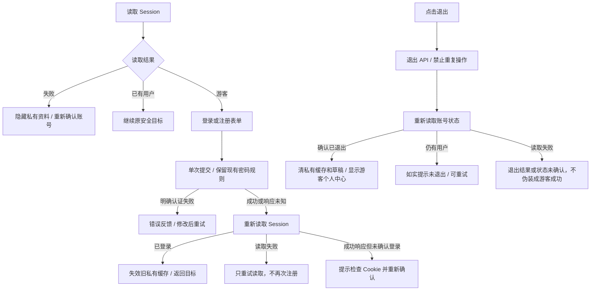

# R9 账号、个人中心与设置重构及验收

日期：2026-10-27。基线 R8 `f9d7408afc134ac152269785f6afd8a6388a4eab`，分支 `refactor/r9-account-profile`。本轮完成后停止，不进入 R10。

已核对《Formula重构.md》、R2/R3 规范、R4—R8 交付和 R6.1 说明及当前源码。仓库仍没有独立命名的 R0 盘点报告，不声称阅读过不存在的文件。

## 1. 范围与职责

| 页面/模块                     | 职责                                                                                           |
| ----------------------------- | ---------------------------------------------------------------------------------------------- |
| `/login`                      | 登录/注册模式、原密码策略、密码可见性、身份错误恢复、安全返回目标；区分认证响应和 Session 确认 |
| `/profile`                    | 游客/账号/未知身份的不同展示，头像昵称层级及公式、收藏、对话和原设置菜单入口                   |
| `/profile/edit`               | 页面身份确认与按账号挂载编辑器；保存确认、资料刷新、身份暂时不可用分开处理                     |
| `AccountProfileEditor`        | 当前账号昵称/头像草稿、图片裁剪、PATCH、失败保留、离开保护；不承担认证实现                     |
| `/settings`                   | 退出确认、本机演示重置确认、账号额度与服务配置展示；不清理服务端业务数据                       |
| `account-boundary`            | 只在已确认身份变化时失效已有私有缓存、清理私有上传/聊天意图及导航来源；不替代各业务请求协调    |
| Better Auth / Profile Service | 继续承担实际认证和资料写入；仅限制默认头像绕过路径，保留现有头像编码、权限、CAS 和对象替换规则 |

未修改 Prisma Schema、迁移、Worker、pg-boss、额度事务、Prompt、模型重试或 SSE 服务端协议。没有新增依赖、Pinia、登录方式或全站事件总线；没有重做 R4—R8 视觉。

## 2. 登录、注册与退出状态流



登录注册继续使用 Better Auth email，注册密码 10～128 字符、昵称 1～100 字符，未降低策略。保留邮箱归一化与原 `accountRedirect` 安全返回校验。IME 组合期间不提交，密码可见性按钮与提交状态可访问。

确认登录成功但 Session 获取失败时，按钮转为重新确认账号；不重复创建用户。认证网络响应不确定时先读 Session，仍未确认才提示用户核对；没有自动重试认证 POST。已登录访问登录页显示继续入口。

路由离开时取消登录等待并使操作代次失效，旧响应不能强行导航。退出失败时不会先清掉本机演示；退出响应丢失时通过 Session 确认实际结果，不盲目重复退出。退出期间限制冲突操作，并允许确认成功后的内部跳转。

## 3. 资料双入口审查与修复

实际安装 **Better Auth 1.7.12**。核对本地 `node_modules/better-auth/dist/api/routes/update-user.mjs`：其默认 `/update-user` 直接接受 `name`、`image`，内部调用用户更新；`sign-up.mjs` 也接收可选图片 URL。这条路径没有调用项目的 `normalizeAvatar`、私有存储和旧对象替换逻辑，绕过风险仍存在。

| 入口                      | R9 策略与兼容性                                                                                                                               |
| ------------------------- | --------------------------------------------------------------------------------------------------------------------------------------------- |
| `/api/auth/update-user`   | 只接受合法 `name`；保留昵称更新和去首尾空格；`image`（包括 null）、`avatar`、email/id/emailVerified 等非昵称字段明确 400                      |
| `/api/auth/sign-up/email` | 正常注册不变；禁止指定 image/avatar 引用；原 ID、验证状态的受保护语义未放宽                                                                   |
| `/api/account/profile`    | 继续接受既有 `{ name, avatar? }`；内嵌 JPEG/PNG 或 null 重置；只更新认证用户；保留旧契约对无权修改字段的忽略，不把额外 email 字段当作合法修改 |
| Better Auth 数据库 hooks  | 创建时禁止外部头像引用，更新时禁止通过 Auth adapter 修改 image；昵称同时作类型与长度防护，防止非字符串走到 `.trim()` 抛 500                   |

`server/auth/profile-policy.ts` 只描述这两条 HTTP 默认入口的规则；配置将违规转换为明确 APIError。Profile Service 直接使用 Prisma 的受控写入不经过 Auth adapter，因此正常上传、重置和昵称更新不受阻。

兼容影响是有意且有限的：旧客户端不能再调用默认 update-user 写 image 或用 image:null 重置，需改用现有 Profile PATCH。仓库实际资料编辑原本已经走 PATCH，没有发现必须保留的默认头像调用方。合法昵称更新继续可用，没有禁用全部资料编辑。未来引入其他身份提供者时，不能绕过此策略直接同步头像，需重新评审。

现有 `saveProfile` 保留：新头像先验证/编码/存储，数据库按 owner 与读取时 updatedAt 条件更新；冲突只补偿新文件；数据库成功替换后才删除本账号旧头像。没有新增字段或迁移，也没有删除仍在使用的旧资源。

## 4. 资料草稿、头像与跨页同步

- 编辑器只使用所属账号的草稿，昵称基准不随普通展示刷新悄悄覆盖。保存失败保留昵称和裁剪结果，提供核对最新资料入口；无实际修改或默认头像重复恢复时不产生离开确认。
- 头像选择保留 JPEG/PNG、10MB、2000 万像素约束。解码错误、超像素和裁剪编码失败明确反馈；出错或关闭时释放 ImageBitmap。没有新增 Object URL；裁剪输出为临时 dataURL，卸载清理引用。
- 选择文件、修改昵称或保存中均有离开/刷新保护。保存请求中离开不能撤销已经提交的后端写入，提示真实说明，不自动重试 PATCH。
- 保存响应确认与 Session 刷新分开：确认保存后仅重读展示数据；刷新失败显示“已保存但刷新失败”，不会把已确认写入当成需要再次上传。
- 身份暂时无法确认时，当前编辑器隐藏且 inert，原账号重新确认后可继续本页内存草稿；确认退出或换账号后销毁旧编辑器。隐藏期间不展示私有字段，但不承诺把已存在浏览器内存里的内容物理擦除。
- Session 更新使个人中心、设置和首页 AppBrand 使用同一新昵称/头像地址。UserAvatar 保留默认图，旧图片元素的迟到 error 不污染新图片引用。

头像真实存储测试验证了：仅改昵称不删旧对象；伪装图片返回 415、损坏 PNG 返回 400，旧头像仍可读；成功替换产生新 key 后旧 key 不可读；重置后新 key 不可读。另用内存 Prisma/存储替身验证数据库冲突时只回滚新对象和写入顺序，明确不是把 Mock 当成真实数据库竞争测试。

## 5. 身份切换与私有缓存

`privateAccountKey` 收敛登录/退出原有规则：account-_（排除 account-session）、saved-formula-_、draft-_、chat-formula-picker_ 和 home-recent；不匹配本机 demo-store。导航来源单独重置。

`account-boundary` 观察已确认 Session：同账号资料刷新不当成换号；错误/未知不当成游客；确认 owner 变化后失效已知私有 Nuxt 数据，并清除轮询 default 可能留下的展示回退。Nuxt 自身的 Promise 身份校验配合已存在的账号键、组件取消与代次检查，防止旧请求重新挂载当前页面。没有为此重写全站请求层，不能把“失效缓存”说成所有底层网络请求都立即终止。

浏览器已验证：A 退出后 B 登录、迟到 A 资料保存、迟到 A 公式列表、迟到额度、离开登录页后的认证回调、Session 失效 SSE 清空与关闭、退出时上传 File/预览清理、Blob URL 失效、返回私有深链接重新鉴权。旧账号内容没有进入新账号界面。

退出保留独立演示数据，验证采用真实持久化的自定义演示标题标记，不以两个空值相等冒充证明。恢复默认示例必须确认，取消不修改数据，确认也不调用账号保存 API。

本轮没有增加跨标签页主动同步或闲置会话心跳。已验证的是当前标签页收到已确认身份变化、实际权限错误和导航鉴权后的行为；不能宣称静置页面会立即感知所有服务器端撤销。统一 Session 生命周期和跨标签页策略留 R11/R17。

## 6. Mobile First 视觉验收

先验收 320/390/430，后 768/1024/1440。登录保持 compact；个人中心、资料编辑、设置采用 R3 reading（900px 以下仍最大 480px，桌面最大 760px）。未改全站宽度或 Token。

登录收敛标题与表单层级；个人中心明确账号身份和三项学习记录入口；编辑页分开头像与字段；设置区分账号、额度、服务与本机数据。16px 表单输入、44px 控件、错误换行、原生 dialog 层级与移动安全区均有浏览器检查。服务“已配置”与“已连接”区分，未为了检查状态调用付费模型。

共 57 张真实 Chromium 截图，业务数据来自明确的内存替身。fullPage 截图中的 fixed 导航仍处于采集视口底部，不代表导航应固定在整张长图末尾；另提供个人中心首屏与滚动底部的视口截图，并断言底部菜单不被导航遮挡。

| 宽度 | 登录 前/后                                                                              | 个人中心 前/后                                                                                  | 编辑 前/后                                                                              | 设置 前/后                                                                              |
| ---- | --------------------------------------------------------------------------------------- | ----------------------------------------------------------------------------------------------- | --------------------------------------------------------------------------------------- | --------------------------------------------------------------------------------------- |
| 320  | [前](设计稿/R9账号资料/登录修改前320.png) / [后](设计稿/R9账号资料/登录修改后320.png)   | [前](设计稿/R9账号资料/个人中心修改前320.png) / [后](设计稿/R9账号资料/个人中心修改后320.png)   | [前](设计稿/R9账号资料/编辑修改前320.png) / [后](设计稿/R9账号资料/编辑修改后320.png)   | [前](设计稿/R9账号资料/设置修改前320.png) / [后](设计稿/R9账号资料/设置修改后320.png)   |
| 390  | [前](设计稿/R9账号资料/登录修改前390.png) / [后](设计稿/R9账号资料/登录修改后390.png)   | [前](设计稿/R9账号资料/个人中心修改前390.png) / [后](设计稿/R9账号资料/个人中心修改后390.png)   | [前](设计稿/R9账号资料/编辑修改前390.png) / [后](设计稿/R9账号资料/编辑修改后390.png)   | [前](设计稿/R9账号资料/设置修改前390.png) / [后](设计稿/R9账号资料/设置修改后390.png)   |
| 430  | [前](设计稿/R9账号资料/登录修改前430.png) / [后](设计稿/R9账号资料/登录修改后430.png)   | [前](设计稿/R9账号资料/个人中心修改前430.png) / [后](设计稿/R9账号资料/个人中心修改后430.png)   | [前](设计稿/R9账号资料/编辑修改前430.png) / [后](设计稿/R9账号资料/编辑修改后430.png)   | [前](设计稿/R9账号资料/设置修改前430.png) / [后](设计稿/R9账号资料/设置修改后430.png)   |
| 768  | [前](设计稿/R9账号资料/登录修改前768.png) / [后](设计稿/R9账号资料/登录修改后768.png)   | [前](设计稿/R9账号资料/个人中心修改前768.png) / [后](设计稿/R9账号资料/个人中心修改后768.png)   | [前](设计稿/R9账号资料/编辑修改前768.png) / [后](设计稿/R9账号资料/编辑修改后768.png)   | [前](设计稿/R9账号资料/设置修改前768.png) / [后](设计稿/R9账号资料/设置修改后768.png)   |
| 1024 | [前](设计稿/R9账号资料/登录修改前1024.png) / [后](设计稿/R9账号资料/登录修改后1024.png) | [前](设计稿/R9账号资料/个人中心修改前1024.png) / [后](设计稿/R9账号资料/个人中心修改后1024.png) | [前](设计稿/R9账号资料/编辑修改前1024.png) / [后](设计稿/R9账号资料/编辑修改后1024.png) | [前](设计稿/R9账号资料/设置修改前1024.png) / [后](设计稿/R9账号资料/设置修改后1024.png) |
| 1440 | [前](设计稿/R9账号资料/登录修改前1440.png) / [后](设计稿/R9账号资料/登录修改后1440.png) | [前](设计稿/R9账号资料/个人中心修改前1440.png) / [后](设计稿/R9账号资料/个人中心修改后1440.png) | [前](设计稿/R9账号资料/编辑修改前1440.png) / [后](设计稿/R9账号资料/编辑修改后1440.png) | [前](设计稿/R9账号资料/设置修改前1440.png) / [后](设计稿/R9账号资料/设置修改后1440.png) |

状态证据：[身份读取失败](设计稿/R9账号资料/会话失败390.png)、[游客](设计稿/R9账号资料/游客个人中心390.png)、[头像裁剪](设计稿/R9账号资料/头像裁剪390.png)、[解码失败](设计稿/R9账号资料/裁剪失败390.png)、[保存失败保留](设计稿/R9账号资料/保存失败390.png)、[额度服务](设计稿/R9账号资料/额度服务390.png)、[账号切换](设计稿/R9账号资料/账号切换390.png)、[首屏导航](设计稿/R9账号资料/个人中心首屏390.png)、[底部导航](设计稿/R9账号资料/个人中心底部390.png)。

## 7. 文件清单及原因

| 文件                                                                                                                                | 原因                                                                        |
| ----------------------------------------------------------------------------------------------------------------------------------- | --------------------------------------------------------------------------- |
| `app/pages/login.vue`                                                                                                               | Session 重试、认证与确认分阶段、路由代次、模式/密码/手机表单                |
| `app/pages/profile/index.vue`                                                                                                       | 身份分支、复用已读取用户、导航层级和手机优先展示                            |
| `app/pages/profile/edit.vue`                                                                                                        | 身份门控、按账号编辑器、隐藏与恢复草稿、保存/刷新状态区分                   |
| `app/pages/settings.vue`                                                                                                            | 退出确认、原演示确认、owner 作用域额度与服务信息                            |
| `app/components/AccountProfileEditor.vue`（新增）                                                                                   | 局部资料草稿、保存请求、裁剪与离开保护                                      |
| `app/components/AvatarCropper.vue`                                                                                                  | 空文件、解码/编码失败、异常 Bitmap 释放和44px操作                           |
| `app/components/UserAvatar.vue`                                                                                                     | 新旧图片元素引用隔离，保留已有图形与样式                                    |
| `app/components/ServiceStatus.vue`                                                                                                  | owner 作用域键与明确服务连接/配置层级、触控                                 |
| `app/plugins/account-boundary.ts`（新增）                                                                                           | 已确认身份变化的私有状态边界                                                |
| `app/utils/account-state.ts`（新增）                                                                                                | 登录/退出原有私有键规则的可测试单一谓词                                     |
| `server/auth/config.ts`                                                                                                             | 最小默认入口及 Auth adapter 头像保护，保留昵称和认证策略                    |
| `server/auth/profile-policy.ts`（新增）                                                                                             | 默认资料入口字段与昵称类型规则                                              |
| `tests/account-state.test.ts`（新增）                                                                                               | 账号键范围、受保护字段和非法昵称纯测试                                      |
| `tests/profile.test.ts`                                                                                                             | 增加头像替换顺序、数据库冲突补偿测试（内存替身）                            |
| `tests/profile-api.test.ts`                                                                                                         | 增加默认入口、注册头像、跨账号及真实S3生命周期验证                          |
| `scripts/test-suite.ts`                                                                                                             | 注册账号纯测试；完整集成列表未缩减                                          |
| `tests/design-preview/account-fixtures.ts`（新增）                                                                                  | 显式 cookie/独立编号的有界内存 Auth、资料及跨页 HTTP/SSE 替身，未知请求拒绝 |
| `tests/design-preview/session-middleware.ts`                                                                                        | 仅测试层注册 R9 替身                                                        |
| `tests/design-preview/app/layouts/account-tools.vue`、`tests/design-preview/app/middleware/account-preview.global.ts`（测试层新增） | 只在显式预览参数中提供 Session 刷新工具，不增加正式产品路由                 |
| `tests/design-preview/check-account-browser.js`（新增）                                                                             | 六视口、登录恢复、裁剪、身份及延迟响应断言                                  |
| 两份 R9 中文文档、57 张截图                                                                                                         | 实施计划、实际证据、边界和评审资料                                          |

`useAccountSession`、`AccountUsage`、认证 middleware 和 `server/services/profile.ts` 保留原实现；本轮通过正确复用、owner 参数与入口保护完善其使用方式，没有为统一形式重写。

## 8. R8 数量差异核对

| 项目                     | 证据与结论                                                                                                                                      |
| ------------------------ | ----------------------------------------------------------------------------------------------------------------------------------------------- |
| R7 集成 74 vs R8 集成 62 | R7 = db13 + library15 + workspace21 + jobs25；R8 = library15 + workspace21 + jobs26，未执行 db13。R8 是选择的验证范围不同，不能称为完整套件通过 |
| 集成注册范围             | `git diff 7cb0896 f9d7408 -- scripts/test-suite.ts` 只增加两个单元文件；完整8组集成列表未删除，R1守卫未改变                                     |
| 客户端149 vs148          | 两次构建日志中 JS52→51、CSS32不变、字体59不变；其余4个公共素材和2个Nuxt构建JSON。R8总148来自实际完整产物遍历，并非少扫一个指定目录              |
| 扫描实现                 | R7→R8 的 `scripts/test-build.ts`、`tests/support/build-receipt.ts`、私有扫描逻辑未缩减；成功凭据校验源码指纹与全部客户端文件哈希                |

不能仅凭散列文件名断言具体哪个模块被合并；能够确认的是分块数量变化和检查范围未变。本轮执行完整隔离套件，并继续按实际产物数量扫描，不把149写成固定门槛。

## 9. 验证结果与复验方式

R9 浏览器最终 **134 项通过**：手机先98项，桌面36项。R4—R8 本轮实际回归分别 **93、104、134、220、141 项通过**；回归截图写在 `tmp/r9-r4/` 至 `tmp/r9-r8/`，历史截图未覆盖。

| 最终检查                             | 实际结果                                             |
| ------------------------------------ | ---------------------------------------------------- |
| npm run typecheck / typecheck:design | 通过                                                 |
| npm run test:unit                    | 67/67，0失败、0跳过                                  |
| npm run test:integration             | 完整104/104，0失败、0跳过；包含最终非法昵称类型断言  |
| npm run check:assets                 | 0缺失                                                |
| npm run check:build                  | 最终构建34.3秒，私有配置扫描1/1通过，147个客户端文件 |
| 修改文件Prettier / git diff --check  | 提交前最终检查通过                                   |
| 生产产物隔离                         | 提交前检查R9预览API、cookie和工具未进入正式构建      |

R9实际JS分块为50，R8为51；CSS仍为32、字体仍为59，因此当前完整扫描147个文件。构建凭据还核对源码SHA-256及每个文件的哈希，不依赖固定文件数。

测试环境使用 R1 新清单 `c4493080-abdd-4faf-b27c-d83d7de3c929`：API3100、PostgreSQL/pg-boss15432、对象存储18333，容器、API和网络目标每次先验证。仅在全新空临时实例应用既有迁移，不访问开发/生产数据。测试结束后已停止API及本轮两个专用容器，3200隔离预览保留供评审。真实集成通过实际 Better Auth HTTP、数据库和S3，队列测试采用受控 Worker/模型替身，不调用付费 DeepSeek。

可复验命令：

```powershell
npm run typecheck
npm run typecheck:design
npm run test:unit
npm run check:assets
npm run check:build
# 按R1文档创建/启动并确认专用测试环境，显式设置本次清单之后：
npm run test:env:check
npm run test:integration
# 类型生成和构建结束后启动稳定预览：
npm run preview:design
playwright-cli -s=formula-r9 open http://127.0.0.1:3200/profile
playwright-cli -s=formula-r9 run-code --filename=tests/design-preview/check-account-browser.js
```

浏览器测试图片沿用 `node tests/design-preview/create-recognition-images.mjs` 生成的本机样本；不是外部素材。前端浏览器场景使用受控内存替身；没有将其冒充浏览器到真实数据库的端到端验收。真实 HTTP/DB/S3 集成单独列出。

本机证据日志为忽略目录中的 `tmp/r9-browser-final.log`、`tmp/r9-integration-final.log`、`tmp/r9-profile.log`、`tmp/r9-unit-final.log`、`tmp/r9-types-final.log`、`tmp/r9-design-final.log`、`tmp/r9-build-final.log`、`tmp/r9-assets.log`、`tmp/r9-r4-regression.log` 至 `tmp/r9-r8-regression.log`。不提交日志、环境清单或密钥。

过程中的失败有据可查：完整套件共享回环IP触发真实注册限流，102/103；测试随后按本机 Better Auth 实际 `X-Retry-After` 等候，只重试明确未执行的429拒绝，没有提高限额或清限流表。新增对象测试初次把伪装PNG预期写成400，实际契约为415；改为分别严格验证伪装格式415和损坏PNG400，没有删除断言。预览旧样式缓存及原生beforeunload的CLI交接也分别通过重启隔离预览、正式SPA离开守卫处理；未用强制点击掩盖遮挡。

## 10. 未验证与后续依赖

- 真机 iOS/Android 软键盘、系统相册、Safari、Linux 部署和完整无障碍认证未验证。浏览器IME事件与触控模拟不等于真实输入法/硬件验收。
- 没有运行真实付费模型或浏览器连接真实隔离数据库的完整端到端流程；后端身份/头像语义由独立真实集成验证。
- **R11**：全站缓存键与 Session 生命周期、跨标签页策略仍需收敛，本轮只建立账号变化边界，不替换全部 Composables。
- **R12b**：进程在 put/数据库/旧对象删除之间崩溃、清理失败后的孤立头像回收及容量/并发约束未解决；没有自动扫描或删除用户存储。
- 原 Profile updatedAt 条件保护保存执行期间的竞争，不等于新增客户端资料版本协议；旧编辑窗口的长期内容冲突仍需后续独立评审，没有借 R9 擅自加字段。
- R8 的快照修订号、历史分页与 Prompt 问题仍留 R14；Worker和部署风险没有因账号页完成而消失。
- 完整套件遵守真实注册限流会增加执行时间。R16可评估专用测试身份/来源的隔离，不应通过放宽生产限流追求更快全绿。

没有引入新的框架技术债务。新增的账号边界插件及隐藏草稿恢复有明确作用与测试保护，仍需后续维护，不宣称“所有状态问题已彻底解决”。

## 11. Git、回滚与 R10 建议

本轮独立本地提交，最终Hash见交付会话或 `git log -1 --format=%H`；不推送远程。回滚经评审后执行 `git revert <R9提交Hash>`，不 reset/clean、不回滚数据库、不删除头像或账号数据。撤销本补丁也会撤销默认头像入口保护，应在决定回滚时考虑这一点。

R10 应核对并逐页整理 `/help`、`/feedback`、`/about`、`/exports/:id`，特别检查导出排队/失败/下载与返回路径；优先复用已有 `check-public-pages-browser.js`、R3布局和公共反馈，不重复造测试或改Worker。继续Mobile First，并检查17个页面最终覆盖矩阵。本轮到此停止，等待视觉和架构评审。
