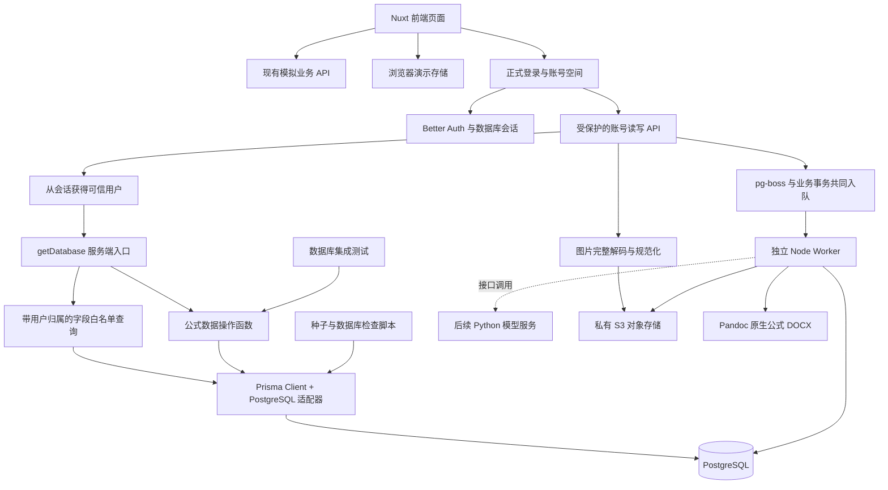
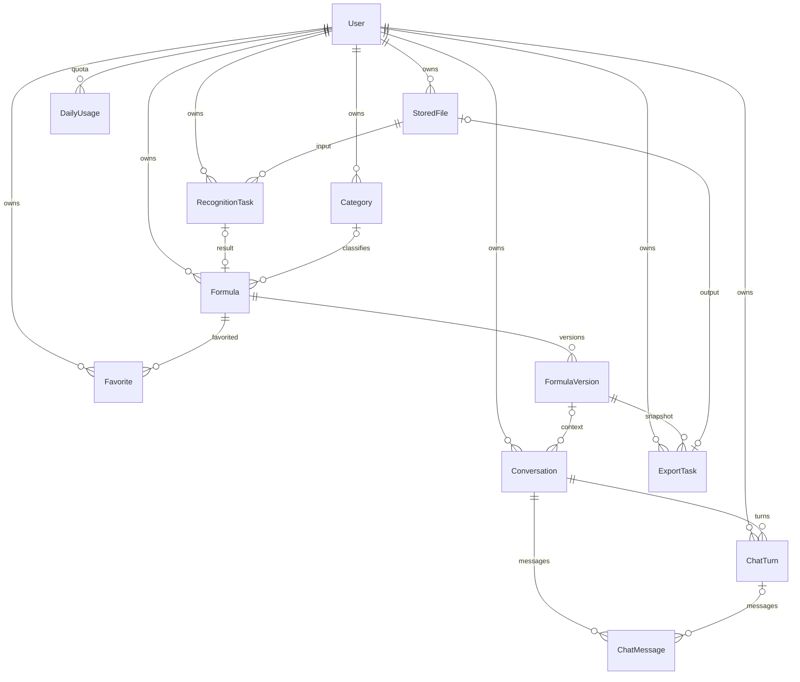

# Formula AI：数据库与架构设计说明

更新日期：2026-10-21。包含 Day 3～13 已实现的数据库、认证、图片存储、公式库、队列、流式对话与导出；第11天真实Python接入暂缓。

本文说明已经构建的数据库、各层职责、表之间的关系，以及关键方案的选择理由。模型依据是 [schema.prisma](../prisma/schema.prisma)，实际数据库规则依据是 [迁移目录](../prisma/migrations/)。启动和日常操作见 [数据库操作说明](数据库操作手册.md)。

## 1. 当前交付范围

已经建立 PostgreSQL 17、Prisma 7.10.1、十二张业务表、四张认证表、六份 SQL 迁移，以及私有 S3 存储。认证见 [第4天开发说明](第4天开发说明.md)，图片与公式保存见 [第5至6天开发说明](第5至6天开发说明.md)。第13天在原ChatTurn中追加流式片段与来源，没有新增表。

**识别内容仍为模拟，账号AI已实现DeepSeek适配，真实短答调用已验证。** 登录后的图片上传、结果、编辑、历史、分类和收藏使用真实存储与数据库。流式进展与任务执行权共同提交，停止保存未完成片段，选择理由及文件图见 [第12至13天开发说明](第12至13天开发说明与验收记录.md)。访客演示继续独立保存在浏览器，不自动导入账号。

| 部分                                     | 状态                                |
| ---------------------------------------- | ----------------------------------- |
| 数据库、表结构、迁移、种子、数据操作函数 | 本次实现                            |
| 当前页面和模拟识别、模拟对话             | 沿用已有实现                        |
| 正式登录、HTTP 会话与私有资源读取权限    | Day 4 已实现，新增写接口须复用守卫  |
| 真实图片上传与私有对象存储               | Day 5 已实现，服务端完整解码校验    |
| 识别结果和人工修改的页面持久化           | Day 6 已实现，包含历史及并发校验    |
| 队列、Worker、可靠入队、重试与额度       | Day8 已实现，包含真实队列和额度事务 |
| Word 导出、真实 Python 模型和大模型      | Word 已实现，真实模型按后续计划接入 |

## 2. 架构分层：每层负责什么



实线是本次已有调用，虚线是后续接入。前端不会直接连接数据库。

- **页面层**：输入、展示和交互，不掌握数据库密码。
- **API 层**：校验请求，从可信会话获取用户，并判断访问权限。
- **数据操作层**：处理多表写入、事务、版本冲突；不依赖 HTTP，可以被 API、Worker 和测试复用。
- **Prisma**：提供类型化查询、客户端生成和迁移工具，不负责用户鉴权。
- **PostgreSQL**：持久化数据，通过外键、唯一约束、CHECK 和触发器保证结构完整性。
- **对象存储**：已保存真实图片，数据库保存归属、定位与元数据；已经支持真实 Word 文件。上传失败采用状态与补偿，详细边界见第5至6天说明。

本阶段采用一个 Nuxt 业务工程，避免过早拆分微服务。Node Worker 可以单独运行进程，Python 保持独立接口，不把模型运行环境混入 Node 项目。

## 3. 十二张业务表的关系与数据字典



可以把 Formula 理解为公式档案，FormulaVersion 是档案里的不同版本，RecognitionTask 是产生识别结果的处理过程。档案名称和分类可以修改，原来识别出的内容与后来修订的内容分别保存。

| 模型 / 数据库表                         | 主要字段                                                                         | 职责                                   |
| --------------------------------------- | -------------------------------------------------------------------------------- | -------------------------------------- |
| `User` / `users`                        | `id`、`email`、`displayName`、创建/更新时间                                      | 业务用户，不包含密码和登录会话         |
| `StoredFile` / `stored_files`           | `ownerId`、`kind`、`status`、`bucket`、`objectKey`、名称、MIME、字节数、宽高     | 私有文件元数据                         |
| `RecognitionTask` / `recognition_tasks` | `ownerId`、`inputFileId`、`requestKey`、模式、状态、尝试次数、错误信息、起止时间 | 识别请求的处理记录                     |
| `Formula` / `formulas`                  | `ownerId`、`title`、可选分类、可选识别任务                                       | 公式档案，不重复保存当前 LaTeX         |
| `FormulaVersion` / `formula_versions`   | `formulaId`、`ownerId`、版本号、LaTeX、来源、模型版本、是否模拟、可选置信度      | 一次不可覆盖的公式内容                 |
| `Category` / `categories`               | `ownerId`、`name`                                                                | 用户自己的单层分类                     |
| `Favorite` / `favorites`                | `ownerId`、`formulaId`、收藏时间                                                 | 用户与公式的收藏关系                   |
| `Conversation` / `conversations`        | `ownerId`、可选 `formulaVersionId`、标题、时间                                   | 固定上下文的对话；版本为空表示普通对话 |
| `ChatMessage` / `chat_messages`         | 会话、用户、顺序号、角色、状态、内容、模拟标记、模型版本                         | 一条用户或助手消息                     |

独立 ID 使用 PostgreSQL 生成的 UUID，时间字段使用 `timestamptz(3)` 保存时间点，展示层再按用户时区转换。表名映射为 snake_case，Prisma 字段保留 camelCase。

### 枚举和边界

| 对象     | 值                                            | 说明                                             |
| -------- | --------------------------------------------- | ------------------------------------------------ |
| 文件类型 | `IMAGE`、`DOCX`                               | 图片或未来导出文档                               |
| 文件状态 | `PENDING`、`READY`、`DELETED`                 | 待上传、可用、标记删除；不会自动执行对象存储操作 |
| 识别模式 | `HANDWRITTEN`、`PRINTED`                      | 手写或印刷                                       |
| 任务状态 | `QUEUED`、`PROCESSING`、`COMPLETED`、`FAILED` | 任务记录的生命周期状态                           |
| 版本来源 | `RECOGNITION`、`MANUAL`、`DEMO`               | 原始识别、人工修订、预置样例                     |
| 消息角色 | `USER`、`ASSISTANT`                           | 用户和助手                                       |
| 消息状态 | `STREAMING`、`COMPLETED`、`FAILED`            | 为后续流式保存预留，不代表当前已接入流式回答     |

页面业务协议与数据库记录不是同一种对象。例如数据库的收藏是一张关系表，页面只需要一个布尔状态；数据库有多个版本，页面需要当前 LaTeX。正式 API 接入时应做明确转换，不直接将整条数据库记录返回浏览器。

## 4. 用户归属为什么要放进外键

以公式分类为例，关联关系不是只引用分类 ID，而是：

```text
Formula(categoryId, ownerId) → Category(id, ownerId)
```

用户 A 拥有分类 C；用户 B 即使知道 C，也无法把自己的公式关联到它，因为分类表中不存在 `(C, B)`。

文件与任务、任务与公式、公式与版本、版本与对话、对话与消息、收藏与公式，都采用类似组合外键。被引用表增加 `(id, ownerId)` 唯一约束，虽然 ID 本身已经唯一，但这些索引让数据库能够直接检查归属一致性。

**关系约束不代替读取权限。** 数据库凭据仍能执行不带用户过滤的查询。Day 4 的正式账号接口先验证数据库会话，再从会话获得 ownerId，不相信客户端传来的用户 ID。其他用户与不存在的资源均返回 404；新增业务接口必须继续复用该守卫。

本次没有启用 PostgreSQL RLS。它需要结合数据库角色、连接池和每次请求的用户上下文整体设计；首版先采用服务端鉴权、带归属的查询和数据库关系约束。归属约束负责阻止错误关联，鉴权负责决定谁可以读写，两者分工明确。

邮箱约定存去掉首尾空白后的小写形式，并由数据库 CHECK 校验；登录服务接入时需要先归一化。分类名在同一用户内精确去重，不同用户允许拥有同名分类。

## 5. 公式版本与并发修改

```text
公式：质能方程
  v1  E = mc^2             来源 RECOGNITION
  v2  m = \frac{E}{c^2}    来源 MANUAL

对话 A → 固定绑定 v1，后续增加 v2 不会改变这次对话的上下文。
```

第一版保存原始结果，修改只插入新的版本。当前版本按版本号最大的一条读取，没有同时维护 `latex`、`originalLatex` 和当前版本指针等多个重复真相。

`createFormula()` 使用事务创建档案和第一版，一起成功或一起失败。业务上公式至少有一版，但外键不能要求父记录必须有子记录，因此正式写入要走这个数据函数，不能由各 API 随意创建空档案。

数据库以 `(formulaId, number)` 防止重复版本号，并通过触发器禁止 UPDATE 公式版本。该规则防止已有内容被覆盖；保留随所属数据删除的能力，并非不能删除的审计存证。本次没有提供单独删除历史版本的产品接口。

### 两个页面同时编辑时怎么办

`appendFormulaVersion()` 要求传入编辑时看到的 `expectedVersionId`：

1. 在短事务中检查公式属于当前用户。
2. 读取最新版，确认它仍等于预期版本。
3. 插入下一版，并更新公式档案的更新时间。
4. 使用 Serializable 隔离级别；遇到序列化或版本号唯一冲突最多尝试 3 次。重新读取后若版本已变化，返回 `VERSION_CONFLICT`，不静默覆盖。

同样内容再次保存返回现有版本，不制造额外版本。事务里不调用 Python 或大模型，避免长时间占用连接。事务与冲突处理方式参考 [Prisma 事务文档](https://www.prisma.io/docs/orm/v7/prisma-client/queries/transactions)。

## 6. 文件、任务与对话的设计取舍

### 文件

数据库保存 `bucket + objectKey`，组合唯一；不保存图片二进制，也不保存会过期的签名链接。后续通过权限校验后再生成临时下载地址。

数据库检查 MIME、大小和宽高：图片最多 10MB、最多 2000 万像素，可用图片必须有尺寸。Day 5 已增加真实格式与完整解码检查、方向校正、元数据移除。正式文件带上传请求键与 SHA256，并按用户请求键去重；旧种子仍为 PENDING，不假称已有图片。

### 任务

同一用户的 `requestKey` 唯一，一个任务最多关联一份公式结果。这是幂等的结构基础，还需要后续实现重复请求返回、可靠入队和 Worker 的处理逻辑。

任务默认最多尝试 3 次，数据库允许配置上限为 10 次；起止时间、失败错误码和尝试次数有基本一致性检查。这些 CHECK 不会自动执行完整状态转移，也不是队列执行器。未来 pg-boss 内部队列表与业务任务表分别维护，Python 仍通过接口被 Node Worker 调用。

### 对话和消息

对话可以不绑定公式；有绑定时必须是同一用户拥有的具体版本。一旦创建，不允许更新版本绑定或 ownerId，切换上下文时新建对话。

消息通过 `(conversationId, position)` 唯一排序，不用时间戳猜先后。Day8已实现轮次行锁、消息幂等、原子扣额和刷新恢复；流式状态仍为后续接入预留。

## 7. 关键选择及没有采用的方案

| 选择                      | 本次决定                 | 理由和代价                                                                            |
| ------------------------- | ------------------------ | ------------------------------------------------------------------------------------- |
| Docker / 系统安装         | Docker 只运行 PostgreSQL | 版本、端口、数据卷配置统一；开发时需要 Docker Desktop 运行                            |
| PostgreSQL / SQLite       | PostgreSQL               | 与原计划和未来 pg-boss 一致，直接验证目标数据库的事务、外键和并发行为                 |
| Prisma / 全部手写 SQL     | Prisma + 少量显式 SQL    | 常规查询与类型交给 ORM；CHECK 和触发器写入 SQL 迁移，需要一起维护                     |
| 依赖版本                  | 固定 Prisma 7.10.1       | 搭建时 latest 指向 8 候选版，因此选受支持的稳定版本，不自动追随预发布版本             |
| UUID / 自增整数           | PostgreSQL 生成 UUID v4  | 统一 API 和后台进程中的标识；索引比整数大，UUID 也不能替代权限校验                    |
| 单行覆盖 / 独立版本表     | 档案与版本分表           | 保留原始识别和修改历史，让对话与未来导出固定到某一版；需要关联查询                    |
| 当前版本指针 / 按编号读取 | 按版本号取最新           | 初期减少重复数据和循环关联，性能问题出现后再决定是否冗余指针                          |
| 布尔收藏 / 收藏表         | 独立关系表               | 保留收藏时间，以复合主键防重复，并约束用户归属                                        |
| 多级分类 / 单层分类       | 单层、一条公式一个分类   | 符合首版范围，避免提前处理分类树与多对多管理                                          |
| 大 JSON / 关系表          | 核心业务使用关系表       | 让关联、唯一性、查询与索引有明确结构，而非全部依赖程序解释 JSON                       |
| Redis / 暂不加入          | 不加入                   | 当前数据库基础不需要额外服务，队列按原计划采用 PostgreSQL 生态                        |
| 自建认证 / 成熟登录库     | Better Auth + Prisma     | 复用 User.id，认证表独立；密码哈希、会话和 Cookie 由成熟库处理，业务 API 判断资源归属 |

UUID 使用数据库内置函数，[PostgreSQL UUID 文档](https://www.postgresql.org/docs/17/functions-uuid.html)。Prisma 版本背景见 [官方版本说明](https://www.prisma.io/docs/prisma-orm/quickstart/postgresql)。

### 连接池、索引与删除

- 每个 Prisma Client 的池上限为 5，连接超时 5 秒，空闲保留 10 秒。Nuxt 热更新复用同一客户端；修改连接或 schema 后重启进程。部署时需把 Nuxt、Worker 和队列进程的连接数一起计算，当前值不是通用最佳值。[Prisma 连接池说明](https://www.prisma.io/docs/orm/v7/prisma-client/setup-and-configuration/databases-connections/connection-pool)
- 索引围绕用户归属、更新时间、任务状态、版本编号与消息顺序设置。没有提前增加全文或向量索引，搜索方案等实际数据量和需求明确后再决定。
- 用户删除可级联清理所属数据。分类仍有公式、版本仍被会话引用时，直接删除会被外键拒绝；需先处理引用，避免悬空上下文。Day7 分类删除接口在事务中先解除公式分类，再删除分类；公式和版本删除尚未开放。

## 8. 代码、迁移与后续修改

| 文件                                                     | 内容                                       |
| -------------------------------------------------------- | ------------------------------------------ |
| `compose.yaml`                                           | PostgreSQL、健康检查、本机端口、命名数据卷 |
| `scripts/setup-db-env.mjs`                               | 生成随机本机密码，已有 .env 不覆盖         |
| `prisma/schema.prisma`                                   | 模型、枚举、外键、唯一约束、索引           |
| `prisma.config.ts`                                       | CLI 连接、schema、迁移和种子入口           |
| `prisma/migrations/202610200001_initial/migration.sql`   | 初始表结构                                 |
| `prisma/migrations/202610200002_integrity/migration.sql` | CHECK、版本不可覆盖、对话上下文不可变      |
| `server/database/client.ts`                              | 连接工厂与适配器                           |
| `server/utils/database.ts`                               | Nuxt 服务端私有配置入口                    |
| `server/database/formulas.ts`                            | 原子创建、归属查询、追加版本和冲突处理     |
| `server/database/errors.ts`                              | 与 HTTP 分离的数据操作错误                 |
| `prisma/seed-data.ts`、`prisma/seed.ts`                  | 固定开发种子                               |
| `tests/database.test.ts`                                 | PostgreSQL 集成检查                        |
| `scripts/check-database.ts`                              | 连接、版本与记录数检查，不打印密码         |

`.env` 和生成的 Prisma Client 不纳入 Git；后者由 schema 生成。安装依赖的 prepare 和生产 build 都先运行 generate。新检出工程无需手工复制生成文件。

已应用的迁移不要回头修改。改表时新增迁移；应用已有迁移用 `db:migrate`，创建开发迁移用 `db:dev`。Prisma schema 不能完整表达自定义 CHECK 和触发器，因此必须一起审阅 SQL，不能只看 ORM diff。[Prisma 迁移说明](https://www.prisma.io/docs/orm/migrations/applying-a-migration)

## 9. 验证依据与后续接入

Day3当时两份迁移已成功应用，第二次执行没有待应用项；当前已追加到五份。种子执行两次后仍为 2 用户、2 文件、2 任务、2 公式、3 版本、2 分类、2 收藏、2 对话和 3 消息。12 项真实数据库检查覆盖了版本、并发、归属关系、唯一约束和级联清理。测试只清理本次随机生成的临时用户，未清空数据库或删除数据卷。

种子用户没有密码，不是两个可登录的测试账号。数据库基础检查见 [第3天验收记录](第3天验收记录.md)，两个真实注册账号的登录、会话及 HTTP 归属验收见 [第4天验收记录](第4天验收记录.md)。

上传、识别保存和版本编辑已复用可信会话与数据事务，账号历史使用稳定的创建时间和 ID 分页。Day7 已接入公式库、分类、收藏与文本搜索，没有新增表或迁移。列表使用参数化 LATERAL 查询最新版本，分类删除使用事务，收藏使用显式目标状态。选择理由见 [第7天开发说明](第7天开发说明.md)，实际验证见 [第7天验收记录](第7天验收记录.md)。第8～9天已实现版本绑定导出、可靠队列、模拟对话保存和日额度，详细表结构及取舍见 [第8至9天开发说明](第8至9天开发说明.md)。
