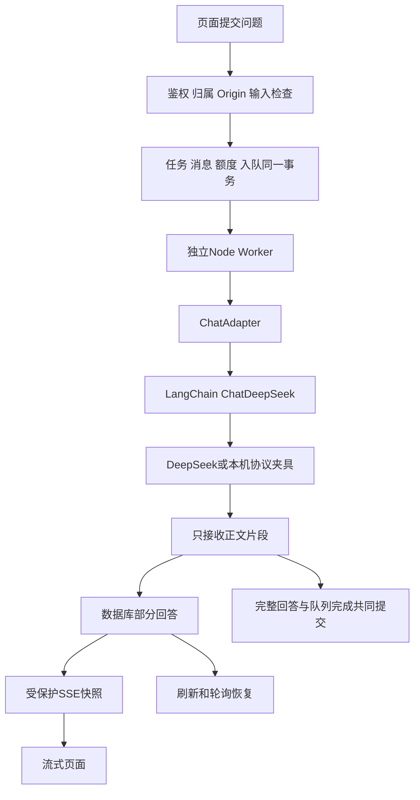

# 第12至13天开发说明与验收记录

日期：2026-10-21。用户确认跳过第11天，先完成可独立推进的第12、13天，并选择 **DeepSeek + LangChain TS**。本轮已完成相关代码、数据库迁移、通用故障处理及本机验收。**以下记录实现阶段的本机夹具验收，当时尚未配置真实密钥；Python真实识别仍待第11天。**

最新补记：用户已配置密钥并完成一次真实调用，来源、固定版本、保存和SSE回读通过，见 [DeepSeek真实联调记录](DeepSeek真实联调记录.md)。

## 交付了什么

账号对话已支持逐段显示、连续追问、刷新恢复、断线后轮询及停止生成。消息显示模拟/DeepSeek来源；未完成片段标记为失败，不冒充完整回答。常见数学分隔符由 KaTeX 渲染，其余内容作为文字，不注入模型 HTML。访客对话继续是独立演示。

第12天的通用能力包括：识别及对话共享60秒调用预算、取消信号传递、输入/配置/限流/超时/临时故障分类，以及队列最多3次执行。请求在开始前已经取消时，不再启动适配器。Python模型的缩放、二值化、设备性能和实际图片回归没有提前实现或宣称完成。

第13天的供应商调用集中在 LangChain DeepSeek 适配器。默认显式模拟模式；切换真实模式但缺少密钥时，API明确拒绝提问且不扣额度，Worker也会首轮明确失败，不会回退模拟。真实成功调用、账户余额和数学质量仍需配置有效密钥后验收。

## 架构与关键选择

保留队列架构，避免浏览器断开就丢失任务。SSE只读取本人对话，不启动模型调用，不消耗新额度。Worker每隔至少250ms保存一次进展，API约750ms读取一次；页面看到的是持久化的增量快照，并非逐个Token原样转发。连接最长约60秒，断开后同一轮停止自动重连，退回已有1.5秒轮询；刷新可重建连接。

流式片段写入前调用 pg-boss 官方 `touch`，同时传递领取时的 `retryCount`，并通过 Prisma事务适配器锁住当前执行权。失败或旧Worker不能覆盖新尝试。最终回答仍与队列完成共同提交。没有直接读写 pg-boss 私有表结构。

停止操作只接受本人会话和有效Origin，取消队列与保存终态消息在同一事务中完成。Worker约每秒检查停止或接管状态，并中断上游读取。页面离开仅停止订阅，不等同取消模型；明确点击“停止生成”才改变任务状态。取消不保证供应商已经发生的计算不计费。

LangChain和HTTP内层重试关闭，只由持久化队列控制最多3次尝试。临时失败可以重新调用供应商，下一次清空旧片段；幂等保证业务结果、消息和应用额度不会重复，不能保证供应商请求只发生一次。应用额度统计接受的任务数，**不是供应商Token或金额账单**。

当前单次输出最多2048 tokens、正文最多16000字符，最近19条完成消息再按20000字符预算筛选。固定版本LaTeX由数据库读取，不接受页面替换公式或系统角色。不保存或传回供应商的思考字段，只保存最终正文和配置的模型标识。未正常结束、截断或空回答明确失败。

## 文件对应关系

| 文件                                                                                                                     | 职责                                   |
| ------------------------------------------------------------------------------------------------------------------------ | -------------------------------------- |
| [failure.ts](../server/inference/failure.ts)、[deadline.ts](../server/inference/deadline.ts)                             | 安全错误分类、超时与外部取消           |
| [adapter.ts](../server/chat/adapter.ts)                                                                                  | 自有流式适配协议，隔离调用库           |
| [settings.ts](../server/chat/settings.ts)、[factory.ts](../server/chat/factory.ts)                                       | 显式模式、私有配置及适配器选择         |
| [prompt.ts](../server/chat/prompt.ts)                                                                                    | 固定版本上下文和有界历史               |
| [deepseek-adapter.ts](../server/chat/deepseek-adapter.ts)                                                                | 唯一LangChain供应商调用位置            |
| [mock-adapter.ts](../server/chat/mock-adapter.ts)                                                                        | 明确标记的模拟分块回答                 |
| [chat.ts](../server/worker/chat.ts)                                                                                      | 领取任务、监测取消、保存进展与最终回答 |
| [chat-progress.ts](../server/database/chat-progress.ts)、[claim.ts](../server/queue/claim.ts)                            | 进展与执行权事务、停止操作             |
| [事件端点](../server/api/account/conversations/%5Bid%5D/events.get.ts)                                                   | 鉴权后的SSE，持续复查会话与归属        |
| [停止端点](../server/api/account/conversations/%5Bid%5D/turns/%5BturnId%5D/cancel.post.ts)                               | 写请求检查、取消与失败片段保存         |
| [useConversationEvents.ts](../app/composables/useConversationEvents.ts)                                                  | 订阅快照、失败退回轮询、离开关闭       |
| [useAccountChat.ts](../app/composables/useAccountChat.ts)                                                                | 提问、停止及共享页面状态               |
| [AccountChat.vue](../app/components/AccountChat.vue)、[ChatMessageContent.vue](../app/components/ChatMessageContent.vue) | 消息、来源、输入交互与安全数学展示     |

## 数据库变化

追加第六份迁移 [202610210004_streaming_chat](../prisma/migrations/202610210004_streaming_chat/migration.sql)，应用表仍为16张，没有重置数据库或改写旧迁移。`ChatTurn`新增：

- `partialContent`：当前尝试的正文快照，数据库限制最多16000字符。
- `responseIsMock`：这次实际使用的适配器来源。
- `responseModel`：配置的模型标识，最多100字符。

最终完成或失败仍保存到原有ChatMessage，沿用每轮每角色唯一约束。失败片段和已停止状态刷新后可恢复，后续问题不会把失败助手回答当作完成历史发送。

## 验收证据

| 检查                  | 结果                                                                                       |
| --------------------- | ------------------------------------------------------------------------------------------ |
| `test:inference`      | 12项通过；真实LangChain调用本机HTTP夹具，正文过滤、401/429/503、超时、取消、配置和历史预算 |
| `test:jobs`           | 24项通过；原18项加6项流式持久化、SSE权限、停止竞争、缺密钥、重试重置和截断检查             |
| `test:workspace`      | 16项通过                                                                                   |
| `test:library`        | 15项通过                                                                                   |
| `test:auth`           | 12项通过；首次与浏览器注册共享限流窗口触发429，错开后复测全部通过，未放宽规则              |
| `test:db`             | 12项通过                                                                                   |
| `test:api`            | 7项通过                                                                                    |
| `test:documents`      | 7项通过；不重复声称WPS已实测                                                               |
| `test:private-config` | 1项通过；加入AI私有凭据及构建哨兵扫描                                                      |

合计 **106项自动检查**。类型、格式与最终生产构建通过，最终构建30.8秒，文档本地链接检查通过。打包曾遇到Windows沙箱链接权限及运行中预览占用Sharp文件，停止预览并重试后成功，没有修改依赖实现来绕过问题。日志保留在 `artifacts/day1213-*.log`。

依赖审计先遇到当前npm镜像未实现安全审计接口，改用官方registry并设置8秒请求上限、关闭网络重试后取得结果：仍为11项高风险、0项严重，与第8～9天计数一致。没有强制升级上游依赖；审计原始结果在 `artifacts/day1213-audit.json`。

浏览器使用真实账号、图片上传、Worker、数据库及生产页面，供应商由本机DeepSeek兼容夹具替代：

1. 创建绑定公式版本的对话，看见真实SSE逐段输出。
2. 生成中刷新，恢复同一任务；完成后数学内容正常渲染。
3. 测试文本含HTML样式字符串，只显示为文字，无新增图片DOM或脚本执行。
4. 连续追问并停止，保存失败片段；刷新仍保留四条消息。
5. 断开SSE，页面自动轮询并最终恢复完整回答；320/390/1280宽度无横向溢出。

夹具观察到恰好3次模型请求：2次完成、1次取消；刷新和SSE重连没有额外调用。三次请求均包含固定版本上下文，连续追问带上已有历史。页面运行时异常为0，主动断开SSE产生的网络失败为预期。

- [流式回答截图](../artifacts/第12至13天-流式回答.png)
- [恢复和停止截图](../artifacts/第12至13天-对话恢复与停止.png)
- [缺少密钥提示](../artifacts/第12至13天-缺少密钥提示.png)

另外用最终生产构建实际切换为DeepSeek但不提供密钥：配置接口返回`ready:false`，开始按钮禁用，已有对话提问返回503，前后额度不变。相关脚本为`artifacts/day1213-missing-key.js`。

脚本在 `artifacts/day1213-browser.js` 和 `day1213-provider-fixture.mjs`。截图正文明确写有“本机协议验收”，**不是DeepSeek真实回答证据**。真实密钥、余额、输出质量、线上代理流式行为，以及Python真实图片联调仍未验收。下一步配置见 [DeepSeek配置与联调手册](DeepSeek配置与联调手册.md)。

验收后清理唯一的本轮浏览器临时账号、所属队列和1个图片对象，保留原有数据及数据卷；关闭本机模型夹具和测试预览，恢复默认开发服务与模拟Worker。没有修改实际`.env`中的密钥或AI模式。精确清理脚本为`artifacts/day1213-qa-cleanup.ts`。
