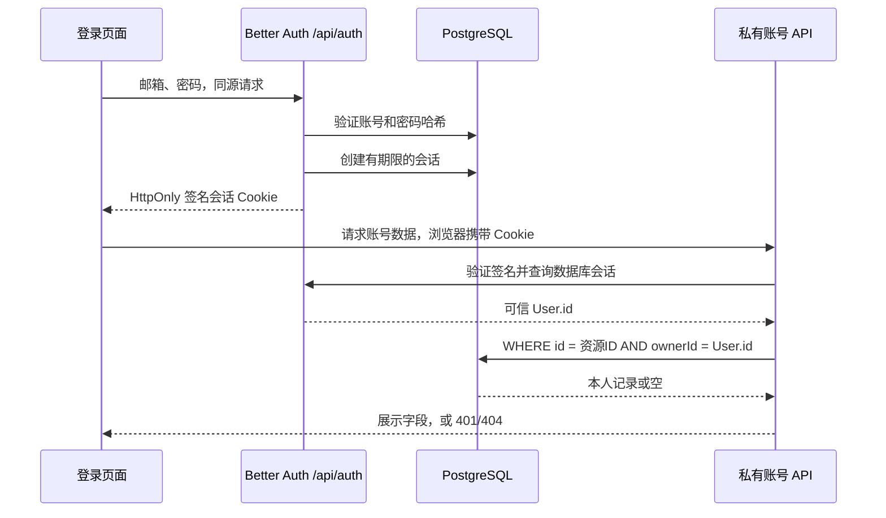
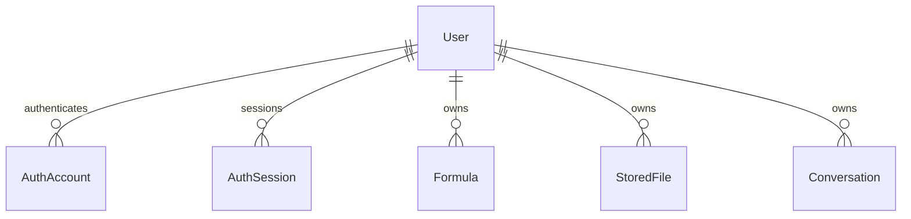

# 第4天开发说明：登录、会话与用户隔离

日期：2026-10-21。对应十五天计划 Day 4。

## 1. 今天具体完成了什么

- 将原先禁用的登录预览改为真实邮箱密码登录，增加注册、提交状态和中文错误反馈。
- 接入 Better Auth 和 Prisma，将认证身份关联到原有 User.id，不重建原来的业务用户和私有资源。
- 新增数据库会话、退出撤销、过期校验和页面刷新后的登录状态恢复。
- 新增 `/account` 账号空间：展示当前用户的资料、真实数据库记录计数和最近十条账号公式。
- 新增必须登录的账号接口，以及公式、版本、文件、任务、分类和对话的归属读取校验。
- 增加跨站来源校验、认证请求数据库限流、私有响应禁止缓存，以及登录后跳转路径限制。
- 把 docs 中原有英文文档名改成中文，更新内部链接，新增 [文档导航](文档导航.md)。

现有首页、公式库、识别和 AI 对话仍是本机演示流程。账号空间是真实数据库查询；两者在页面文案上区分，登录不会自动上传或导入浏览器中的公式。真实上传在 Day 5，结果编辑持久化在 Day 6，公式库业务在 Day 7，对话保存与额度在 Day 8。

## 2. 为什么选择 Better Auth

| 方案                                 | 判断                                                                                                           |
| ------------------------------------ | -------------------------------------------------------------------------------------------------------------- |
| Better Auth + Prisma                 | 本次采用。适配 Nuxt/TypeScript，已有密码认证、会话、Cookie 和来源校验，复用 PostgreSQL；认证数据由本项目维护。 |
| 托管认证，例如 Supabase Auth         | 能减少认证运维，但需要额外服务配置和外部账号，还要协调外部用户标识与现有 User.id。本阶段没有引入。             |
| 自行组合哈希、签名 Cookie 与登录接口 | 初期文件可能更少，但会承担认证协议和会话边界的维护，本项目采用成熟库处理这些部分。                             |

Better Auth 与 Prisma 适配器均固定为 **1.7.12**，使用其最小服务端入口和独立适配器。当前只启用邮箱密码，不配置社交登录，不开放自动账号合并。

依据：[Nuxt 集成](https://better-auth.com/docs/integrations/nuxt)、[Prisma 适配器](https://better-auth.com/docs/adapters/prisma)、[邮箱密码认证](https://better-auth.com/docs/authentication/email-password)。

## 3. 一次登录到读取数据的过程



页面刷新时，由 Nuxt `useFetch` 转发当前请求的 Cookie，读取精简的账号资料。服务端不会把所有请求的用户放入一个全局变量；全局复用的只有数据库连接池和认证配置实例。

`/api/account/session` 只返回用户的 id、name、email、emailVerified，不返回会话令牌。登录响应由成熟认证库处理；本项目不会将其令牌写入 localStorage 或页面状态。现有 localStorage 仍只用于明确标识的演示记录。

## 4. 数据库增加了什么

原有九张业务表保留。新增四张认证基础表，共十三张应用表（不含 Prisma 迁移记录表）。

| 表                   | 内容                                                           | 重要关系或约束                                 |
| -------------------- | -------------------------------------------------------------- | ---------------------------------------------- |
| `users`（原有）      | 增加 `emailVerified` 与可选 `image`                            | 认证 name 映射到现有 displayName；id 仍为 UUID |
| `auth_accounts`      | 登录方式、账号标识、密码哈希、为其他认证方式保留的可选令牌字段 | userId → users；providerId + accountId 唯一    |
| `auth_sessions`      | 不透明会话令牌、有效期、用户、客户端信息                       | userId → users；token 唯一；用户与过期时间索引 |
| `auth_verifications` | 验证标识、值与有效期                                           | 配套基础表；尚未配置发送邮件和找回密码流程     |
| `auth_rate_limits`   | 请求键、计数和最近请求时间                                     | key 唯一，计数非负，支持跨进程的数据库限流     |



新增迁移为 `prisma/migrations/202610210001_authentication/migration.sql`。从现有真实库生成结构差异，审阅后应用；没有修改前两份已应用迁移，没有 reset 或删除数据卷。认证表随用户级联删除。原 Day 3 的 CHECK、组合外键与版本触发器仍保留并通过回归检查。

种子用户仍没有密码，不会凭空变为可登录账号。请在登录页创建自己的账号。

## 5. 权限如何执行

页面守卫和后端守卫分别负责导航体验和实际权限。

- `/account` 声明 `middleware: 'auth'`。未登录时跳转到登录页，成功后回到账号空间。
- 每个 `/api/account` 私有数据接口调用 `requireAccountUser(event)`；没有有效会话返回 **401**。
- 读取资源时始终带上会话中的 ownerId。URL 查询参数、请求体或自定义请求头不能指定当前用户。
- 其他用户的资源和不存在的资源都返回 **404**；错误响应不暴露记录是否属于别人。
- 私有资源 ID 先检查 UUID 格式。数据函数缺失用户标识时直接拒绝或返回空，避免 Prisma 忽略 undefined 条件。
- 文件只返回名称、状态、格式和大小等展示字段，不返回 bucket、objectKey 或下载地址。
- 对话内的消息也显式按所属用户读取；当前最多返回前 100 条，正式历史分页在后续对话业务中处理。

这次覆盖的真实读取类别是 `formulas`、`versions`、`files`、`tasks`、`categories`、`conversations`。收藏仍由后续公式库接口接入；数据库已有归属外键。本次没有提供公共未鉴权写入口。

## 6. 密码、会话与请求策略

| 项目   | 当前规则                                                                                          |
| ------ | ------------------------------------------------------------------------------------------------- |
| 密码   | 10～128 字符，由 Better Auth 默认密码算法处理，只保存哈希                                         |
| 昵称   | 服务端去空白，1～100 字符                                                                         |
| 邮箱   | 服务端归一化为小写；数据库唯一；注册不能伪造已验证标记或指定 User.id                              |
| 会话   | 7 天有效期，每隔 1 天允许续期；禁用 Cookie 会话缓存，每次私有请求检查数据库                       |
| Cookie | HttpOnly、SameSite=Lax；HTTPS 站点使用 Secure Cookie；仅回环地址允许 HTTP                         |
| 退出   | 撤销当前数据库会话，并清除浏览器 Cookie；其他设备会话不会被一起退出                               |
| 来源   | 保留库的来源与 CSRF 校验；开发额外允许 localhost:3000 和 127.0.0.1:3000，生产只允许配置的站点来源 |
| 限流   | 注册每连接地址每 60 秒 5 次，登录每 60 秒 8 次；其他认证请求每 60 秒 100 次，状态存 PostgreSQL    |
| 跳转   | 只允许回到 `/account` 或其内部路径，拒绝外站 redirect                                             |
| 缓存   | 账号 API、认证接口和含账号资料的页面使用 private, no-store，并按 Cookie 区分                      |

HTTP 入口会用实际连接地址覆盖 `x-formula-client-ip`，不信任浏览器提交的同名头或 X-Forwarded-For。反向代理部署时，目前按代理连接地址限流；Day 14 需要根据实际代理拓扑配置可信客户端地址，不能直接信任所有转发头。

限流是认证防滥用，不是大模型额度。大模型额度仍按后续业务事务设计。

依据：[会话与请求安全](https://better-auth.com/docs/reference/security)、[数据库限流](https://better-auth.com/docs/concepts/rate-limit)。

## 7. 代码位置与可维护性

| 文件                                                                            | 职责                                                            |
| ------------------------------------------------------------------------------- | --------------------------------------------------------------- |
| [server/auth/config.ts](../server/auth/config.ts)                               | 认证工厂，集中维护映射、密码、会话、来源和限流策略；不依赖 Nuxt |
| [server/utils/auth.ts](../server/utils/auth.ts)                                 | 从私有 runtimeConfig 创建认证实例；统一读取会话、获取可信用户   |
| [server/api/auth/[...all].ts](../server/api/auth/%5B...all%5D.ts)               | 挂载库的 HTTP 入口，覆盖客户端地址头                            |
| [server/database/private-resources.ts](../server/database/private-resources.ts) | 资源归属查询、字段白名单与账号概况                              |
| [server/api/account/](../server/api/account/)                                   | 精简会话、账号概况、六类资源的受保护读取                        |
| [server/middleware/private-cache.ts](../server/middleware/private-cache.ts)     | 账号相关响应的缓存策略                                          |
| [app/pages/login.vue](../app/pages/login.vue)                                   | 登录、注册、提交状态和错误反馈                                  |
| [app/pages/account/index.vue](../app/pages/account/index.vue)                   | 账号资料、真实记录概况和退出                                    |
| [app/composables/useAccountSession.ts](../app/composables/useAccountSession.ts) | 共享会话请求及 SSR Cookie 转发                                  |
| [app/middleware/auth.ts](../app/middleware/auth.ts)                             | 私有页面导航守卫                                                |
| [app/utils/auth-client.ts](../app/utils/auth-client.ts)                         | 同源认证客户端，仅用于浏览器登录动作                            |
| [app/utils/auth-feedback.ts](../app/utils/auth-feedback.ts)                     | 中文错误映射与受限返回路径                                      |
| [shared/types/account.ts](../shared/types/account.ts)                           | 精简账号和概况响应类型                                          |
| [scripts/setup-auth-env.mjs](../scripts/setup-auth-env.mjs)                     | 补充随机认证密钥与站点 URL，不改数据库密码                      |
| [tests/auth.test.ts](../tests/auth.test.ts)                                     | 两个真实账号的 HTTP 与数据库隔离验收                            |

底部导航继续使用原来的共享组件。页面不读取数据库密码，不拼接 SQL，不直接处理密码哈希。认证策略、权限守卫、数据查询和展示各自独立，后续接入业务写接口可以复用同一个守卫。

## 8. 如何运行和体验

项目根目录执行：

```powershell
npm install
npm run db:env
npm run auth:env
npm run db:up
npm run db:migrate
npm run dev
```

已有配置时，脚本只补空缺；不会覆盖现有数据库密码或非空认证密钥。修改配置后重启 Nuxt。默认打开 `http://127.0.0.1:3000/login`，点击“创建一个”，注册后进入账号空间。新账号初始没有公式，不能把空列表误认为数据库故障。

退出入口在“我的 → 账号空间 → 退出登录”。刷新页面应保持身份；退出后直接访问 `/account` 应回到登录页。

私有配置：

| 环境变量             | 用途                                                                  |
| -------------------- | --------------------------------------------------------------------- |
| `NUXT_DATABASE_URL`  | 数据库连接                                                            |
| `NUXT_AUTH_SECRET`   | 至少 32 字符的私有随机认证密钥，生成脚本使用 48 字节随机源            |
| `NUXT_AUTH_BASE_URL` | 完整站点来源，本机默认 http://127.0.0.1:3000，部署改为实际 HTTPS 站点 |

生产服务需注入环境变量；`npm run start` 不自动读取 .env。多实例必须使用相同密钥、站点配置和数据库。不要每次启动重新生成密钥。

## 9. 当前边界

### 运行时与依赖维护

认证页面包含用户资料，因此同步更新了原 Nuxt 4.4.2：当前固定为 **4.6.2**，包含旧版 SSR 用户数据缓存相关修复；KaTeX 更新为 **0.19.0**。没有用 `npm audit fix --force` 自动改动依赖。

当前全局 Node 24.14.0 低于新版 Nuxt 要求，未修改全局安装。在本项目 `.tools/` 放置官方 **Node 24.22.0** Windows 便携版，下载后使用官方 SHASUMS256 校验压缩包。`scripts/run-node.mjs` 在当前 Node 满足要求时直接使用它，否则选择本项目便携运行时；没有可用运行时时给出明确提示。该目录不纳入 Git，其他电脑需要安装 Node 22.22.3+（22.x）、24.15.0+（24.x）或 26+。

来源：[Node 官方发行目录](https://nodejs.org/dist/v24.22.0/)、[Nuxt SSR 缓存问题公告](https://github.com/advisories/GHSA-wm8w-6qjm-cv43)。依赖扫描仍报告上游 braces/node-forge 相关项，具体运行边界与结果记录在验收文档，不宣称整个依赖树已无漏洞。

邮箱密码可以真实注册和登录，但尚未接邮件服务，因此 **没有邮箱所有权验证、找回密码、验证码、第三方登录或全设备退出界面**。emailVerified 保持 false，不能把这个邮箱当作已验证的联系方式。这些功能需要单独配置对应服务和流程。

本次没有调用大模型 API，没有接 LangChain，也没有改变朋友的 Python 识别服务接入时间。后续模型选型可以在服务端适配层独立调整。

验收命令与实际结果见 [第4天验收记录](第4天验收记录.md)。
