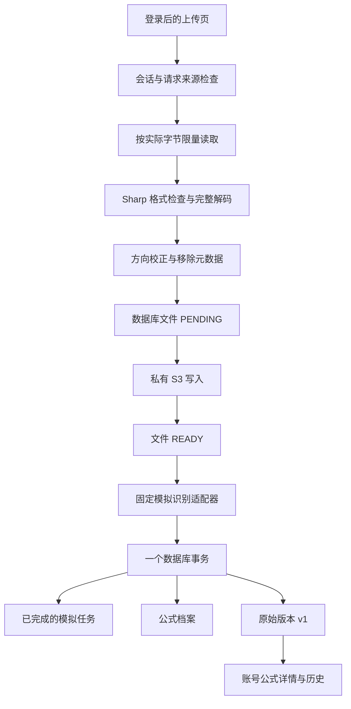

# 第5至6天开发说明：真实上传、识别结果与版本保存

日期：2026-10-21。对应十五天计划 Day 5、6。

## 一、这两天完成了什么

| 范围       | 已实现的行为                                                           |
| ---------- | ---------------------------------------------------------------------- |
| 图片上传   | 登录后上传真实 JPEG/PNG 到私有对象存储，数据库关联当前用户             |
| 服务端检查 | 按实际字节限制 10MB，验证真实格式，完整解码，限制 2000 万像素          |
| 图片方向   | 根据 EXIF 自动旋转/翻转，移除 EXIF/GPS 等元数据，保存规范化图片        |
| 私有读取   | 同源接口先检查会话和归属，再读取图片；刷新仍能显示，不提供公开对象地址 |
| 模拟识别   | 使用本人已上传文件，保存模拟任务、公式和不可覆盖的第一版               |
| 修改确认   | 实时预览 LaTeX，确认后保存到账号；每次内容变化新增版本，原始结果不覆盖 |
| 并发处理   | 提交编辑时的预期版本；旧版本提交返回 409，不静默覆盖其他修改           |
| 历史记录   | 新增账号识别历史，每页 20 条，能重新打开详情及原图                     |
| 网络重试   | 上传和识别分别使用请求键，重复提交返回已有结果或明确冲突               |
| 文档和代码 | 中文实施与验收文档；存储、图像、数据事务、DTO、接口和页面分别组织      |

**真实的是图片上传、存储、数据库和版本保存；识别仍返回固定模拟 LaTeX。** 手写/印刷两种模式均明确标注模拟，不会根据所选图片真实推理，不生成虚假置信度。AI 对话和 Word 导出仍按原计划后续接入。

## 二、用户怎么使用

1. 在 `/login` 注册或登录。
2. 打开 `/upload`。页面提示“图片与版本将保存到你的账号”。
3. 选图或通过手机文件选择器拍照，点击“识别并保存到账号（模拟）”。
4. 页面依次显示上传和生成模拟结果的状态，成功后进入 `/account/formulas/:id`。
5. 原图、LaTeX 和当前版本一起展示。点击编辑，修改名称或 LaTeX，确认保存。
6. 刷新仍能读取图片和新版；在版本记录中展开 v1 查看原始结果。
7. 从“我的 → 识别历史”或账号空间进入 `/account/history`，重新打开已保存记录。

未登录时 `/upload` 显示“本机演示”与登录入口，图片不会上传，也不会自动进入任何账号。原来的 `/result/:id`、演示公式库和模拟对话保留，避免将访客记录误认成账号数据。

手机“拍照识别”使用 `capture="environment"` 请求后置相机，实际选择界面由手机浏览器决定；桌面自动化不能代替真机相机验收。

## 三、为什么选 SeaweedFS 和 S3

本机使用 **SeaweedFS 4.48** Docker 单节点对象存储，命名卷持久化。只将 S3 端口绑定 `127.0.0.1:8333`，不发布 Filer、Master 或管理控制台端口。初始化脚本生成随机访问密钥，容器拒绝在空密钥配置下启动。

| 可选方案              | 本次选择与取舍                                                                                        |
| --------------------- | ----------------------------------------------------------------------------------------------------- |
| 写入 Nuxt public/     | 没有采用。public 路径会绕开用户归属检查，也不利于独立存储与部署                                       |
| 直接要求云存储账号    | 暂不要求。先在本机完整验证，再通过环境变量切换兼容服务                                                |
| SeaweedFS + S3 适配层 | 本次采用。提供真实对象接口与持久化，增加一个本机 Docker 服务；不是已经购买的云存储或高可用集群        |
| 浏览器直传或签名链接  | 目前由 Nuxt 接收并代理读取。这样服务端可以先完整解码校验，读取时立即检查会话；代价是图片流量经过 Nuxt |

业务依赖 `PrivateObjectStore` 接口。AWS SDK 封装在 `server/storage/object-store.ts` 中，页面不认识 S3、bucket 或对象密钥。以后改用兼容存储，主要调整配置、权限与兼容性验收，不改页面协议。

依据：[SeaweedFS 官方快速开始](https://github.com/seaweedfs/seaweedfs)、[官方单节点说明](https://github.com/seaweedfs/seaweedfs/wiki/Quick-Start-with-weed-mini)。

## 四、一次上传和保存的数据流

文件只接受 JPEG/PNG 内容；文件名放在 URL 编码的 `X-File-Name` 请求头，正文是文件字节。选择二进制单文件协议，是因为当前一次只上传一张图，不需要引入多文件表单解析。API 同时检查声明的 MIME、文件签名和实际解码结果，不信任扩展名。

会话读取直接使用请求头，不提前读取请求体；文件内容在认证成功后才限量读取。即使没有 Content-Length，累计超过限制也返回 413，并关闭本次连接，避免不完整请求体影响后续复用。

Sharp 先检查尺寸，再完整重编码；仅能打开元数据的损坏图片不能算成功。JPEG 输出质量为 95，PNG 无损重编码；保存的是方向校正后的规范化图片，不承诺与上传字节完全一致。输入与规范化后的输出均不超过 10MB。

依据：[Sharp 输入限制](https://sharp.pixelplumbing.com/api-constructor/)、[Sharp 输出与元数据](https://sharp.pixelplumbing.com/api-output/)。

## 五、数据库修改与失败处理

本次新增迁移 `202610210002_private_uploads`，没有修改已应用的前三份迁移。表数量仍为十三张。

| 修改                                     | 作用                                                               |
| ---------------------------------------- | ------------------------------------------------------------------ |
| StoredFile.uploadKey                     | 每用户范围内唯一的上传请求键                                       |
| StoredFile.contentHash                   | 原始上传内容的 SHA256；同时比较文件名和 MIME，防止同请求键替换内容 |
| 组合唯一约束 ownerId + uploadKey         | 数据库层阻止并发重复建文件                                         |
| 请求键与哈希成对存在的 CHECK             | 旧种子允许同时留空；正式上传两者必须有效                           |
| Formula 的 ownerId + createdAt + id 索引 | 对应账号历史排序与游标分页                                         |

文件原有 status 字段继续使用：PENDING → READY；写入失败且对象清理成功后标记 DELETED。同一个失败请求重试时可以重新使用该文件行，而不是生成无限重复行。

对象存储与 PostgreSQL 无法放进同一个本地事务。本次使用显式生命周期和尽力补偿：

- S3 写失败：不返回成功，不创建识别结果；尝试删除对象，再标记 DELETED。
- S3 已写入但数据库标记失败：同样尝试删除对象并标记失败，客户端显示可重试错误。
- 补偿失败或进程突然停止：保留 PENDING，不当作可识别文件。重复请求返回“仍在上传”，不会擅自覆盖未知状态。

**本次没有实现定时清理或自动修复 PENDING。** 遗留记录的排查方式见存储操作手册，后续任务可靠性阶段再加入有年龄阈值和一致性检查的恢复机制，不直接删除所有 PENDING。

## 六、识别与版本事务

`saveMockRecognition()` 先确认 fileId 属于当前用户且状态 READY，再调用固定模拟适配器。在同一个 Prisma 事务中创建完成任务、公式档案和 v1；任何数据库写入失败都会整体回滚，已上传图片仍可用于重试。

识别请求键在用户内唯一。相同请求键、同一文件和模式会返回同一结果；请求键被用于另一份输入时返回 409。并发重复请求通过唯一约束和重新读取已有结果收敛为一个档案。

当前是同步的模拟处理，不是后台队列。完成任务记录的尝试次数为 1；Worker、排队状态、超时恢复和任务轮询在 Day 8 接入。

编辑沿用 Day 3 的 Serializable 事务和预期版本 ID。修改 LaTeX 新增下一版，禁止 UPDATE 旧版的数据库触发器继续有效；仅改名称或重复保存相同内容不会制造空版本。名称与版本变化在同一事务中提交。冲突时页面保留草稿，不自动把旧内容覆盖到新版本。

当前乐观校验以内容版本为准；两个仅改名称的操作按后提交生效，不生成版本。以后若需要名称级冲突提示，可以再给档案增加独立修订号。

## 七、页面与文件对照

| 文件                                                                                    | 职责                                       |
| --------------------------------------------------------------------------------------- | ------------------------------------------ |
| [server/storage/object-store.ts](../server/storage/object-store.ts)                     | S3 适配器、超时与有限请求重试              |
| [server/utils/storage.ts](../server/utils/storage.ts)                                   | Nuxt 私有配置入口与实例复用                |
| [server/images/normalize-image.ts](../server/images/normalize-image.ts)                 | 文件签名、解码、像素限制、方向与重编码     |
| [server/services/image-upload.ts](../server/services/image-upload.ts)                   | 上传幂等、文件生命周期与失败补偿           |
| [server/database/file-metadata.ts](../server/database/file-metadata.ts)                 | 不含存储定位的图片 DTO                     |
| [server/database/task-submissions.ts](../server/database/task-submissions.ts)           | 模拟识别的原子保存及请求幂等               |
| [server/database/formula-queries.ts](../server/database/formula-queries.ts)             | 本人详情和历史分页                         |
| [server/database/formulas.ts](../server/database/formulas.ts)                           | 首版本事务复用、修改版本与名称             |
| [server/utils/request-body.ts](../server/utils/request-body.ts)                         | 二进制与 JSON 请求限量读取                 |
| [server/utils/auth.ts](../server/utils/auth.ts)                                         | 业务写操作的会话及来源检查                 |
| [server/utils/workspace-operation.ts](../server/utils/workspace-operation.ts)           | 业务错误到 HTTP 的统一映射，不泄漏内部异常 |
| [shared/types/workspace.ts](../shared/types/workspace.ts)                               | 上传、详情、版本、历史的共享协议           |
| [app/composables/useImageSelection.ts](../app/composables/useImageSelection.ts)         | 本机选图与预览，不把 File 存到可序列化状态 |
| [app/composables/useAccountRecognition.ts](../app/composables/useAccountRecognition.ts) | 两步提交、阶段提示与失败重试请求键         |
| [app/pages/upload.vue](../app/pages/upload.vue)                                         | 根据登录状态区分账号上传与访客演示         |
| [app/pages/account/index.vue](../app/pages/account/index.vue)                           | 账号概况、真实详情和历史入口               |
| [app/pages/account/formulas/[id].vue](../app/pages/account/formulas/%5Bid%5D.vue)       | 原图、当前结果、复制和版本记录             |
| [app/components/AccountFormulaEditor.vue](../app/components/AccountFormulaEditor.vue)   | 编辑草稿、实时预览、保存与冲突反馈         |
| [app/pages/account/history.vue](../app/pages/account/history.vue)                       | 账号历史及加载更多                         |
| [tests/workspace.test.ts](../tests/workspace.test.ts)                                   | 真实数据库、对象存储与 HTTP 集成检查       |

原 `app/pages/account/index.vue` 已移到 `app/pages/account/index.vue`，让账号首页和嵌套详情/历史各自成为独立路由，避免父页面漏放 NuxtPage 导致子路由不显示。

## 八、权限与数据边界

所有账号接口从数据库会话获取 ownerId，不相信请求体的用户 ID。图片、任务和公式都按所属用户查询；不存在与其他用户的资源统一 404，未登录为 401。写接口另行验证 Origin，跨站请求为 403。

图片由 Nuxt 代理读取，不把 bucket、objectKey、密钥或 S3 URL 返回页面。文件内容和账号页面禁止缓存，退出后旧会话不能继续读图片。S3 原始对象匿名读取被拒绝，但该保障不等于已配置云端 HTTPS、磁盘加密或备份。

上传页面只保留当前 File；重新进入上传或退出账号会清理临时图片预览，避免下一次账号操作看到上次的临时预览。原访客演示数据不自动导入或删除。

## 九、如何启动及后续范围

完整启动与私有配置见 [私有对象存储操作手册](私有对象存储操作手册.md)。前端仍使用 `npm run dev`，新增 `storage:env`、`storage:up`、`storage:check` 和 `test:workspace` 命令。

本次没有实现真实模型、AI 回答、分类收藏的账号操作、Word、队列、额度或 PENDING 自动恢复。下一步 Day 7 可以复用现有归属守卫、历史读取和版本模型，继续实现账号公式库。

实际检查与已知限制见 [第5至6天验收记录](第5至6天验收记录.md)。
