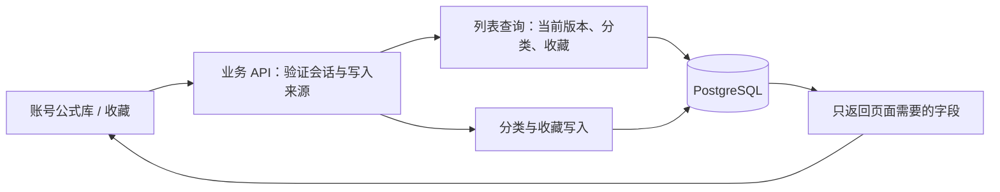

# 第7天开发说明

日期：2026-10-21。范围：公式库、单层分类、收藏、分页和文本搜索。

## 这一天具体做了什么

登录后，公式库现在读取账号真实保存的公式，可以按标题和当前 LaTeX 搜索、按分类筛选、收藏或取消收藏。分类支持新建、改名和删除；删除分类时，公式移至“未分类”，版本、原图和收藏全部保留。

公式详情也能直接修改分类和收藏。收藏沿用紫色实心爱心，不添加外圈；等待服务器保存时禁用重复点击，失败显示提示。列表每页20条，使用“加载更多”，无需一次下载全部公式和版本。

**识别仍然是固定模拟结果，AI 回答仍为模拟。** 本次没有接入真实模型或安装 LangChain。用户仍在考虑 LangChain TS，模型调用方案保留待定，不影响当前账号业务。

## 页面和代码对应关系

| 页面或职责                                   | 文件                                                                               |
| -------------------------------------------- | ---------------------------------------------------------------------------------- |
| 账号公式库 `/account/library`                | [library.vue](../app/pages/account/library.vue)                                    |
| 账号收藏 `/account/favorites`                | [favorites.vue](../app/pages/account/favorites.vue)                                |
| 两个页面共享的布局、搜索、分类筛选和操作入口 | [AccountLibrary.vue](../app/components/AccountLibrary.vue)                         |
| 单条账号公式、最新公式渲染、收藏和分类入口   | [AccountFormulaCard.vue](../app/components/AccountFormulaCard.vue)                 |
| 分类新建、改名及删除确认                     | [AccountCategoryManager.vue](../app/components/AccountCategoryManager.vue)         |
| 给公式选择一个分类                           | [AccountCategoryPicker.vue](../app/components/AccountCategoryPicker.vue)           |
| 详情页的分类与收藏栏                         | [AccountFormulaOrganization.vue](../app/components/AccountFormulaOrganization.vue) |
| 搜索条件、分页、迟到请求保护及列表状态       | [useAccountLibrary.ts](../app/composables/useAccountLibrary.ts)                    |
| 显式设置收藏、重复点击保护和错误提示         | [useAccountFavorite.ts](../app/composables/useAccountFavorite.ts)                  |
| 统一的业务错误文案                           | [workspace-feedback.ts](../app/utils/workspace-feedback.ts)                        |
| 列表和分类统计查询                           | [library-queries.ts](../server/database/library-queries.ts)                        |
| 分类、归类和收藏写入                         | [library-mutations.ts](../server/database/library-mutations.ts)                    |
| 搜索参数与分类名称校验                       | [library-input.ts](../server/services/library-input.ts)                            |
| 列表与分类的前后端类型                       | [library.ts](../shared/types/library.ts)                                           |
| 真实 HTTP 与 PostgreSQL 验收                 | [library.test.ts](../tests/library.test.ts)                                        |

公共入口 `/library`、`/favorites` 在已登录时跳转账号页面；未登录保留本机演示。原公式库界面移到 [DemoLibrary.vue](../app/components/DemoLibrary.vue)，账号页面不读取或导入其 localStorage。底部导航继续由 [AppBottomNav.vue](../app/components/AppBottomNav.vue) 统一管理，账号公式库和收藏均选中“公式库”。

## 数据库怎么使用

本次**没有增加表、字段或迁移**，继续使用九张业务表、四张认证表及现有四份迁移。Day3 的数据结构已经覆盖本次需求：

- `Formula`：标题、所属用户、可选 `categoryId`，以及创建和修改时间。
- `FormulaVersion`：不可修改的内容版本；按 `number` 最大值读取当前 LaTeX。
- `Category`：用户自己的单层分类；`(ownerId, name)` 唯一。
- `Favorite`：收藏关系，`(ownerId, formulaId)` 主键，防止重复收藏。

分类和收藏属于公式档案的组织信息，改变它们不会创建 LaTeX 版本。收藏与分类分开存储，因此取消收藏不删除公式，删除分类也不取消收藏。

## 遇到选择时为什么这样做

### 搜索最新版本，不搜索全部历史

如果对 `versions.some.latex` 做搜索，公式修订后，已经删除的旧内容仍可能让公式出现在结果里。现在使用参数化 SQL 的 `JOIN LATERAL`，先按版本号取每条公式的最新版本，再搜索它。

搜索采用 `position(lower(关键词) in lower(内容))`，匹配标题或最新 LaTeX。`%`、`_` 和反斜杠均为普通文本，无需让用户了解数据库通配符。关键词以绑定参数传入，不能拼成 SQL。

这是首版的文本包含搜索，没有语义搜索、拼音搜索、LaTeX 结构等价搜索或知识库检索。暂时不增加搜索服务和冗余当前版本指针。数据量增长后，根据查询耗时决定是否采用全文/三元组索引或维护搜索投影；普通 B-tree 索引不能加速任意子串搜索。

### 稳定分页，而非一次读取全部

按 `(createdAt DESC, id DESC)` 排序，以最后一条公式 ID 为游标。服务端先验证游标属于当前用户，再读取锚点时间，查询比锚点更早的记录；最多取21条，展示20条，多出的1条决定是否还有下一页。

创建时间相同时，UUID 提供明确排序。分类、搜索和收藏条件保存在 URL 中，刷新仍能恢复筛选；分页游标在当前页面内存中，刷新回到该条件下的第一页。列表不是长事务快照，期间发生收藏或分类变更时，以后续请求的当前数据库状态为准。

前端更换筛选时增加请求代次，旧“加载更多”响应不会混入新结果。新一页与已有列表按 ID 去重。失败时保留已加载内容，并允许重试。

### 收藏提交目标状态，不提交“切换一下”

接口使用 `PUT { favorite: true/false }`。重复发出“收藏”不会把状态切回未收藏。添加使用数据库唯一主键及 `createMany(skipDuplicates)`，取消使用 `deleteMany`。网络中断时，用户可以重新提交同一个目标状态。

同一按钮保存中禁用重复点击；多个设备同时提交相反状态时，最终状态取决于数据库中的执行顺序，本次没有额外引入收藏修订号。

### 删除分类使用一个事务

分类外键使用 `(categoryId, ownerId)` 检查归属，不能直接把复合外键都设为空。删除时在 Serializable 事务中先将该用户的公式 `categoryId` 设为 `null`，再删除分类，整体成功或回滚。

分类管理和归类共用事务边界，序列化冲突最多尝试4次。重名返回409，并发变化仍无法完成时返回409提示刷新，不向浏览器泄漏数据库错误。分类改名先去首尾空格、NFC 规范化，限制1～50字符，不接受换行和控制字符；同一用户按规范化后的名称精确去重，英文字母大小写仍可区分。

### 页面、状态、数据库操作分别负责一件事

页面路由文件只设置标题和权限。账号列表共享组件负责布局，组合函数负责请求及分页，分类弹窗各自管理表单状态；API 文件只做鉴权、解析和调用。数据库查询与写入分开，避免把业务规则分散进 Vue 模板，也不把原始 Prisma 记录直接返回页面。

## 权限和接口边界

所有账号接口都通过数据库会话取得用户 ID，不接受浏览器指定 ownerId。分类、公式和游标均检查归属；他人资源和不存在资源统一404。写操作另检查 Origin。接口和会产生账号跳转的页面使用私有、不缓存响应。

列表只返回 ID、标题、当前 LaTeX、版本号、模拟标记、分类和收藏状态，不返回历史版本全文、用户凭据、文件存储定位或模型密钥。完整版本和原图仍由受保护的详情接口提供。

接口清单与请求示例见 [接口协议说明](接口协议说明.md)，实际验证结果见 [第7天验收记录](第7天验收记录.md)。
