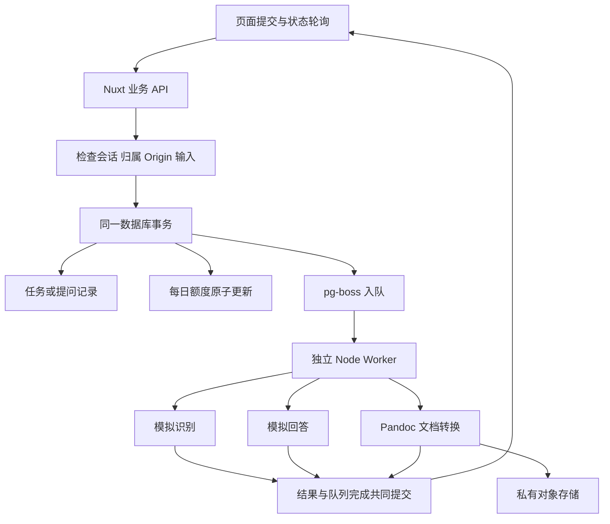

# 第8至9天开发说明

日期：2026-10-21。范围是可靠后台任务、账号模拟对话、每日额度，以及包含原生可编辑公式的 Word 导出。

## 已实现的产品流程

登录上传图片后，接口返回已保存的识别任务，页面显示排队、处理、完成或失败。独立 Worker 读取图片、调用模拟适配器、保存公式与原始版本；完成后页面自动进入详情。刷新任务页能继续查询，离开页面不会取消任务。

公式详情增加“AI 解析这个版本”和 Word 导出。AI 入口先明确所选版本，再创建账号对话。提问和回答保存在数据库，消息按位置排序，可以从“我的对话”重新打开；识别和回答内容仍是固定模拟，**没有调用真实大模型，也没有安装 LangChain**。

Word 导出可以选择任一已有版本。任务记录所选版本和提交时的标题，Worker 生成 DOCX、存到私有对象存储，成功后提供本人专属下载。之后编辑公式不会修改已经生成的文件。转换不支持时提示失败，不把图片或未转换的文本当成可编辑公式。

启动、配置和故障处理见 [后台任务与导出操作手册](后台任务与导出操作手册.md)，验证结果见 [第8至9天验收记录](第8至9天验收记录.md)。

## 为什么这样分层

Nuxt 不在 HTTP 请求里执行识别或转换，也不在页面里维护服务器任务计数。Worker 不处理浏览器鉴权，只根据服务器写入的任务读取相应用户资源。转换器只关心文字、LaTeX 与 DOCX，不接触会话、额度或任务状态。

## 文件对应关系

| 代码位置                                                                                       | 职责                                         |
| ---------------------------------------------------------------------------------------------- | -------------------------------------------- |
| [shared/types/tasks.ts](../shared/types/tasks.ts)                                              | 任务、版本上下文、账号消息和额度的页面协议   |
| [server/queue/client.ts](../server/queue/client.ts)                                            | 队列名称、连接配置及初始化                   |
| [server/queue/enqueue.ts](../server/queue/enqueue.ts)                                          | 通过官方 Prisma 适配器在业务事务里入队       |
| [server/queue/claim.ts](../server/queue/claim.ts)                                              | 保存结果时校验当前执行权并完成队列任务       |
| [server/database/task-submissions.ts](../server/database/task-submissions.ts)                  | 提交识别和导出，校验资源、去重、扣额和入队   |
| [server/database/conversations.ts](../server/database/conversations.ts)                        | 固定版本上下文、对话创建、提问和消息序号     |
| [server/database/task-queries.ts](../server/database/task-queries.ts)                          | 安全任务 DTO 和中断状态修复                  |
| [server/database/usage.ts](../server/database/usage.ts)                                        | UTC 日额度查询与数据库原子扣额               |
| [server/database/idempotent-task.ts](../server/database/idempotent-task.ts)                    | 唯一请求编号竞争后的回读，避免重复业务记录   |
| [server/worker/lifecycle.ts](../server/worker/lifecycle.ts)                                    | 单次执行状态、错误、自动重试与最终失败       |
| [server/worker/recognition.ts](../server/worker/recognition.ts)                                | 读取私有图片、模拟识别、保存公式与首版       |
| [server/worker/chat.ts](../server/worker/chat.ts)                                              | 从数据库组装上下文和最近消息，保存模拟回答   |
| [server/worker/export.ts](../server/worker/export.ts)                                          | 转换、存储成品、完成导出和补偿               |
| [server/worker/start.ts](../server/worker/start.ts)                                            | 注册三个独立处理器                           |
| [server/documents/formula-document.ts](../server/documents/formula-document.ts)                | 受限 Pandoc 调用、原生公式检查和基础文档样式 |
| [scripts/queue-setup.ts](../scripts/queue-setup.ts)、[scripts/worker.ts](../scripts/worker.ts) | 队列安装和独立 Worker 进程入口               |

页面文件：

| 页面或组件                                   | 文件                                                                                                                 |
| -------------------------------------------- | -------------------------------------------------------------------------------------------------------------------- |
| `/account/tasks/:id` 识别任务                | [任务页](../app/pages/account/tasks/%5Bid%5D.vue)                                                                    |
| `/account/exports/:id` 导出任务与下载        | [导出页](../app/pages/account/exports/%5Bid%5D.vue)                                                                  |
| `/account/chat?versionId=…` 创建指定版本对话 | [开始对话](../app/pages/account/chat.vue)                                                                            |
| `/account/conversations` 我的对话            | [对话列表](../app/pages/account/conversations/index.vue)                                                             |
| `/account/conversations/:id` 对话详情        | [对话页](../app/pages/account/conversations/%5Bid%5D.vue)                                                            |
| 消息与发送表单                               | [AccountChat.vue](../app/components/AccountChat.vue)                                                                 |
| 选择导出版本与提交                           | [AccountExport.vue](../app/components/AccountExport.vue)                                                             |
| 任务状态展示、今日额度                       | [TaskProgress.vue](../app/components/TaskProgress.vue)、[AccountUsage.vue](../app/components/AccountUsage.vue)       |
| 可停止的页面轮询、请求幂等                   | [useTaskPolling.ts](../app/composables/useTaskPolling.ts)、[useAccountChat.ts](../app/composables/useAccountChat.ts) |
| 访客模拟对话                                 | [DemoChat.vue](../app/components/DemoChat.vue)                                                                       |

公共 `/ai` 登录后进入账号对话列表，带旧演示 formulaId 的入口继续保留本机示例。账号详情使用正式版本 ID。原同步识别保存文件已由任务提交与 Worker 处理器替代，避免保留两条互相分歧的保存路径。

识别适配协议单独定义在 [recognition-adapter.ts](../server/services/recognition-adapter.ts)，包括图片、模式、取消信号和统一结果。后续 Python 接入实现同一接口，不需要重写任务事务或页面。

## 数据库如何扩展

追加第五份迁移 [202610210003_jobs_chat_exports](../prisma/migrations/202610210003_jobs_chat_exports/migration.sql)，没有改写旧迁移或清空数据。应用现在有16张表，队列结构单独在 `pgboss` schema 中，由固定版本的 pg-boss 管理。

- `RecognitionTask.queueJobId`：关联后台队列任务，原有已完成数据允许为空。
- `ExportTask`：保存用户、不可变公式版本、提交标题、请求编号、队列编号、状态、尝试次数及成品文件。
- `ChatTurn`：保存一轮问题、所属对话、请求编号、状态和尝试次数。用部分唯一索引保证同一对话最多只有一轮排队或处理中。
- `ChatMessage.turnId`：使用户消息和回答归属同一轮；`(turnId, role)` 唯一，防止重试重复保存回答。
- `Conversation.requestKey`：创建对话的幂等编号，旧记录允许为空。
- `DailyUsage`：以 `(ownerId, day, kind)` 为主键，分别记录识别、对话、导出的日请求数。

新增记录继续使用带 ownerId 的复合外键。导出版本和提交标题另有数据库触发器保护，不能更新成另一个导出上下文。任务尝试次数、终态时间、完成导出必须有文件、额度不能为负等规则由数据库检查。

## 关键选择及取舍

### 用 PostgreSQL 队列，继续不引入 Redis

pg-boss 复用现有数据库。任务和扣额通过 `fromPrisma(tx)` 与入队共同提交：任务创建失败、额度不足或队列写入失败都会整笔回滚。没有使用“先写数据库，再尝试发队列”的易丢任务流程。官方适配器使用参数绑定，不拼接浏览器输入为 SQL。[事务适配器说明](https://pgboss.io/api/adapters)

API 只投递，不启动消费者。Worker 为独立 Node 进程，可以单独停止、重启或扩容。当前每个队列每次处理1个任务，默认轮询1秒。连接池分别限制为业务5、API队列2、Worker队列4；扩容前需计算总连接数。

### 接受重复执行，保证业务结果幂等

任务最多执行3次，包括首次和2次自动重试。队列使用有限重试、延迟、心跳和执行期限。Worker 崩溃后，要等心跳或租约失效，再由监督逻辑恢复；不承诺重启瞬间立即执行。[任务与重试](https://pgboss.io/api/jobs)

提交识别、提问和导出均使用用户范围内的唯一请求编号。同一编号不能改成其他图片、问题或版本。并发创建冲突后，失败事务已回滚，再读胜出的记录；不会再扣一次额度。

保存公式、回答或导出结果时，在同一个 Prisma 事务中调用队列完成操作，并携带该次领取的 retryCount。只有影响1个当前活动任务才能提交；旧 Worker 已失效时整笔回滚。包装层集中处理 pg-boss 12.38.0 的 affected 响应类型缺项，避免散落类型断言。

任务被最终取消、失败或队列记录已过保留期时，受保护的查询会修复仍停留在处理中/排队的业务状态。中断对话会补充失败回答并释放该对话的活动轮次约束。自动重试不重复创建公式、消息或成品。

### 额度统计被接受的任务，不统计按钮点击

默认每日识别50次、对话30轮、导出20次，按 UTC 日期计算，即北京时间08:00重置。采用数据库 `INSERT ... ON CONFLICT ... WHERE used < limit RETURNING` 原子更新，多进程并发也不能突破上限。

额度记录被接受的任务数；处理失败仍占本次额度，自动重试不追加扣额。用户主动重新提交属于新任务，使用新编号并消耗新额度。这样不会因网络重放扣多次，也不会允许无限手动重试绕过额度。

### 对话引用版本，不接收客户端提供的公式正文

服务端按会话用户查询不可变的版本内容。Worker 只读取数据库中的用户/助手消息，不接收客户端系统角色或替代 LaTeX。同一对话的行锁保护消息位置编号，部分唯一索引防止多轮并发穿插。修改公式后，可以新建绑定新版本的对话，旧对话仍保留原上下文。

当前展示最近100条消息，较早记录仍保存在数据库；本次没有实现更早消息翻页。模拟回答仍为普通 JSON 与任务轮询，真正流式回答按第13天接入。

### 用 Pandoc 输出原生公式，再检查文件结构

LaTeX 先做有界语法检查，再作为 Pandoc JSON AST 的 Math 节点输入；标题和说明只作为纯文本。进程调用使用参数数组、固定参数、标准输入、20秒超时、5MB输出限制与 sandbox，不启动 Shell，不解析用户 HTML 或 Markdown。

启用转换警告即失败。转换后解压 DOCX，要求存在原生 OMML 公式，拒绝图片替代；文档使用黑色标题、中文字体和 A4 页面，并附版本号、模拟来源说明与 LaTeX。本次没有声称支持任意 LaTeX 宏包或整篇文档。[Pandoc 数学格式说明](https://www.pandoc.org/demo/example33/8.13-math.html)

Pandoc 采用官方3.12.1便携版，下载后核对发布页 SHA256，没有改全局安装。[官方发布](https://github.com/jgm/pandoc/releases/tag/3.12.1)

### 文件尝试各用独立对象键

转换成功后先登记 PENDING 文件，再上传私有对象，最后把 READY 文件和完成任务一起提交。每次尝试的对象键独立，旧 Worker 补偿不会删除新 Worker 成品。普通异常会删除本次对象并标记 DELETED；进程在上传窗口直接崩溃时可能留下可追踪的 PENDING 元数据，需要按操作手册排查，本次没有自动删除历史孤儿对象。

下载必须有有效会话且任务属于本人，响应不包含对象存储路径；失败或尚未完成的导出不能下载。

## 当前交付边界

业务流程、数据库、队列、对象存储、对话记录和 Word 导出是真实实现；识别和回答内容仍为模拟。真实 Python 模型、第13天的大模型与流式响应、正式部署和备份恢复继续按总计划执行。LangChain TS 保留待定，没有提前绑定其 API。

Microsoft Word 的实际打开、编辑保存和视觉检查已完成；本机没有 WPS，WPS 兼容性尚未实测。长公式、大量数据、真实手机和生产负载仍需第10天及后续验收。
